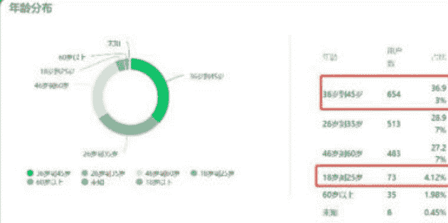
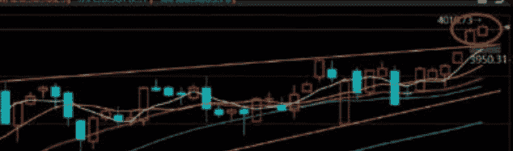

@观海 观大，你现在有几成仓位呀

问这种就不大礼貌了

180%，前面说过的

只是回调 1-2 天，我硬抗一下

观大满仓了

预计回调到多少?

不是大的波回回调，没必要为那点蝇头小利进进出出。

老股民在 4000点以上几乎没几个挣到钱的，现在新老股民都在一个起跑线上。

观海

话说间，股指 4000 点了。。

妮娃娃.念母：啥时候回调啊😂

黄炜：他 7 月份说买没涨的科创

观海：这还是在打压大金融的情况下

理论上突破 4000 点后目标位在 5000 点以上，设立极端行情下别爆仓拿到 5000 点即可。

# 观海

看我公众号这个统计数字

# 观海

# 观海
36-45 这个最具炒股能力的人群占占比还不如小屁孩

# 观海
这个群体就是牛马，被房债套牢了。

观海：小年轻为哈比主力群占比高呢？因为他爹妈没套牢

梁先乐：来股市解套房贷

梁先乐：贷中贷

"阿里" 撤回了一条消息

阿里：剧本中的中场大戏从今天开始上演。

观海：前几年买房的人，类似炒股上杠杆股票套牢的那批人，已经有 00 后拿父母给的钱炒股了。 10 后也有了，只不过不是自己的账户，我儿子的同学生物课都在交易，还悠悠悠他也开了个模拟账户😂。

这话就是为了收割韭菜准备的。

梁先乐：4000点以上我就不敢碰了，4000点以上的机会留。

从政策上能看出国家认识到股市的重要性了，一轮牛市难免。

@观海 观大 周三还会回踩吗？

如果下午能回调，明天回踩就是大概率。

从政策上能看出国家认识到股市的重要性了，一轮牛市难免。

@观海 观大 周三还会回踩吗?

如果下午能回调，明天回踩就是大概概率。

下一个阻力位是 4100点，理想的走势是回踩一下再涨。

@观海 这轮到 4300 左右，会有大四浪调整吗

阿里：尽可能的盘中做T，降成本。正T，倒T都要做。这对技术要求很高。防止出现 150点阴线。

观海：高层确认中国领导人 10月30-11月1日出席韩国国……

观海：30日是周四，上涨概率很高的。

花雨【精情寻】：整都在涨?

司睿1319：明天是九重阳节哇

妮娃娃.念母：150点阴线?

阿里：尽的可能的盘中做T，降成本。正T，倒T都要做。这对技术要求很高。防止…

阿里：未来，说的是以后。别当真@妮娃娃.念母

高层确认中国领导人 10月30-11月1日出席韩国。。。。

30日是周四，上涨概率很高。

整周都在涨？

明天是九九重阳节哇。

150点阴线？

阿里：尽可能的盘中做T，降成本。正T， 倒T都要做。这对技术要求很高。防止……

未来，说的是以后。别当真@妮娃娃.念母

妮娃娃.念母：150点阴线？

点位仅参考，走一步看一步，不能死板@翔宇*

上涨途中，中央在众多阳线中的一根阴线而已。

观海：周三如果走成了高点，那么回踩就在周四五，反正后面都都有一个回踩。

观海：

花王【猜情符】：下午已经开始调整？

观海：突破后会吸引技术派资金入场。

## 基本符合合走势

观海：
8:23
股市行情推演.docx124.docx (999.5K)
28号大盘: 上午反弹震荡，午盘后所有回落调整。

自得：@观海 现在补仓还是明天补？ 谢谢

"观海" 邀请"欢欢" 加入了群聊
"欢欢"与群里其他人都不是朋友关系，请注意隐私安全。

观海：@自得 参考这个预测补仓

观海：10月预测中低点，实际是 13号 3800点，27号是“时间点”，可能是个小高点。

## 深度视野
包含以下内容：限时188/年 加微信cuk55

- 吃瓜群众限时（原价365 元）
- 子明私享（原价568 元）
- 政事辑（子明加顺）
- 米穗锦顶（原价599 元）
- 欧洲会员专属（原价328 元）
- 砖瓦内部（原价400 元）
- 卢克文青学会（原价699 元）
- 鉴茶财经（原价3310 元）
- 猫哥的视界（原价299 元）
- 财经周独家（原价1498 元）
- 扬世光在钱桶（原价2200 元）
- 森淼知识星球（原价1600 元）
- 激荡异译（持续更新）

## 深度文集

14 司马林解读毛选全套音频和全套书籍藏版无减（原价2.3 万）
15 虚构三部曲【梦想、帝国扩张、不被理解的MAO】（原价599 元）
16 卢克文知识星球文章（原价268 元）
17 额外再送：卢薛元新浪博付费专栏、三村丰老菜、三花九树文集

不定期内容：——更多资源将不下去了……

- 守夜人司令知识星球
- 接换魔王知识星球
- 生才有知识星球
- 创始老师
- 达沃浅论星球
- 成付财富圈
- 雪花甲头部
- A视野
- 大树乡谈
- 江宁后语
- 泮说说
- 上海海家
- 西风付费
- 老端
- 赢在八小时之外
- 局人的视界
- 升值迁
- 老A体制内
