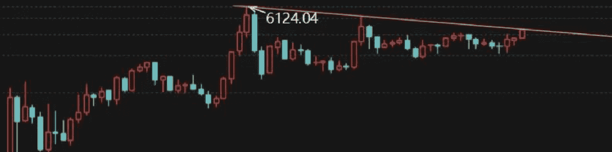
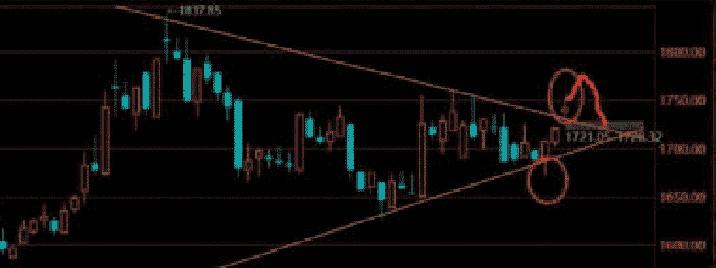

# 上证指数(半年线)
3996.94 +1.18%



## 观海
4000点是阻力位，今天没摸到，要等明天上摸回调了

## 观海
证券今天正式突破，回踩是加n仓良机

## 观海


## 观海
这是etf，也突破了

观海

翔宇
@观海 观大那还会有低点出现吗？

花王【猜情寻】
@观海 观大那还会有低点出现吗？

观海
每周都有低点，本周在周三

观海
大趋势牛市三浪浪三，后面是涨幅最好的一段

观海
上周就说过:下个月60日均线都到3900点了，还怎么跌？

## 观海
上周四跌时我买入，都是在群里说的，我还少直接说我买入的，怕影响到别人

## 观海
昨天语音从各个角度分析了，都显示大牛市突破行情开始了

## 花王【精寻】
买了，但没有回到之前8成仓。现在还是5成😂

## Zoe
证券，大概有推荐的标的么

## 花王【精寻】
周三低点直接满🥰

观海
```
512880
```

## 深度视野优质集圈（链接优质社群，助你成功）

全部包含以下内容：限时优惠188/年 加微信cuk255

- ① 吃瓜群众含信圈加时群群对话（原价 365 元/年）
- ② 子子明享汇（含）内部文章（原价 568 元/年）
- ③ 政事室（顾子明）付内容加再送顾子明群聊
- ④ 米联锦兜【作者米穗】（原价 599 元/年）
- ⑤ 欧洲金获会员专属文章（原价 328 元/年）
- ⑥ 砖瓦斥内部文档（原价 400 元/年）
- ⑦ 卢克文青读书会专属文章（原价 699 元/年）
- ⑧ 鉴茶财经知识星球（原价 3310 元/年）
- ⑨ 猫哥的视界知识星球文章（原价 299 元/年）
- ⑩ 财新周刊【独家新闻】（原价 1498 元/年）
- ⑪ 杨世光在金钱圈（原价 2200 元/年）
- ⑫ 森淼财经知识星球（原价 1600 元/年）
- ⑬ 激湃译读付费文章和全书版权无减（持续更新）
- ⑭ 司马林解读谋选全套音频和全书版权收藏无割（原价 2.3 万）
- ⑮ 虚虚三部曲[民国梦、帝国争战、不被理解的 MAO]（原价 599 元）
- ⑔ 克文知识星球（原价 268 元/年）
- ⑰ 额外再送：卢薛元新浪薇付费专栏、三村丰老王、三花九树文集

+ 不定内容：......（更多资源不写下去了......
① 守夜人知识星球、接换魔王后星球、养成财富知识星球
② 创始小东、达叔译论星球、成就财富圈、雪花甲老头等
③ A 视野、大树乡谈、江宁后、咩咩说、上海海家学等付费文集
④ 西风付费文章、老端、赢在八小时之外、局人的视界、升值、老A体制内等其它一些大V付费文集

## 深度视野文集n群微微信cuk255

深度视野（付费文集）


## 限时优惠188/年 低成本链接全网V优质内容
