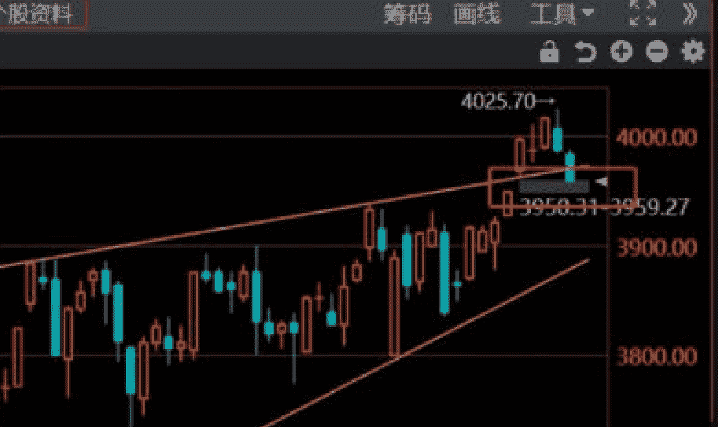
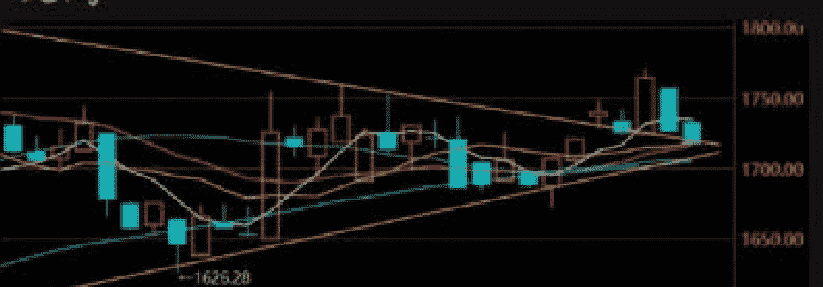
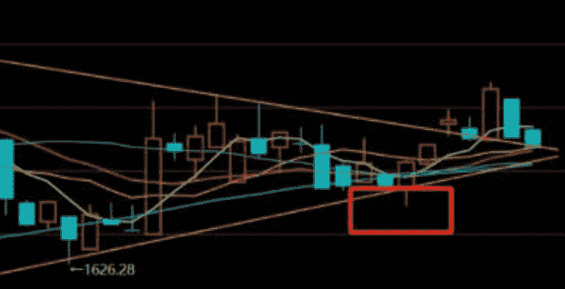
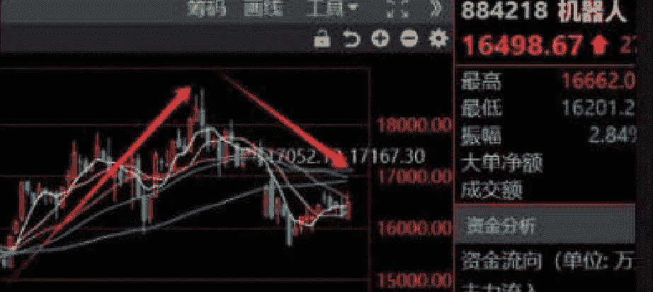

今天低点可能在 11 点前。

已经加过的，只敢加A500和恒生科技💪

其他的不懂，怕两头挨打

还是还是要补缺

参考点位 3950

# 观海

看看这个缺口能否补上

# 观海

报价资料

观海

证券今天图形，本月预测证券下跌，再对照一下下月涨跌，就可以决定是否买入了

观海

# 观海

证券要按预测的低点买，大部分人没遵守，包括我

证券要按预测的低点买，大部分人没遵守，包括我

预测的低点在 11 月吗

我是在这个位置买的，还有点安全垫

# 观海

预测一旦公开，就得提前买入，不然，有人抢跑

预测今天低点出现在 11 点前，今天最低到了 3957，还有几个点没补

你的意思几点就不算了嘛

@观海观大

今年证券，保险利润增长爆表

感觉保险不压盘，不如买保险

今年很多缺口都没补

@方菲 机器人头部明显，预计年底前只有反弹，没有新高行情了

观海

## 本周大盘因为前半周美联储降息和中美领导人会谈的消息影响，走了方框内走势，今天补完缺口后就基本调整到位了

观海

周一上行遇阻，回调到下周三，也就是29号，预判是个低点，就是本周有一个低点。

一向上向上突破，涨到下周三。如果这样，29号就成了高点，下半周...

# 观海

缺口没补完，就要拖时间来补

# 观海

按照周预测，今天收阴的

# 观海

周一上行遇阻，回调到下周三，也是 29 号，预测是个低点，就是本周有个低点。

一向上向上突破，涨到下周三。如果这样，29 号就成了高点，下半周就

今天大盘回跌，双创回跌也不小，但个股却是 4000 家红盘

## 深度视野优质集圈（链接优质社群，助你成功）

全部包含以下内容：限时年费188/年 加微信cuk255

- ① 吃瓜群众倍帝圈实时群群对话（原价 365 元/年）
- ② 子明私享汇（含）内部文章
- ③ 政事室（顾子明）付费内容内再送顾子明群
- ④ 米联闲间【作者米横】（原价 599 元/年）
- ⑤ 欧洲金雀会员专属文章（原价 328 元/年）
- ⑥ 砖瓦仁内部圈（原价 400 元/年）
- ⑦ 卢克文青读书会专属文章（原价 699 元/年）
- ⑧ 鉴茶财经知识星球（原价 3310 元/年）
- ⑨ 猫哥的视界知识星球文章（原价 299 元/年）
- ⑩ 财财经财经【独家新闻】（原价 1498 元/年）
- ⑪ 杨世光在金钱塔（原价 2200 元/年）
- ⑫ 森淼财经知识星球（原价 1600 元/年）
- ⑬ 激泽译译付费星球（持续更新）
- ⑭ 司马林解读谋选全套音频和全套书籍收藏版无删减（原价 2.3 万）
- ⑮ 虚三三部[民国梦、帝国争战、不被理解的 MAO]（原价 599 元）
- ⑔ 卢克知识星球文章（原价 268 元/年）
- ⑰ 额外再送：卢祺元新浪微博付费专栏、三村丰老王、三花九树文集

不定期内容：......（更多资源写不下去了）

- ① 守夜人司令星球、接换魔王后星球、成就财富圈、雪花花甲头等
- ② 创世佳锐、达叔谈论星球、成就财富圈、雪花花甲头等
- ③ A 视野、大树乡谈、江宁序、泮咩说、上海海学等付费文集
- ④ 西凤付费文章、老端、高在八小时之外、外人的视界、升值、老体制内等其它一些大 V 付费文章（每月不低于 600 元的付费文章）
