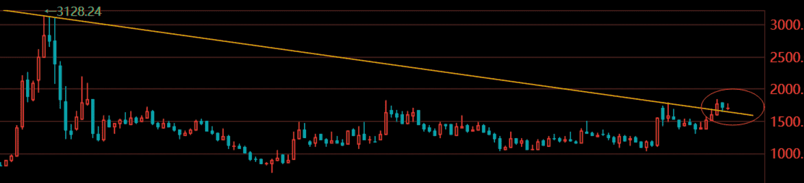
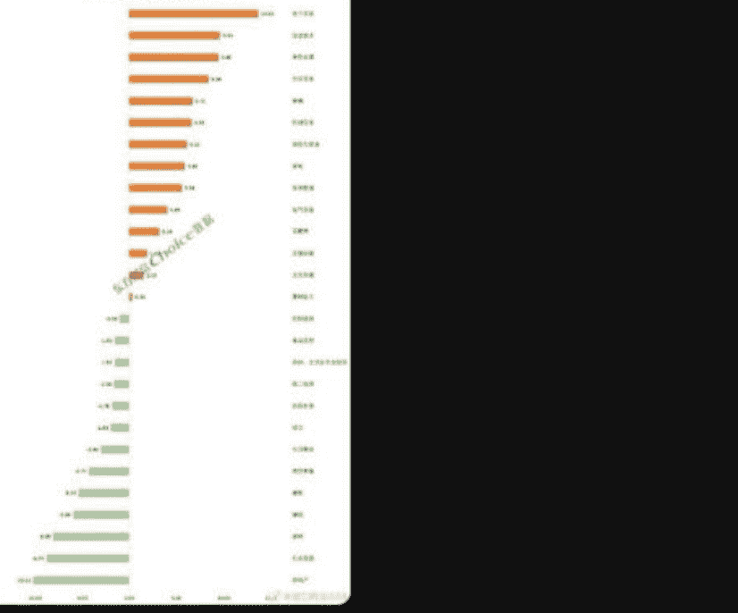
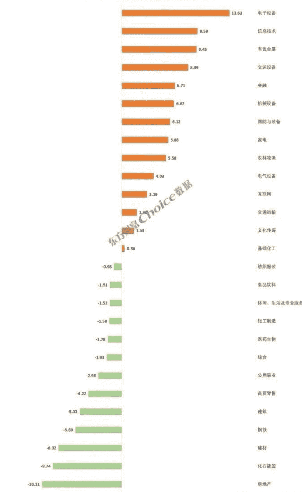
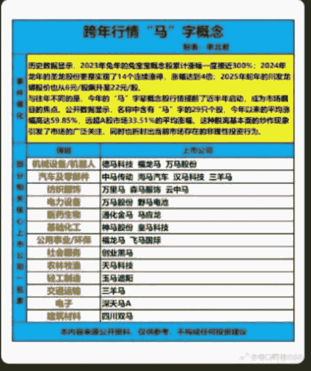

科创板7月中旬提示还在今年4月位置；最近一直提示高位股科技风险，年底科创板无大行情。

高位股处于博傻阶段时，没底仓就不能买了。

滴，扣费成功。

下周一开盘估计就补完缺口了。

年底前未必必行情吧。整个市场炒作灵魂核心集中在科技股。

@观海 观大，恒生科技呢?您怎么看？

现在回头看周三是高点。

不是没行情，是科创板年底没有新高了，所以高位股就难赚钱了。

## 观海
头部明显，年底前只有反弹，

## 流云飞
> 给观海的红包
恭喜发财，大吉大利
微信红包

## 方菲🍂
谢谢观大。

## 花王【情情兮】
谢谢观大。

## 边走逛
还是乐观一点了，之前都以为加速上涨所以就麻痹大意了，周三应该看到看到不涨及时撤退的。

## 边走逛
现在只能等反弹减仓了。

## 观海
其实炒股炒的就是概率，如果从概率上来看，拿着证券要比拿着科技股跟钱概率高。

观大说没行情，只是反弹。

我觉得后面应该有啥行情吧，要不大家也不能都火急火燎的满仓。昨看的，翻翻明天我群内的话，今年还有2波，2个高点，11月有个高点@云海。年底科创板只有反弹。

券商集体停涨后行情才见大顶。

那要到明年了吧？

只要券商没大涨，安安稳稳炒股就行。

是指今年的的大顶？

那就券商去年9.24开了好头，也要好好收尾。

观海：只要券商没大涨，安安稳稳炒股就行。

走势都是：犹豫犹豫--慢吞吞---磨磨蹭蹭---小步加快---一轰到顶。

自己琢磨现在到那步了。

走势都是：犹豫犹豫--慢慢吞吞---磨磨蹭蹭---小步加快---一轰到顶。

自己琢磨现在到那步了。

磨蹭蹭蹭？

明显是犹豫犹豫，上蹿下跳。

共同点：上涨明显没有加速。

犹豫中上涨。人声鼎沸中结束。

反正小步加快都没有。

反正人声鼎沸离不开证券...

今天A股跌幅榜，清一色极差股，高标趋势股，高标连涨股。每月月底主力集中兑现一次高标，然后下个月再寻找新的方向，新主线开启新行情。

周五 19:38

机构三季度对科技仓位达到40.16%，已经超过了2021年新能源的抱团（接近 40%），只低于2019年对“茅指数”的抱团（大致45%左右）！但极端抱团的结果大家看到了，白酒跌了5年还没跌完。

机构当年可是抱团茅台度过熊市的，只不过这一次时代不同不同了。

> 【潘喆胜:对金融市场及时纠正和阻断市场“羊群效应”促进实体经济和金融市场的正向循环】

## 观海
今天A股跌幅榜，清一色极差股，高标趋势股，高标连涨股。每月月底主力集中兑现一次高标，然后下个月寻找新的方向，新主线开启新行情。

周五 19:38

## 观海
机构三季度对科技控仓位达到40.16%，已经超过了2021年新能源的抱团（接近40%），只低于2019年对“茅指数”的抱团（大致45%左右）！但极端抱团的结果大家看到了，白酒跌了5年还没涨跌完。

## 云海
机构当年抱团茅台度过熊市，只不过这一次时代不同了。

## 观海
> 2025-10-31 15:27 星期五 @爱股票 【潘喆胜:对金融市场及时纠正和断市场“羊群效应”促进实体经济和金融市场的正向循环】

行情最新表态，对金融市场及时纠正和阻断市场“羊群效应”，促进实体经济和金融市场的正向循环。我的理解如果是股市，不要极端抱团，要健康动的牛市。周五 19:40

## 观海
政策理解是要吃大亏的杨涛（杨涛）@观海 星辰 周五 19:47 中美下周就签了，科技估计要一段时间。

## 观海
现在缺钱，想办法扩大源，炒股也要交，只有A股。

## 观海
量化时代，散户做T不容易了周五 20:23 令狐。主要做T容易吃点赢。

## 观海
上涨趋势很容易套了。要改思维，能力不行就买，买指数，才能跟上主力。既然大资金买自己选的票，指数还在原地踏步，很多票，指数涨了30%，他还跌了了。

## 观海
群公告[File]股市行情推演.docx12.docx 周日“风向有变”：
1. 潘喆胜最新表态：及时纠正和阻断市场“羊群效应”，是否引发科技股调整。
2. 中美下周签署贸易协定，是否削弱了国产替代的逻辑，并引发股回调。
3. 年底前市场的走势及上班族的首选。了解更多

## 观海
三季报出炉，科技上涨是有业绩预期的，所以资金才追捧，但已经投资了多的涨幅，落袋为安。继续潜伏未来有潜力的板块不动。投资的精髓就是潜伏风来。

## 观海
后面行情这些行业坚决别碰。

## 2025年三季报A股各行业增速 (%)

## 观海
白酒上市2025年三季度业绩报

| 公司 | 营收(亿元) | 利润 | 净利润(亿元) | 增幅 |
|---|---|---|---|
| 贵州茅台 | 390.64 | 0.56 | 192.24 | 0.48% |
| 山山西酒 | 89.6 | 4.05% | 28.99 | -1.38% |
| 五粮液 | 81.74 | -52.66% | 20.19 | -65.62% |
| 泸州五粮 | 66.74 | -9.80% | 30.99 | -13.07% |
| 洋河啤酒 | 32.95 | -29.01% | -3.68 | -158.38% |
| 古井酒 | 24.5 | -51.65% | 2.99 | -74.56% |
| 今域 | 19.3 | -26.78% | 3.2 | -48.69% |
| 安兴 | 13.56 | -20.78% | 3.81 | -39.01% |
| 会源啤酒 | 10 | -15.88% | 0.29 | -63.18% |
| 水井坊 | 8.5 | -58.91% | 2.21 | -75.01% |
| 老窖 | 8.49 | -47.55% | 0.77 | -68.48% |
| 口子酒 | 6.43 | -46.23% | 0.27 | -92.55% |
| 金域酒 | 5.46 | -4.89% | 0.25 | -33.02% |
| 伊利特 | 2.99 | -29.44% | 0.25 | -158.52% |
| 天醒德 | 2.07 | -9.28% | 0.03 | -33.73% |
| 造酒 | 1.98 | 0.78% | 0.19 | 70.93% |
| 金种子酒 | 1.44 | 3.73% | 0.28 | 74.42% |
| 皇台酒 | 2.29 | -38.83% | 0.02 | 107.02% |

Milan向观海转账已接收微信转账

## 观海
白酒本质上就是苦喝的，之前千年喝的黄酒。

白酒足够惨，可能还不到惨，估计明年陆续出现损股，坚决不碰。

## 观海
主要是年轻人白酒的人越来越少。

## 观海
啤酒大多也是勾兑酒，几元一瓶酒哪是粮食酿造。以东北的勇闯天涯为最，全是利尿剂。观海记得青岛啤酒节上有个德国喝了说是假酒，媒体一载，给退钱了。都加利尿剂，在香港上市的查出来统列为假酒。大陆啤酒允许利尿剂，在国外不让；朋友，现在俄罗斯和美国的就是我们买的粮食。阿里：我告诉你的类似酱油，在国外不允许掺腐剂，致癌。

## 观海
我们在俄罗斯，非洲都有土地种粮食，美国也有，好像给冻结了。阿里@云海 你查一下我们每年的产粮数据，年年创历史高。云海经过三年自然灾害和对备战可以尽放心。国家粮库三年都没问题。云海有什么问题吗？现在的科学技术。阿里@云海 你查一下我们每年的产粮数据，年年创历史高。观海我们主要是进口大豆。

## 观海
粮食太便宜了，一斤小麦玉米还不如一瓶矿水价高。

## 观海
只要不打仗，饿不着人的，现在粮食亩产比以前提高了不止一点点。云海打仗也饿不着人，关键是不要内乱。观海自从有了化肥农药，产量翻倍。

## 招商证券上线融规模由1500亿至2500亿
招商证券最新公告显示，董事会同意公司融资债券规模上限由1500亿元人民币增至2500亿元人民币。

## 观海
两融额度调整提了1000亿，招商证券先开了头，后排券商也会提额，这就不是几千亿可以挡住了，最后的结果肯定是以万亿计的。

## 跨年行情“马”字股票股票
2023年兔年的宝宝概念股票涨幅一度接近300%；
2024年龙年的圣龙股份更是实现了14个连续涨停，涨幅达到4倍；
2025年蛇年的川龙蝴蝶股价也从6元/股飙升至22元/股。
今年的“马”字辈概念股，预计年底前还能炒一波。

## 观海

观海行情“马字”概念

观海复盘：2023年类资金板块行情一度逼近300%，2024年初的暴涨了12个板块，涨幅超过300%，2025年的行情也可能与“马”字有关。与去年相比，今年的“马”字成为焦点，根据数据显示，带“马”字的股票今年来的平均涨幅超过59%，远超市场平均33%，显示出基本持续性。

| 行业 | 核心股票 |
|---|---|
| 汽车及零部件 | 中华赛、赛马 |
| 防御物资 | 万马、格拉文 |
| 电力设备 | 万马、云讯 |
| 医药 | 通化、神马 |
| 机械 | 通华、斯达 |
| 公用事业/环保 | 工程机械、飞马 |
| 社会服务 | 创业莱、天马 |
| 农林牧业 | 天马科技 |
| 工程制造 | 玉马 |
| 交通运输 | 三马 |
| 能源 | 天马 |
| 建筑材料 | 四川双马 |

观海年底还有个月，不知道天开始炒。

1973年：日本曾建立严格体系并切断，结果导致官方跌，催生了黄金（黑市）。
1978年：日本政府意识到政策只是转移了场所（劣币），并未改变居民对日元的信任，于是取消了该税。

## 观海
为了让这条供应链转起来，美国给重稀体定了每公斤美元的“保护价”。当时国际市场上的价才60左右，相当于逼着企业去买非中国的货。之前马来西亚的稀土分离纯度产能达不到，需要好几年。

## 观海
借着工业机器人旺盛消息下，下周工业机器人要稳转了。

## 观海
简单说几句，先来说大盘啊，大盘在上周创出4025点新高后出现回调行情了，这是突破那个2007年到2015年，这两个牛市最高点画了个线，这个压力线。长期压力线以后出现的回调啊，突破以后一般的一种可能性就是，它突破这个压力线就会变成支撑，这个支撑线大概在3900点左右了，上周回调到3950点这个缺口，旁边还有一个缺口，在3930点左右。

前两轮牛市，它中期回调都在60日均线处，本次牛市一直就没回调到60日均线，所以说好多那个大资金，他不进场啊，等等这个点位，技术派就在这儿等，就现在增量资金并不是很多的，在年底之前可能要回调到这个点位。但是它60日均线是逐步往上的，你现在看这是上个礼五，本周五是3822点的60均线，它比每天涨六个点的往往往往上涨，到了年底那么就很高了。到了999月份到月底大概3900了，它这个是逐步上涨的。

## 观海
下周可能就是下一个回调到周三四左右看看看看回调点，回调到低点位置，再继续往上，估计能反弹到下周了。看看那个那个会不会再在4100多点左右，有可能又在战成回回调，因为牛市嘛，它逐步新高，也有回调啊，不可能就是天天拉阳线。你看本次回调，本次牛市啊，一般就是很少出现3根阴线，连续3根阴线本周已经出现了两根了，看周一。应该就差不多了，就是这个是，但是还不等到底部，还得在周三周四左右啊。

## 观海
礼拜五那个央行那个潘功胜行长，他提出这个发表个看法，就是要及时纠正和阻断市场这个羊群效应，促进实体经济和金融市场的正向循环。周五马上科技股就表现出来了，有些因为媒体一登载出来，他这个信息已经在广泛传播了。但是媒体上还没登载，因为它有一个审核制度，所以说他们主力早早知道了，所以周五这个科技股跌的真不像，出去，但是这个政策出现以后了。通常情况下，按照历史经验，通常情况下还得再炒啊，就是有些人不听喇。

# 深度视野优质集团（链接优质社群，助你成功）

全部包含以下内容：限时年费188/年 加微信cuk255

- ① 吃瓜群众包帝圈微信社群对话（原价365 元/年）
- ② 子子明享汇（内部）文章
- ③ 政事室（顾子明）付费内容再送顾子明群
- ④ 米联储闲兜【作者米穗】（原价 599 元/年）
- ⑤ 欧洲金汇会员专属文章（原价 328 元/年）
- ⑥ 砖瓦斥内部圈（原价 400 元/年）
- ⑦ 卢克文青读书会专属文章（原价 699 元/年）
- ⑧ 鉴茶财经知识星球（原价 3310 元/年）
- ⑨ 猫哥的视界知识星球文章（原价299 元/年）
- ⑩ 财新周【独家新闻】（原价 1498 元/年）
- ⑪ 杨世光在金钱波（原价 2200 元/年）
- ⑫ 森淼财经知识星球（原价 1600 元/年）
- ⑬ 激源译译付费文章（持续更新）
- ⑭ 司马林解读毛选全套音频和全套书籍版权无损版（原价 2.3 万）
- ⑮ 虚政三部曲[民国梦、帝国争霸、不被理解的 MAO]（原价 599 元）
- ⑯ 克文知识星球文章（原价 268 元/年）
- ⑰ 额外再送：卢祺新滚浪付费专栏、三村丰老王、三花九术文集

不定内容：……更多资源不写下去了……

- ① 守夜人知识星球、接妖魔王星球
- ② 创建笔记、达叔谈论星球、成就财富、雪球花甲老头等
- ③ A视野、大树乡谈、江初国、泮咩说、上海海家学等付费文集
-  ④ 西风付费文章、老端、赢在八小时之外、局外的视界、升值、体制内等其它一些大 V 付费文章

# 深度视野文集
进群微信cuk255

深度视野（付费文集）

限时年费188/年 底部链接全网V优质内容