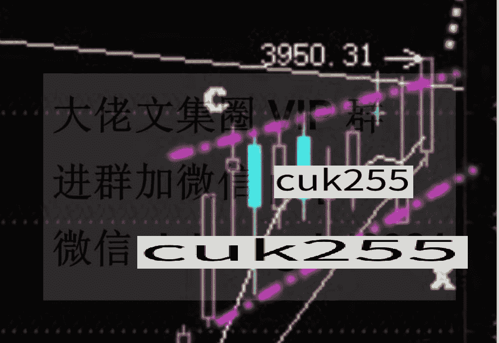

大趋势分析：

10月30日大盘给出行情的新高4025点产生调整走势，市场又出现了中期调整的声音，本重要重新分析一下：

中期顶部紧聚两个考量：1，市场再度上涨；2，板块底部击低回升。

目前两个考量都没有出现，所以目前的调整大概不是中枢顶部，只是正常回调，大鸽文集团加微群cuk255。

回调的目标是：

1，回调可见突破6124点-5178点连线的回调，连线支撑线已经由压力线变为支撑线，大盘约在3950点左右；2，回升在过程中留下的方的几个小缺口，目前已经能撑3950点这个缺口，还有继续下跌的功能；3，回调到60日均线附近，但仍有有利的利空，我看来，

周末有两个信息影响股市：

1，行业：复时响和限制市场“暴跌行情”；2，中签签署将易定。

如果是行业问题，就不用怕回调，健康加油的牛市。中签签署将易于，至于破损了国内的逻辑。在双方关注系统和，双方整合的“限制市场暴跌行情”这个词，注意集团高科技的投资风险。

下周大盘震荡：有涨回调再反弹的趋势。

下周回调点可能在周三。

预判周一调整反弹，周二冲高回调，周三回调，周四复落，周五反弹。

11月3日内大盘领先：上午强势后跌，下午震荡。深度视野VIP群 人追踪50+大V 加微群cuk255微信chp568

# 深度视野优质集群（链接优质社群，助你成功）

全部包含以下内容：限时年费188/8

- 深度视野（付费文集）加微信cuk255
- 限制时响（原价365元/年）
- 深度视野（内部）
- 卢克文（原价599元/年）
- 欧洲金雀（原价328元/年）
- 砖瓦（原价400元/年）
- 卢克青读书会（原价699元/年）
- 鉴茶财经（原价3310元/年）
- 猫哥的视界（原价299元/年）
- 财经周刊（原价1498元/年）
- 杨世光在金钱（原价2200元/年）
- 蒜森财经（原价1600元/年）
- 潇泽异译（持续更新）
- 司马林解读课（原价2.3万）
- 虚构三部[民国梦、帝国争霸、不被理解的DAO]（原价599元/年）
- 卢克再送（原价268元/年）
- 额外再送：卢麒元新浪微播付费专栏、三村丰老王、三花九树文集
- 守夜人司令星球、接换魔王后星球、达叔谈论星球、成术财富圈、雪花枫甲头等
- A视野、大树乡谈、江宁后、咩咩说、上海海家等付费文集
- 西凤、老端、赢在八小时之外、局外的视界、升值、老A体制内等其它一些大V付费文章（每月不超过600元付费文集）
