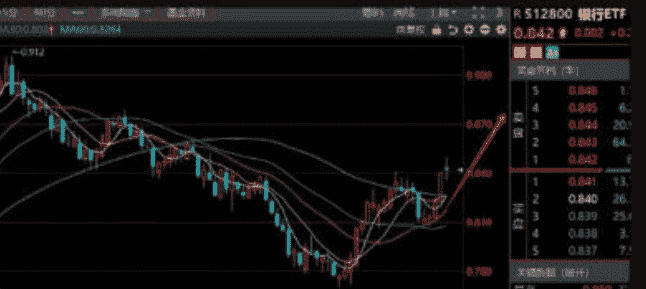
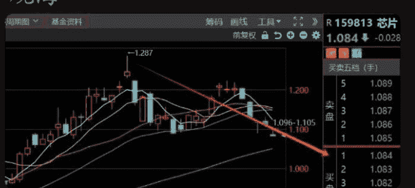
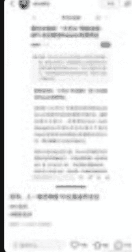
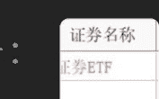

| 成交时间 | 证券代码 | 证券名称 | 操作 | 成交均价 |
| --- | --- | --- | --- | --- |
| 09:25:00 | 512880 | 证券ETF | 买入 | 1.236 |

观海：证券散户多，怎么让散户抛了证券去买科技，是主力操心的。

Alex：😂😂

云海：狗日的又拉银。

云海：银行

观海：拉科技的时候跌银行，这很正常嘛。

## 观海
拉科技的时候跌银行，这很不正常咩。

## 岳麓
观海：证券里散户多，怎么让散户抛了证券去买科技，是主力操心的

## 观海
跌了3个月，该轮到银行了

## Alex
农业银行涨了一个月了。。

## 观海

## 观海
证券跌了2个多月，按照银行下跌时间，本月就会轮到国产要回避，都达成协议了，还恋恋不舍。

观海

令孙狮zane

方菲：芯片我9月底就走了，没敢留着过节。

Alex：抄观大作业就好了。

观海：

马Yuc：抄作业了。

马Yuc：静待花开。

观海：短线可不要买这意思儿，上午反弹后下午还会回落。

## 深度视野优质集圈（链接优质社群，助你成功）

全部包含以下内容：限时优惠188/年 加微信cuk255

- ① 吃瓜群众包时圈微信加时群对话（原价365 元/年）
- ② 子明私享会（含）内部文章（原价568 元/年）
- ③ 政事室（子明佛）付费内容再送额外子明群聊
- ④ 米联锦闲【作者米穗】（原价599 元/年）
- ⑤ 欧洲金雀会员专属文章（原价328 元/年）
- ⑥ 砖瓦斥内部文档（原价400 元/年）
- ⑦ 卢克文青学读书会专属文章（原价699 元/年）
- ⑧ 鉴茶财经知识星球（原价3310 元/年）
- ⑨ 猫哥的视界知识星球文章（原价299 元/年）
- ⑩ 财经新周【独家新闻】（原价1498 元/年）
- ⑪ 扬世光在金钱圈（原价2200 元/年）
- ⑫ 森淼财经知识星球（原价1600 元/年）
- ⑬ 激源异译付费文集（持续更新）
- ⑭ 司马林解读全套音频和全套书籍版权无损减（原价2.3 万）
- ⑮ 虚政三部曲[民国梦、帝国争夺、不被理解的MAO]（原价599 元）
- ⑯ 卢克知识星球文章（原价268 元/年）
- ⑰ 额外再送：卢盟元微信微浪付费专栏、三村丰老王、三花九树文集

不定内容：......（更多资源不写下去了......
- ① 守夜司令知识星球、接换魔王知识星球、成术译论星球、成就财富圈、雪花甲老头等
- ② 创始小张妮
- ③ A 视野、大树乡谈、江宁后、咩咩说、上海海家等付费文集
- ④ 西风付费文章、老端、赛在八小时之外、局外人的视界、升值、老
- ⑤ 体制内等其它一些大V付费文集

限时优惠188/年

# 深度视野文集进群微信cuk255

深度视野（付费文集）

# 低成本链接全网优质优质
