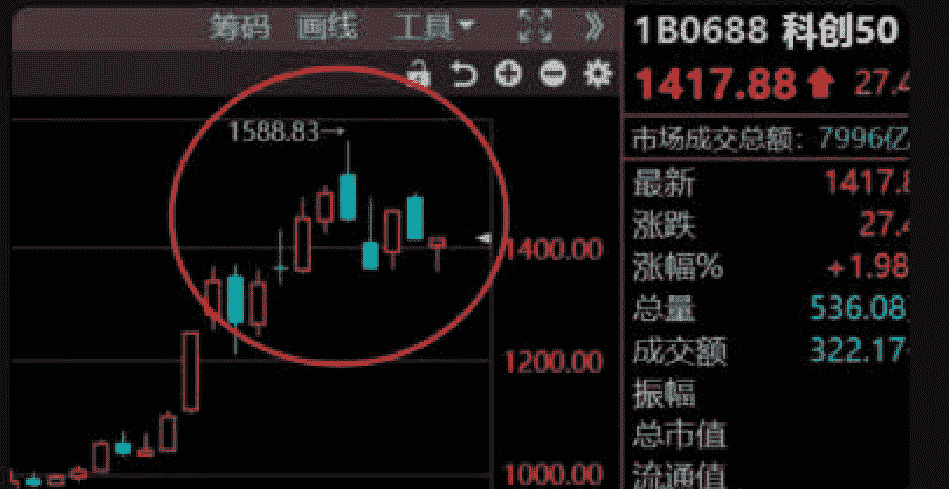

# 观海

今天看能否站稳3990, 才是标准，过不了就要回调

# 观海

科创正内在构筑顶部，一次两次进去偷点肉吃没事事，第三次偷吃就可能被抓住

# 观海

短线操作是对对的，科创波动大，主板虽然有创新高潜力，但波动太小

本周预测季节对了

下周大盘短期走势: 有震荡回调再反弹的趋势。

下周回调低点可能在周三四。

# 观海

昨天大盘低开逐步上行，开盘就买入，时间节点也没问题，就是证券反弹力度小了点，

# 深度视野优质集群（链接优质社群，助你成功）

全部包含以下内容：限时年费188/年 加微信cuk255

- ① 吃瓜群众倍时文档加时群聊对话（原价 365 元/年）
- ② 子明私享汇（含）内部文章
- ③ 政事室（顾子明）付费内容加送顾子明群聊
- ④ 米联锦顶【作者米楼】（原价 599 元/年）
- ⑤ 欧洲金雀会员专属文章（原价 328 元/年）
- ⑥ 砖万瓦内部文档（原价 400 元/年）
- ⑦ 卢克文青读书会专属文章（原价 699 元/年）
- ⑧ 鉴茶财经知识星球（原价 3310 元/年）
- ⑨ 猫哥的视界知识星球文章（原价 299 元/年）
- 10 财经周刊【独家新闻】原价 1498 元/年）
- 11 杨世在金钱塔（原价 2200 元/年）
- 12 森淼财经知识星球（原价 1600 元/年）
- 13 激赛异译付费文集（持续更新）
- 14 司马林解读猛选全套音频和全套书籍隐藏无割减（原价 2.3 万）
- 15 虚构三部曲[民国梦、帝国荒、不被理解的 MAO](原价 599 元）
- 16 卢克知识星球文章（原价 268 元/年）
- 17 额外再送：卢祺元新浪薇付费专栏、三村丰老王、三花九树文集

不定期内容：——（更多资源将写不下……

- ① 守夜人司令星球、接换魔王后论星球、成术财富圈、雪花甲头部等
- ② 创始佳事、达叔深度论星球、成术财富圈
- ③ A 视野、大树乡谈、江后宁、泮咩说、上海海家学等付费文集
- ④ 西凤付费文章、老端、高在八小时之外、局外的视界、升值、老体制内等其它一些大 V 付费文集（每月不 600 元的付费文集）

限时年费188/年

## 低成本链接全网大V优质内容

深度视野文集

进群微信cuk255

深度视野（付费文集）
