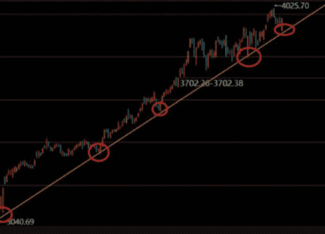
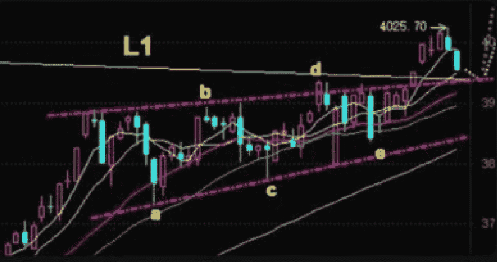
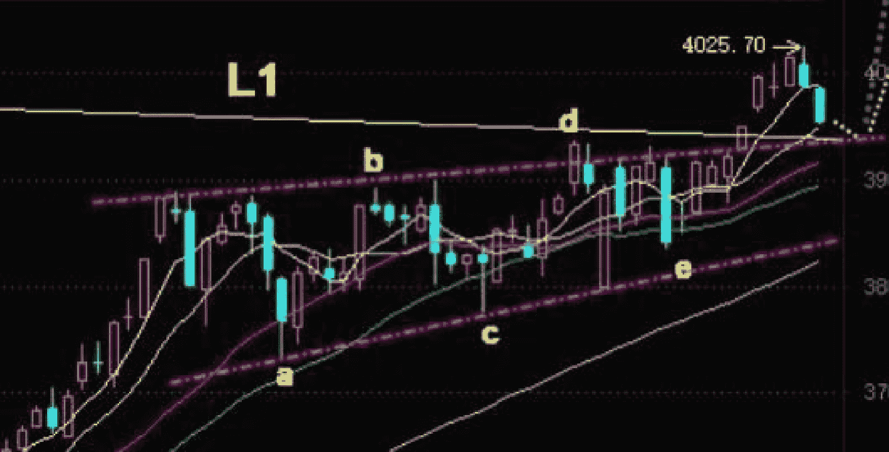

# 观海

# 格隆仁·电报

新闻更快的财经资讯

2025-11-05 14:07 星期三

# 华强北商家称“一天一价”存储价格仍在涨，业内预测涨货至明年

格隆仁11月5日 | 摄财，不少内存存储价格是在9月开始明显上涨的，并持续至今。深深圳华强北商家表示，从8月就能感受到所有内存颗粒都有涨价的趋势，涨价也及手机内存条价格，每款价格每天天都不一样，整体一路上涨。8月，一块DDR48G内存条价格低至90元以下，一个月时间内内存条涨到100元-130元。10月起涨价趋于猛烈。从华强北商家报价来看，9月DDR416G内存的价格200多元，DDR516G的价格在390元左右。目前，主流电商平台上，一些热销的DDR416G内存条价格在350元-520元之间，DDR516G的价格达到了600元左右。业内人士认为，供应短缺的局面短期难以扭转。

# 观海

# 云海

最喜欢和你这个造反派杠😎

令狐瓣zane: 你保持安静，别和我搭话😎😌

# 令狐瓣zane

你太菜了，拉低我的水平

# 令狐瓣zane

越讨论越蠢

# 观海

明天又到 3990 点压力位

# 观海

# 群公告

[File] 股市行情推演.docx125.docx

- 4号大盘: 上午反弹，下午荡调整。
- 5号大盘: 上午跌后弹，下午反弹后回调。
- 6号大盘: 上午冲高后回调，下午先跌后弹震荡。

了解更多

Steven: 话说观大6号和7号哪天是高点啊

观海：[File] 股市行情推演.docx4号大盘：上午反弹，下午震荡调整。……

观海：高点在下周

# 深度视野优质集圈（链接优质社群，助你成功）

全部包含以下内容：限时优惠188/年 加微信cuk255

- ① 吃瓜群众倍时圈加时群群对话（原价365 元/年）
- ② 子明私享汇（含）内部文章（原价568 元/年）
- ③ 政事室（子明佛）付费内容加送顺子子明群
- ④ 米联锦顶【作者米楼】（原价599 元/年）
- ⑤ 欧洲金雀会员专属文章（原价328 元/年）
- ⑥ 砖瓦斥内部文档（原价400 元/年）
- ⑦ 卢克文青学读书会专属文章（原价699 元/年）
- ⑧ 鉴茶财经知识星球（原价3310 元/年）
- ⑨ 猫哥的视界知识星球文章（原价299 元/年）
- ⑩ 财经新周【独家新闻】（原价1498 元/年）
- ⑪ 扬世光在金钱塔（原价2200 元/年）
- ⑫ 森淼财经知识星球（原价1600 元/年）
- ⑬ 激源译译付费文集（持续更新）
- ⑭ 司马林解读全套音频和全套书籍版权无损减（原价2.3 万）
- ⑮ 虚政三部曲[民国梦、帝国统治、不被理解的MAO]（原价599 元/年）
- ⑯ 克文知识星球文章（原价268 元/年）

额外再送：卢祺元新浪薇付费专栏、三村丰老王、三花九洞文集
不定期内容：（更多资源不写下去了……——

- ① 守人司令知识星球、接换魔王星球、成就财富圈、雪花花甲老头等
- ② 创始星纪、达叔译论星球、成就财富
- ③ A 视野、大树乡谈、江初号、咩咩说、上海海家等付费文集
- ④ 西风付费文章、老端、赢在八小时之外、局人的视界、升值、老A体制内等等其它一些大V付费文集（每月不低于600元的付费文集）

# 深度视野文集

# 进群微信cuk255

深度视野（付费文集）

限时优惠188/年

# 低成本链接全网V优质内容

十五未
