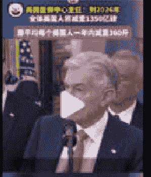

# 观海

谈判前都有个互相互施压的过程，美国那么强硬都妥协了，小小的荷兰得括量量量

# 观海

11 月 7 日，美联储理事米兰公宣布，预计美联储将在 12 月启动降息，希望以每次 50 个基点的步子把利率调到中性水平。

## 东方财经 关注
“房贷套接”引发关注，甄制“房高贷”下的恶意断供
阅读 · 17分钟前
“当前房贷本金曾经超过650万，如今却只有360万。如今吴豪（化名）说，她的房子几乎交付了房贷总额的一半。”
前段时间，一深耕中介在朋友圈曝出的“房贷套接”案，由于业主要求卖房并套接，引起了市场对于“房贷套接”现象的广泛关注。所谓“房贷套接”，通常是指挂牌房价下，市场的价格低于挂牌的房贷贷款。

在交易平台上，与房贷套接现象类似的案例被认为是稀有的。第一财经在采访中了解到，断供与房贷套接并没有直接关系，“除非卖房者是恶意断供，否则正常贷款人都是故意的，所以正常情况下出现恶意断供的案例极少。”有法律人士表示，多位业内人士对记者表示，由于绝大多数购房人的主要目的是居住，因此，即使出现房贷套接，并不影响装修。但如果购房人收入大幅下降或开支突然增加等情况，导致负债房贷断供，断供的房风险可能会增加。

# 现在“断供”成了敏感词，看到有好几个大V因为应用今年断供率3%而被禁言

好房子好地角难跌
看来广东都不都是好地段。哪里都是跌的
很多人一辈子给房子打工，还完贷款也老了
都不知道没到还完......
我现在住的地方也没跌
普通房子跌的多

# 观海

这世界就是个草台班子，估计这家伙多说了个0

# 观海

# 美官员预计明年每个美国人平均减重360斤# 美国医保中心主任：到2026年全美美国人将减重1350亿磅，即平均每个美国人一年内减重360斤（观察者网）观察者网的微博视频

# 群公告

“五行”测到下周有股做空动能可能来袭，可在下周预测高点附近减仓操作；没进“下周群”的朋友，下周自己做好风控控制，不可盲目乐观。

了解更多
13:11
一朵小黄花
反正周五是缩量上涨后打下来的
13:14
观海
中长线可关注 AI 人工产业链，固态电池（新能源）产业链、人形机器人、卫星航天、可控核、量子科技、生物医药等高端制造，这些是这轮牛市的主线，遇到好的低点就加仓....

“五行”测到下周有做空动能来袭，可在下周预测高点附近减仓操作，没进“下周群”的朋友，下周自己做好风险控制，不可盲目乐观。
了解更多
反正周五是缩量上涨后打来的
中长线可关注AI人工智能产业链，固态电池（新能源）产业链，人形机器人、卫星航天、可控核、量子科技、生物医药等高端制造，这些是这轮牛市的主线，遇到好的低点就加仓****
短线：指数高调调整时，小弱的一些题材股表现可能会好于上证指数

# 深度视野优质集群（链接优质社群，助你成功）

全部包含以下内容：限时费188

- 深度群（原价365/年）
- 内部私享
- 子明付费内容
- 米联储闲钱（原价599/年）
- 欧洲金雀专属文章（原价328/年）
- 砖瓦仁内部圈（原价400/年）
- 卢克文青书会（原价699/年）
- 鉴茶知识星球（原价3310/年）
- 猫哥的视界（原价299/年）
- 财经周刊独家（原价1498/年）
- 扬世光在钱（原价2200/年）
- 森淼知识星球（原价1600/年）
- 潇泽异译付费文章持续更新
- 司马林解课全套音频和全套书籍无割（原价2.3万）
- 虚构三部曲民国梦、帝国争亡、不被理解的MAO（原价599）
- 卢克文星球文章（原价268）
- 额外送：卢薛元微博付费专栏、三村丰老王、三花九树文集

不定期内容：
- 守夜人司令知识星球、接魔王星球、叔达谈论星球、成术花财富、雪球花甲老头
- 创始人笔记、达叔谈论星球、成术花财富、雪球花甲老头
- A视野、大树乡谈、江守访、咩同学、上海海学等付费文集
- 西风付费文章、老端、赢在八小时之外、局外的视界、升值、老A体制内等其它一些大V付费文章（每月不低于600元）

限时费188/年

# 底链链接全网优质内容

# 深度视野文集进群微信cuk255

深度视野（付费文集）

