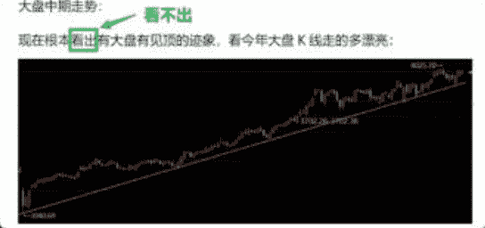

# Steven

大盘中期趋势：看不出 现在基本没有大盘有预见的，看今年大盘K线走的多涨

# Steven

话说明观大 这里是看不出？

昨天 22:03

# 观海

更多优质内容：微信:K255

# 观海

今天中信策略报告说，机构约60%的持仓与AI相关！从利好的角度看，AI一直都是A股主线，没变过；从利空的角度，机构在AI相关科技股持仓太高，会导致后续资金不足！

观大，与其与其在科技上大起大落，是不是不是搞创新药和券商安心些？

科技范围很广，里面每天都有上涨的票，创新药和证券未必涨
