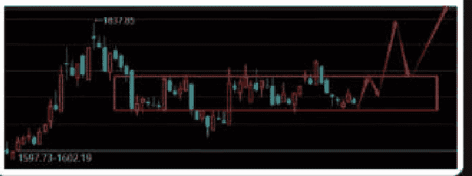

# 观海

机构重仓的抱团股遭遇集体下控，新易盛大跌超6%，工业富联跌逾5%，中际旭创跌幅超4%，胜宏科技重跌6%，寒武纪亦跌超5%。

周末消息面释放了利空信号，中信证券指出，当前AI科技相关板块在机构持仓中占比已超过六成，反映出机构对该领域明显超配。机构资金过度集中于AI科技，必然意味着对其他行业的低配。

## 预测今天高点，仓位自主决定

观海

+ 1. 证券版881157海观点点评:

更多资源进群微信cuk255

# 观海

高点可能出现在明天上午

更多资源进群微信cuk255

高点可能出现在明天上午

14:30

破了上周五高度了

😄

最好能创出新高再回调

拉证证券银行，想涨多少都行😊😉

今晚鹰来个大反弹，明早有希望😁

上周说过 10 号股见底上涨

Alex
观大，机器人ETF怎么看，能企稳吗😁

观海
A股如果回调，估计会跟随

## 深度视野优质社群（链接优质社群，助你成功）

全部包含以下内容：限时年费188/年 加微信cuk255

- ① 吃瓜群众含信时圈加时群群对话（原价 365 元/年）
- ② 子明私享汇（内部）优秀文章
- ③ 政事室（顾子明）付费内容再送顾子明群资料
- ④ 米联锦闲【作者米楷】（原价 599 元/年）
- ⑤ 欧洲金雀会员专属文章（原价 328 元/年）
- ⑥ 砖瓦斥内部画圈（原价 400 元/年）
- ⑦ 卢克青云读书会专属文章（原价 699 元/年）
- ⑧ 鉴茶财经知识星球（原价 3310 元/年）
- ⑨ 猫哥的视界知识星球文章（原价 299 元/年）
- ⑩ 财新周【独家新闻】（原价 1498 元/年）
- ⑪ 杨世光在金钱煽（原价 2200 元/年）
- ⑫ 森淼财经知识星球（原价 1600 元/年）
- ⑬ 潇泽译译付费文集（持续更新）
- ⑭ 司马林解龙逸全套音频和全套书籍珍藏版无割减（原价 2.3 万）
- ⑮ 虚构三部曲[民国梦、帝国兴亡、不被理解的MAO]（原价 599 元）
- ⑑  160克知识星球文章（原价 268 元/年）
- ⑰ 额外再送：卢祺新微博付费专栏、三村丰老王、三花九树文集

不定内容：（更多资源下方去了）......

- ① 守护人司令知识星球、接换魔王后星球、成达泛论星球、成术财富、雪雪甲老头等
- ② 创始人笔记：越达谈论星球、成术财富集
- ③ A 视野、大树伶、江宁后、咩咩咩说、上海海家学等付费文集
- ④ 西风付费文章、老萧、在小八之时、外人的视界、升值优、体制内等其它一些大 A 付费文集（每月不低于 600 元的付费文集）

## 限时年费188/年 低价格全网优质内容

更多资源请加微信cuk255

# 深度视野文集
进微微信cuk255

深度视野（付费文集）

