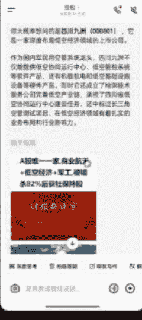

牛市里高点后回调，然后再涨，不断新高，不断回调，券商不拉涨停，不用考虑大的顶部

# 观海

## 群公告

[文件]股市行情推演.docx126doc

11号大盘:上午冲高后调整，下午先跌反弹。如果上午未出现调整，则注意下午可能出现回调。

了解更多

# 观海

临近年底，机构要结算兑现，科技从长远周期看，并没有结束，但在在此之前，可能会砸出一个坑。

# 观海

抱团风险提示过了，今天盘面上看，机构他们早早就知道消息或接到指令了

# 观海

建议大家最好选择已摆脱下降趋势且近一年乃至两年没有大涨的个股。未来3个月，极有可能是一个市场赚钱情绪发酵的黄金期。

# 观海

白酒，地产类不要买，无大行情，想翻倍，就不要碰此类。

观海

中信证券带着一帮基金在买北证证券

# 观海

2025-11-10 19:01 星期一

【“不许低价”抖音通知抖音商：卖涨价低于市场行情价将被处罚】

明天就是“双十一”，电主播大咖的却在减价。有酒商表示，今日已接到抖音平台通知，酒商销售标价如果低于市场行情价将会处罚。上述酒商表示，抖音今日称，“无论标价海外还是国内，低于市场行情的，一律按违规处罚，达人自己贴抖也不行。坚决打击虚假营销，只禁一种低价促销、售卖的行为。”竟多方了解到，酒商并不清楚上述“市场行情价”的具体数字，下一步预计价格根据线下市场行情浮动，一定（一对）。

- 自播 +3.77% ▲ 太费 +3.26% ▲
- 213关注 95% 评论

扫描全文
关注二抖音推荐更多资讯

国办放大招，促进民间投资推出 13 项针对性政策措施，明确点名铁路、核电、低空、商业航天等领域！

其中最大的亮点，低空被作为单项，并且引导民间资本有序参与低空经济，这个有点出乎预期的。

观海

豆包搜索一下，推了这个公司

云海

走出思维泥潭

@观海 哪个公司?

观海

观海

四川九州，唯一的一家商业航天，低空，军工

## 深度视野优质集圈（链接优质社群，助你成功）

全部包含以下内容：限时年费188/年 加微信cuk255

- ① 吃瓜群众倍帝圈文加时群群对话（原价 365 元/年）
- ② 子明私享（会）内部文章
- ③ 政事室（顾子明）付费内容加送逐顺子明群
- ④ 米联锦顶【作者米楼】（原价 599 元/年）
- ⑤ 欧洲金雀会员专属文章（原价 328 元/年）
- ⑥ 砖瓦斥内部文档（原价 400 元/年）
- ⑦ 卢克文青读书会专属文章（原价 699 元/年）
- ⑧ 鉴茶财经知识星球（原价 3310 元/年）
- ⑨ 猫哥的视界知识星球文章（原价 299 元/年）
- ⑩ 周周【独家新闻】（原价 1498 元/年）
- ⑪ 杨世在金钱圈（原价 2200 元/年）
- ⑫ 森淼财经知识星球（原价 1600 元/年）
- ⑬ 激泽译译付费文章（持续更新）
- ⑭ 司马林解读猛选全套音频和全套书籍收藏版无割减（原价 2.3 万）
- ⑮ 虚三三部[民国梦、帝国战争、不被理解的MAO]（原价 599 元）
- ⑑知识星球文章（原价 268 元/年）
- ⑰ 额外再送：卢薛元新浪微博付费专栏、三村丰老文、三花九洞文集

不定内容：......（更多资源写去了......）

- ① 守夜人司令星球、接换魔王后星球、成达谈论星球、成就财富圈、雪花甲老头等
- ② A视野、大树乡谈、江初何、泮咩说、上海家居等付费文集
- ③ 西风付费文章、老端、高小时之时、局外的视界、升值、老体制内等其它一些V付费文集（每月不低于600元的付费文集）

限时年费188/年 低成本链接全网V优质内容

## 深度视野文集
进群微信cuk255

深度视野（付费文集）

