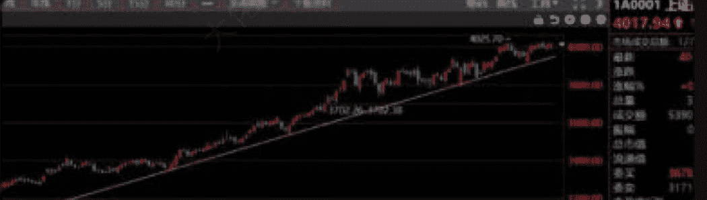
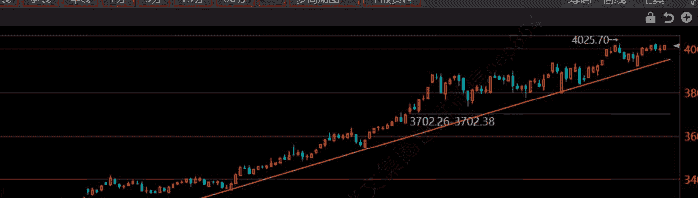
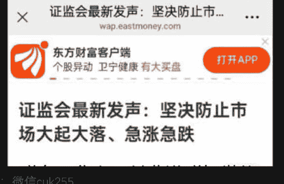

# 观海

证券14号或下周初启动，可观察

更多优质内容：微信：cuk255

# 工信部：促进动力电池在相关领域扩大应用 支持换电模式创新和车网互动试点

更多优质内容：微信cuk255

# 观海

# 4.99 万!宁德时代、京东、广汽集团联合打造京东汽车开售

在相关领域扩大应用 支持更多圈VIP专属分享

4.99 万!宁德时代、京东、广汽集团联合打造京东汽车开售

青岛这边交 5000 可以预定，已经开始试驾

电池一年 5000 元租金

# 观海

7月中旬我给大家筛选了一批“泛科技”的ETF，包含这个电池

| R 5619110 电池ETF | 删自选 |
| --- | --- |
| 0.919 ⬆ 0.058 +6.74% | 连续竞价 |
| NYP 高 | |
| 买卖五档 (手) | |

| 电池产业链我国稳居世界第一 | |

牛市里大家千万万别做空，遇到下跌望即可，没必要要去开空单，

什么时候说的？

黄炜：刚刚观海说券商可能启动，剩下的全仓同花顺、东方财富中信证券

# 观海

# 创新药持有到12月

| R 513120 HK创新药 | 1.405 0.047 +3.46% |
|---|---|---|
| 买入五档 (手) | | | |
| 5 | 1.410 27.77万 | |
| 4 | 1.409 13.39万 | |
| 3 | 1.408 4.48万 | |
| 2 | 1.407 5.86万 | |
| 1 | 1.406 5.33万 | |

@观海 观，您发的图是港股的吧？您预测的是港股吗

乐活：港股创新药ETF

观海：创新药跟着港股走

笨笨乖运：好的

方菲：OK，明白了，谢谢

观海：A股创新药走势不如港股强

# 观海

不要去追高买，遇到下跌就买点，不要遇到上涨去买，不会有直线拉升行情，所谓慢牛，就是震荡中慢慢上涨

上午反弹震荡，下午高回

佳伟：下跌过程中买的，不敢追高

观海：我昨天买了点，每次下跌买一点，上涨我也不卖，等大盘见顶再卖，目前大盘没有见顶迹象

观大有无限子弹😅

观海：我昨天买了点，每次下跌买一点，上涨我也不卖，等大盘见顶再卖，目前…

有好的买点我就转点资金进去，不会被迫涨

# 观海

主力拿着尺子画图，多么标准的走势

更多优质内容：微信cuk255 更多VIP资料加力，这里加微信后pe354微信zongdai2021

# 1A0001 上证指数

4017.94↑ 17.80
市场成交总额:12734亿
最新 4017.94
涨跌 17.80
涨幅% +0.44%
总量 3.80万亿
成交额 5390.33亿
振幅 0.58%
流通值 3678.34万
委买 3171.89万
市盈率(动) 16.97
金额 181.14亿

更多优质内容：微信cuk255

这轮牛市很少出现3连阴，前两日下跌，今天上涨就是大概率

观海：
> 周末预测机器人未来走势，发在下周预测里

阳光领域：
> @观海 观大，请问怎么看恒生科技呢

漫步人生：
> 明天大盘什么走势？观大

落日晚风：
> 一根太阳线，金融带着指数冲4100🤡

观海：
> 昨天政策调控了，还想啥呢

更多优质内容：微信cuk255

# 深度视野文集 全部包含以下内容：限时年费188 加微信cuk255

| 序号 | 内容 | 价格/备注 |
| --- | --- | --- |
| 1 | 守夜人司令知识星球 | 原价 365 元 |
| 2 | 接换魔王知识星球 | |
| 3 | 成就财富圈 | |
| 4 | 雪花甲老头 | 原价 599 元 |
| 5 | 欧洲金 | |
| 6 | 砖瓦斥 | 原价 400 元 |
| 7 | 卢克文读书会 | 原价 699 元 |
| 8 | 鉴茶知识星球 | 原价 3310 元 |
| 9 | 猫哥的视界 | 原价 299 元 |
| 10 | 财经新周 | 原价 1498 元 |
| 11 | 杨世光在钱 | 原价 2200 元 |
| 12 | 森淼财经星球 | 原价 1600 元 |
| 13 | 激源异译 | 持续更新 |
| 14 | 司马林解读谋选 | 原价 2.3 万 |
| 15 | 卢虚三部曲[民国梦、帝国争亡、不被理解的MAO] | 原价 599 元 |
| 16 | 知识星球 | 原价 268 元 |

额外再送：卢薛元新微博付费专栏、三村丰老王、三花九树文集

- 创始星球
- 达叔浅论星球
- 成就财富
- 上海海家等
- 西风付费文章
- 老端
- 赢在小时之时
- 局外人的视界
- 升值
- 老A体制内等其它一些大V付费文章（每月不600 元）
