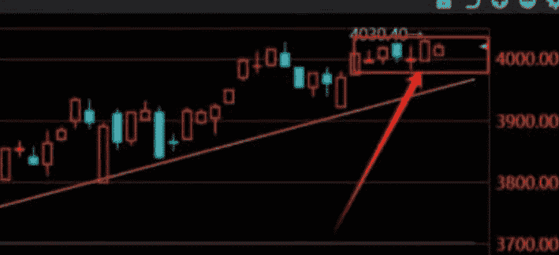
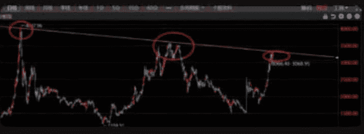
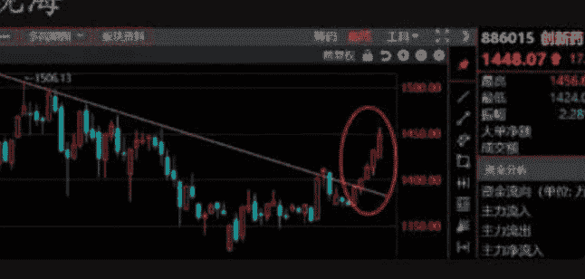
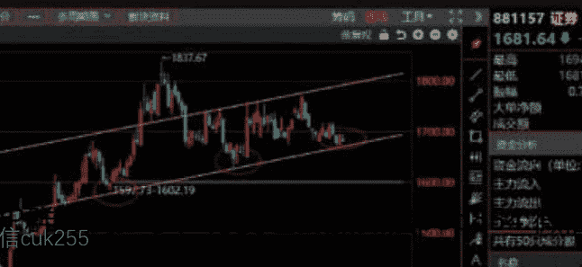

# 观海

波动这么狭窄，其实，就是个震荡走势，走势看不出有向坏的方向发展

# 观海

# 么王前进前进前进

是因为村里不让急上急下😌

# 观海

科创板和创业板年底前难有新高行情，要震荡到年底，10月就发预测

# 观海

科创板和创业板年底前难有新高行情，要震荡到年底，10 月初就发过预测了。

# 观海

# 日月生

大盘不弱，涨跌各半

# 观海

创业板看图就明白白了，需要震荡一段时间，还没突破长期压力线，上证则不同，早已突破支撑线。

东方字头拉升，大东方涨停，日出东方涨停，恒信东方直线拉升。。。

券券不发力，会不会向下去60日线

市场情绪高标还可以的。

AI绑架了美国经济，不是美股了。

怕啥，有证监会顶着。

证监会最新发声：坚决防止市场大起大落、急涨急跌。

最好不要今天加仓

“花王【精情寻】”撤回了一条消息

花王【精情寻】

加完了。。。。

观海：最好不要今天加仓

一朵小黄花

看样子要跌月底了吗

一丹青

水逆

方菲薇

正犹豫要加创新新药

观海

14号是个时间点，17号也是时间点，等周末预测出来走势再操作不迟。

观海

盘中我们散户不知道发生了啥，最好观望，等周末消息明朗化巨。

更多优质内容：微信cuk255

# 本周预测的创新药，连涨5天

观海

令孤翀zane

# 医药向来是防守板块

观海

# 证券下周初启动，待验

观海

# 深度视野优质集群（链接优质社群，助你成功）

全部包含以下内容：限时年费188/年 加微信cuk255

- ① 吃瓜群众包信文档加时群群对话（原价 365 元/年）
- ② 子明私享汇（内部）文章
- ③ 政事室（顾子明）付费内容加送顺子明群
- ④ 米联储友【作者米栖】（原价 599 元/年）
- ⑤ 欧洲金雀会员专属文章（原价 328 元/年）
- ⑥ 砖瓦斥内部文档（原价 400 元/年）
- ⑦ 卢克文青读书会专属文章（原价 699 元/年）
- ⑧ 鉴茶财经知识星球（原价 3310 元/年）
- ⑨ 猫哥的视界知识星球（原价 299 元/年）
- 10 财新周【独家新闻】（原价 1498 元/年）
- 11 杨世光在金钱（原价 2200 元/年）
- 12 森淼财经知识星球（原价 1600 元/年）
- 13 激源异译付费文章（持续更新）
- 14 司马林解谋毛全套音频和全套书籍珍版无割减（原价 2.3 万）
- 15 虚构三部[民国梦、帝国争战、不理解的 MAO]（原价 599 元）
- 16 卢克文知识星球文章（原价 268 元/年）
- 17 额外再送：卢锐元新浪播付费专栏、三村丰老王、三花九树文集
