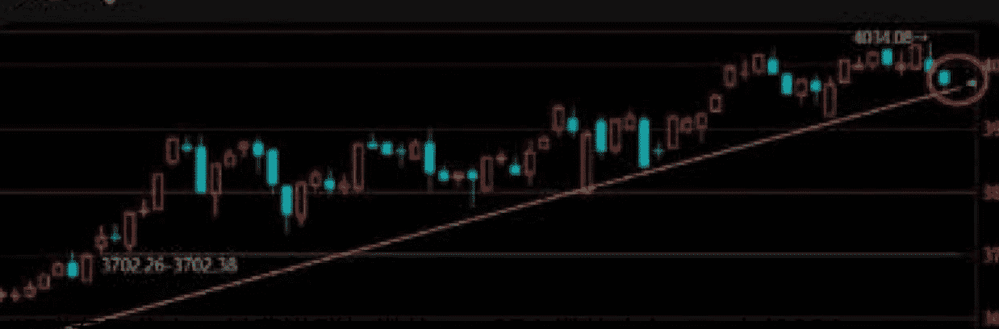
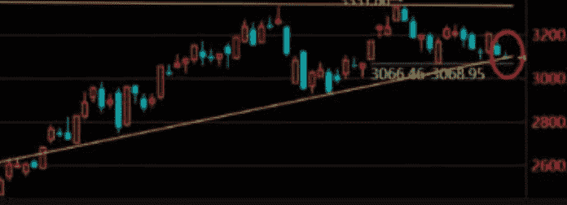
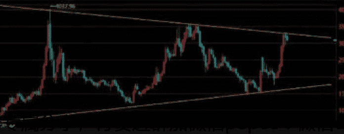

观海

# 群公告

[File] 股市行情推演.docx127.docx

下周大概周一二震荡反弹，周三有有所回调，周四五继续反弹。

○○○○

17号：今日有回调触底震荡的趋势。预判上午先跌后弹，下午回调震荡。

了解更多

@观海 没有60开头的股票，如果买证券的，哪个机会大点

证券 17-18 号触底，拿不准个股，就选 etf

# 观海

看看走势图就不用慌了

# 观海

大佬文集图

观海

如果跌破就是中期大顶

令狐睁zane

再买一点看看👀😳。连跌第二天了

观海

# 创业板

观海

观海

短期创业板触底，中期并不好看

观海

# 深度视野优质文集（链接优质社群，助你成功）

全部包含以下内容：限时年费188/年 加微信cuk255

- ① 吃瓜群众倍贷时圈微信时费群对话（原价365 元/年）
- ② 子明私享汇（含）内部文章（原价568 元/年）
- ③ 政事室（顾子明）付费内容再送顾子明群聊
- ④ 米联储间【作者米穗》（原价599 元/年）
- ⑤ 欧洲金雀会员专属文章（原价328 元/年）
- ⑥ 砖瓦斥内部圈（原价400 元/年）
- ⑦ 卢克文青读书会专属文章（原价699 元/年）
- ⑧ 鉴茶财经知识星球（原价3310 元/年）
- ⑨ 猫哥的视界知识星球文章（原价299 元/年）
- 十 财新周刊【独家新闻》（原价1498 元/年）
- 十一 杨世光在金钱坝（原价2200 元/年）
- ⑫ 森淼财经知识星球（原价1600 元/年）
- ⑬ 潇泽异译付费文章（持续更新）
- 十四 司马林解课全套音频和全套书籍收藏版无割减（原价 2.3 万）
- 十五 虚构三部曲民国梦、帝国争霸、不被理解的 MAO（原价 599 元）
- 十六 卢克知识星球文章再送（原价 268 元/年）
- 十七 额外赠：卢祺源新浪微博费专栏、三村丰老王、三花九树文集

不定内容：……更多资源将下去了......

- ① 守夜人司令星球、接换魔王后星球、达叔谈论星球、成术后财富、雪球花甲老头等
- ② 创创始笔记、达叔谈论星球、成术后财富、雪球花甲老头等
- ③ A 视野、大树乡谈、江宁序、泮咩说、上海家学等付费文集
- ④ 西凤付费文章、老端、赢在八小时之外、局外的视界、升值、老体制内等其它一些大 V 付文章（每月低于 600 元的付费文章）

限时年费188/年

# 底层链链接全网 V 优质内容

深度视野文集进群微信cuk255

深度视野（付费文集）

