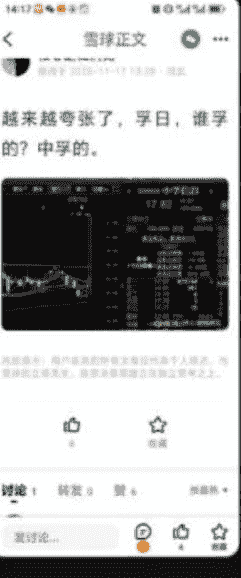

> “高市早苗在反省，今后应该不会有类似发言”

政事儿

云海

> 药似无大行情

观海

> 这女人年轻时就反华，狗改不了吃屎的

@观海 创新药预计涨幅多大

令厉 Morrisseyzane

干她뺨뺨

云海

观海

就涨一个月，应该是超跌反强@笨笨回牛运

# 观海

这种调整了3个月的，都该反弹了。

# 观海

| R 159851 金融科技ETF | |
| :--- | :--- |
| 0.838 跌 0.013 +1.58% | |
| 买卖涨五档 (手) | |
| 5 0.842 3.76万 | |
| 4 0.841 4.04万 | |
| 3 0.840 14.27万 | |
| 2 0.839 8.98万 | |
| 1 0.838 7.23万 | |

# 观海

短线操作就得跟热点，设置好止损点。

前期大幅上过的好票，已经调整了两个个月，图形三角形，大批这种，自己找即可。

Alex @观海 观大，机器人会反弹到什么时候呢？幅度有多大？

笨笨运气 @Alex 我想问创新药的幅度呢

观海 预测里有详细描述，未必就涨，只是大概率。

观海 幅度主力说了，这要看投入多少资金...以预测的时间为准。

伊利股也发布公开公告开始保底分红了。

目前A股承诺保底分红的有：

- 国电电力保底分红未来三年每年最低0.22元。
- 淮河能源保底分红未来三年每年最低0.19元。
- 伊利股份保底分红未来三年每年最低1.22元。

此外，浙江沪杭甬高速路是港股上市企业，“最近收购入股东亚的的A股的亮镇洋发展头部板块AH地上市后，承诺未来三年每年最低分红0.41元。”

下周大概率周二震荡反弹，周三有所回调，周四五继续反弹。

17号：今日有回调触底震荡的趋势。预判上午先跌后弹，下午回调震荡。

18号大盘：上午先跌后弹，下午冲高回落，上行还有阻力。

了解更多

## 深度视野优质集团（链接优质社群，助你成功）

全部包含以下内容：限时年费188/年 加微信cuk255

- ① 吃瓜群众倍信时文加时群群对话（原价 365 元/年）
- ② 子明私享汇（含）内部文章
- ③ 政事堂（顾子明）付费内容再送顾子明群倾
- ④ 米联储闲【作者米穗】（原价 599 元/年）
- ⑤ 欧洲金钻会员专属文章（原价 328 元/年）
- ⑥ 砖瓦幻内部文章（原价 400 元/年）
- ⑦ 老克青云读书会专属文章（原价 699 元/年）
- ⑧ 鉴茶财经知识星球（原价 3310 元/年）
- ⑨ 猫哥的视界知识星球文章（原价 299 元/年）
- 十 财经周刊【独家新闻】（原价 1498 元/年）
- 十一 杨世光在金钱爆发（原价 2200 元/年）
- 十二 森淼财经知识星球（原价 1600 元/年）
- 十三 激源异译付费文章（持续更新）
- 十四 司马林谋末选全套音频和全套书籍珍版无减（原价 2.3 万）
- 十五 虚三三部[国梦、帝国战争、不理解的 Mao]（原价 599 元
- 十六 卢克文知识星球文章（原价 268 元/年）
- 十七 额外再送：卢薛新浪微付费专栏、三村丰老菜、三花九洞文集
