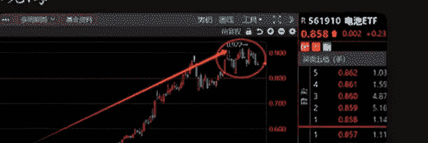

今天大盘基本上运作指数为主，个股变化不大，2成左右红盘。

令狐辩zane:
尾盘买点电池ETF。

花王【猜情符】：
有色诚不欺我。打算破1.7继续跟，其实今日没胆大加😂

花王【猜情符】：
刚追了

令狐辩zane: 尾盘买点电池ETF。

花王【猜情符】：
令狐公子讲的etf大胆跟。个股就……不会卖，不敢跟

令狐辩zane:
今天就像9月3号和10月17号。连续2天恐慌。没几个股敢涨

观海:
电池一旦不能新高，就要及时止损，因为涨幅太大，一旦调整，也不含糊的。

电池一旦不能高，就要及时止损，因为涨幅太大，一旦调整，也不含糊的。

观海

花王【错情寻】：
还是听观大的，不动了😱

令醉狮zane:
你想笑死我😁😁😁

令醉狮zane:
观大说大盘要4200你怕哈。我我不信4200都不怕😎😏

花王【错情寻】：
所以我是韭菜一颗

观海:
现在市场主要有两种观点，一种是4300点就是顶部，另一种就是我的观点还要走一波到4200点见顶。其实4200点也没涨，也就5%左右。

观海

# A股跌幅榜跌，20家股停跌10%，是重灾。

观海

| 股票代码 | 证券名称 | 市价 | 涨跌 | 换手率 | 成交额 |
| :--- | :--- | :--- | :--- | :--- | :--- |
| 600622 | 本世纪 | 10.98 | -1.08% | 4.37% | 29.69亿 |
| 601727 | 中字矿 | 17.57 | -0.36% | 1.52% | 25.57亿 |
| 600186 | 万华 | 16.94 | -1.56% | 2.07% | 20.69亿 |
| 600511 | 海新科技 | 7.03 | 0.00% | 7.0% | 23.81亿 |
| 600032 | 三本股份 | 10.38 | 0.53% | 5.0% | 34.12亿 |
| 600568 | 华星材料 | 29.30 | -1.00% | 1.16% | 54.26亿 |
| 600029 | 鲁蜀能源 | 39.92 | -0.12% | 0.82% | 30.92亿 |
| 600467 | 利德股份 | 7.29 | 0.00% | 10.10% | 12.41亿 |
| 601939 | 清华银行 | 15.45 | 0.00% | 1.76% | 17.65亿 |
| 600758 | 中广聚 | 4.00 | -0.19% | 9.12% | 9.12亿 |
| 601988 | 中国神华 | 7.38 | -0.59% | 6.59% | 10.10亿 |
| 600276 | 宁德时代 | 18.66 | 1.91% | 10.0% | 1.68% | 160亿 |
| 600365 | 立信科技 | 16.89 | 1.89% | 10.0% | 1.11% | 93.68亿 |
| 600018 | 金科股份 | 33.12 | 0.00% | 0.0% | 0.45% | 3.49亿 |
| 600653 | 华泰股份 | 9.48 | 0.57% | 3.0% | 1.43% | 87.26亿 |
| 600583 | 日韩股份 | 11.22 | 0.95% | 5.0% | 2.22% | 106亿 |
| 601899 | 宝钢国际 | 7.95 | 2.99% | 15.0% | 2.27% | 72.7亿 |
| 600489 | 华民电力 | 5.83 | 10.1% | 50.0% | 18.5% | 56.48亿 |

# 群公告

观海
2025-11-20 股市行情

下周概率周一二震荡反弹，周三有所回调，周四五继续反弹。17号：今日回调震荡的趋势。预判上午先跌后弹，下午震荡。18号大盘：上午先跌后弹，下午冲高回落，上行还有阻力。本波调整目标位在3930点左右，如果下午不能到位，调整有延续到明天的可能，然后开启年度最后一波上涨，目标4200点左右。19号大盘：先跌后弹态势。20日大盘：上午反弹震荡，下午震荡。

# 深度视野优质集群（链接优质群，助你成功）

全部包含以下内容：限时年费188/年 加微信cuk255

- 吃瓜群众粉丝圈加时群对话（原价 365 元/年）
- 子明私享（内部）文章（原价 568 元/年）
- 政室（顾子明）付费内容加再送顾子明群聊
- 米联储闲友【作者米栖（原价 599 元/年）
- 欧洲金雀会员专属文章（原价 328 元/年）
- 钨岩内部文档（原价 400 元/年）
- 卢文青读书会专属文章（原价 699 元/年）
- 鉴茶财经知识星球（原价 3310 元/年）
- 猫哥的视界知识星球文章（原价 299 元/年）
- 财新周【独家新闻】（原价 1498 元/年）
- 杨世光在金钱暴（原价 2200 元/年）
- 森森陆财经知识星球（原价 1600 元/年）
- 潇泽异译付费文集（持续更新）
- 司马林解课选全套音频和全套书籍版权无损减（原价 2.3 万）
- 虚政三部曲[民国梦、帝国亡、不被理解的MAO]（原价 599 元）
- 优星球文章（原价 268 元/年）
- 额外再送：卢薛元新微博付费专栏、三村丰老王、三花九树文集

不定期内容：（更多资源将写下去了）......
