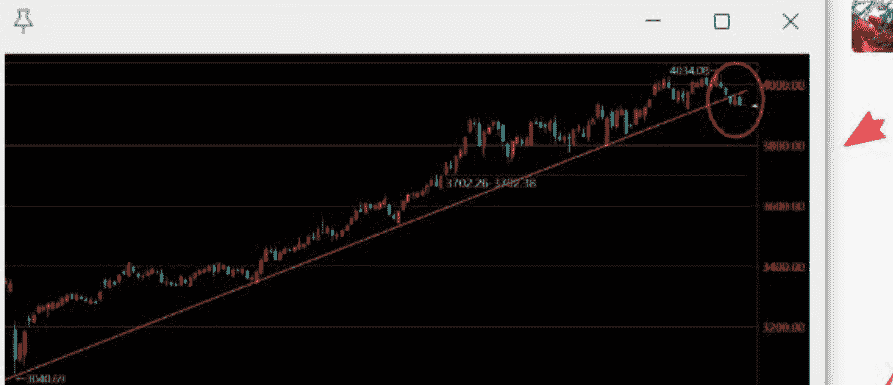
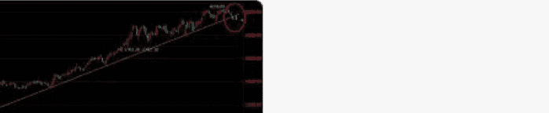
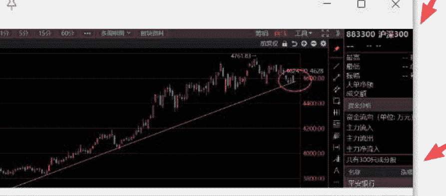
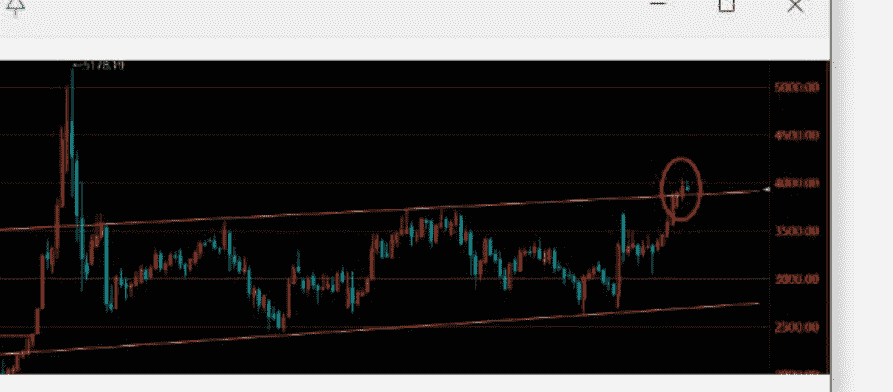

# 突破后的正常回踩而已

心态要平和，跌了1%心想就跑了的人，预计这牛市不到什么钱。

学习那些持股拿几年的人，牛市市值中重要的（关键必须是牛市）。

如果现在不是牛市，重仓就不适合了，这关系的认知，我们每个人都是韭狗的“认知”的钱。

群内也有持股拿1年以上的人，一年内大波动很大的，能拿住不容易。牛市进去进出似乎错过了每次跌，但却错过了每次大涨，到牛市结束，算总利润，总是拿着不动的人的盈利。

## 深度视野优质集团（链接优质社群，助你成功）

全部包含以下内容：限时年费188/年 加微信cuk255

- ① 吃瓜群众倍时圈加时群对话（原价 365 元/年）
- ② 子子明享汇（内部）文章（原价 568 元/年）
- ③ 政事室（顾子明）付费内容再送顾子明群聊
- ④ 米联锦闲【作者米穗】（原价 599 元/年）
- ⑤ 欧洲金会员专属文章（原价 328 元/年）
- ⑥ 砖瓦仁内部圈（原价 400 元/年）
- ⑦ 老文青读书会专属文章（原价 699 元/年）
- ⑧ 鉴财经知识星球（原价 3310 元/年）
- ⑨ 猫哥的视界知识星球文章（原价 299 元/年）
- ⑩ 财经周刊【独家新闻】（原价 1498 元/年）
- ⑪ 杨世光在金钱波（原价 2200 元/年）
- ⑫ 森淼财经知识星球（原价 1600 元/年）
- ⑬ 激译译付费文章（持续更新）
- ⑭ 司马林解课全套音频和全套书籍版权无损（原价 2.3 万）
- ⑮ 虚政三部曲【民国梦、帝国亡、不被理解的 MAO】（原价 599 元）
- ⑱ 克知识星球文章（原价 268 元/年）
- ⑰ 额外再送：卢薛元新微博付费专栏、三村丰老王、三花九术文集

不定期内容：（更多资源不写下去了）......

- ① 守夜司令知识星球、接换魔王后星球、星富有知识星球、
- ② 创始笔记、达叔谈论星球、财富富有雪雪雪花甲老头等
- ③ A 视野、大树乡谈、江初将军、咩咩说、上海海家学等付费文集
- ④ 西风付费文章、老端、赢在八小时之外、局人的视界、升值、老体制内等其它一些大 V 付费文章（每月不低于600 元的付费文集）
