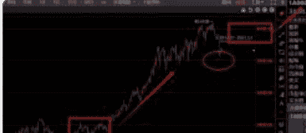

昨天 16:01

观海

> 东方观点 焦点专题
> 特朗普：俄乌和平协议非常接近达成
> 特朗普：已派特使开展磋商！| 全球财经讯

贝加尔湖

对于中国来说，军事压力日益增加

观海

俄乌马上签协议了，特朗普不希望这个时候出俄乌子，所以就给小日子打电话了，电话内容至今仍保密

观海

几个月前预测俄乌11月停战看样子成真

贝加尔湖

是的，这个预测看到了

明年4月特朗普访华，我们还要回访，也不可能特朗普刚就回访，最快也得明年下半年或27年上上半年，这段时间各方大的冲突不会有，为主升浪创造了有利条件

所以今天天才问下

笨笨园牛运：这个月小阳的观点改不改呀

rosemary：Hello 2025

说的证券吧

大盘“月预测”是涨到11月中旬下跌，月底反弹，现在就是月底了

昨天 16:07

对啊，触底反弹

大盘季度跌到5月线在10月的月预测和11月的月预测均有描述

大阴线一步到位（跌到5月线）出乎意料

不会再下探一次五月线吧?

观海：大阴线一步到位（跌到5月线）出乎意料

早盘给出预测图了

观海

拉升估计在春季左右

观海

年底前没啥大行情

观海，这个年底是农历年还是阳历年？

观海：年底前没啥大行情

观海

补缺后还会会有二次探底，怕新低就先出来出来

贝加尔湖

好

昨天 16:18

观海

@——一二四的一——

观海

早盘给出预测图了

提升估计在春季左右

年底前没啥大行情

观海

特朗普4月访华，股市肯定提前体现，不可能等等到3,4月份

贝加尔湖

4月历来无行情

观海

特朗普访华前后几个月，中美都不会互相找事，从特朗普给小日本打电话就看出来了

观海

外部环境难得几个好时光

观海

俄乌停战，中美又处于微妙的蜜月期，说不定俄乌重建分我们一杯羹

观海

当年美国打了伊拉克，我的国企业去竞竞标吃到肉了

昨天 16:27

弘王前进前进前进

不会俄乌刚停，亚洲就就把斧头转向了亚太吗?

focus

乌克兰实在不太好回答，哦你打的时候帮俄罗斯打我，
现在重建还让我来

观海：俄乌停战，中美又处于微妙的蜜月期，说不定俄乌重建我们一杯羹

弘王前进前进前进前

分包

观海

东方观点 焦点专题

特朗普：俄乌和平协议非常接近达成

特朗普：已指派特使展开协商！| 全球财经快讯

昨天 16:34

# 深度视野优质集群（链接优质社群，助你成功）

全部包含以下内容：限时年费188/年 加微信cuk255

- ① 吃群众倍贷时圈微信时群对话（原价 365 元/年）
- ② 子明享汇（会）内部文章（原价 568 元/年）
- ③ 政事室（子明优）付费内容加送顺子子明群聊
- ④ 米联锦获【作者米穗】（原价 599 元/年）
- ⑤ 欧洲金雀会员专属文章（原价 328 元/年）
- ⑥ 钨瓦片内部文档（原价 400 元/年）
- ⑦ 卢文青读书会专属文章（原价 699 元/年）
- ⑧ 鉴茶财经知识星球（原价 3310 元/年）
- ⑨ 猫哥的视界知识星球文章（原价 299 元/年）
- ⑩ 财财经周【独家新闻】（原价1498 元/年）
- ⑪ 杨世光在金钱圈（原价 2200 元/年）
- ⑫ 森淼财经知识星球（原价 1600 元/年）
- ⑬ 激源译译付费文章（持续更新）

- ⑭ 司马林解读谋选全套音频和全套书籍无删减（原价 2.3 万）
- ⑮ 虚政三部曲[民国、帝国争霸、不被理解的 MAO]（原价 599 元）
- ⑱ 克文星球文章（原价 268 元/年）

- ⑰ 额外再送：卢祺新微浪付费专栏、三村丰老王、三花九树文集

不定期内容：——（更多资源不写下了......

- ① 守夜人司令星球、接换魔王后星球、成就财富圈、雪雪花甲老头等
- ② 创始姚圣、达叔浅论星球、成就财富圈
- ③ A 视野、大树乡谈、江初序、泮咩说、上海海家学等付费文集
- ④ 西风付费文章、老端、赢在八小时之外、局外的视界、升值、老体制内等其它一些大V付费文集（每月不超过600 元付费文集）
