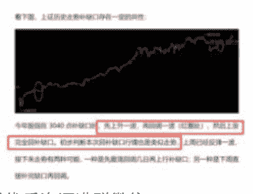
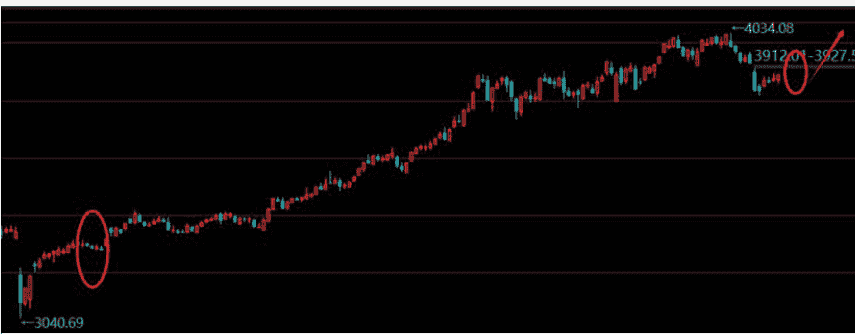

观海

量化老套路，如果上午提前回调，下午就会反弹一波

大盘可能走我说的这种走势

一手优质资源进群微信cuk255

看下图，上证历史走势缺口存在一定的共性:

今年股指在 3040 点补缺口时，先上升一波，再回调一波（红圈处），然后上涨完全回补缺口。初步判断本次补缺口行情是类似走势，上周已经反弹一波，接下来走势有两种可能，一种是先震荡回调几日再上行补缺口；另一种是下周直接补完缺口再回调。

- 一手优质资源进群微信cuk255
- 一手优质资源进群微信cuk255

观海

这波调整最快在下周结束，然后拉升

本周趋势就是跌

一手优质资源进群微信cuk255

日内量化割韭菜模式：上午跌了下午就弹弹；上午如果上涨，下午就割韭菜

本周预测不变

沪大盘整体节奏：冲高震回落调整趋势。回回调日K呈阴阳交织形式，不排除周四再出高高的可能，但周五

一手优质资源进群微信cuk255

# 观海

冷眼看主玩日内割韭

观海
Yesterday 23:09

股市行情模拟.docx129.docx 31.8K

3号大盘 上午反弹，下周调整预期。本周大控空，使得周三回调，周四还有调整风险

一手优质资源进群微信cuk255

估计明天反抽一根阳线，不会改变下跌趋势

整体涨跌节奏：冲高震荡回落调整趋势。

调整日K线呈阴阳交织形式，不排除周四反抽再出高点

一手优质资源进群微信cuk255

## 深度视野优质集团（链接优质社群，助你成功）

全部包含以下内容：限时年费188/年 加微信cuk255

- ① 吃瓜群众倍时圈文加时群对话（原价365 元/年）
- ② 子明享享（内部）文章（原价568 元/年）
- ③ 政事室（顾子明）付费内容再送顾子明群聊
- ④ 米联储闲【作者米穗】（原价599 元/年）
- ⑤ 欧洲金雀会员专属文章（原价328 元/年）
- ⑥ 砖瓦斥内部圈文（原价400 元/年）
- ⑦ 卢克文优读书会专属文章（原价699 元/年）
- ⑧ 鉴茶财经知识星球（原价3310 元/年）
- ⑨ 猫哥的视界知识星球文章（原价299 元/年）
- ⑩ 财新周刊【独家新闻】（原价1498 元/年）
- ⑪ 扬世光在金钱报（原价2200 元/年）
- ⑫ 森淼财经知识星球（原价1600 元/年）
- ⑬ 激源译译付费文章（持续更新）
- ⑭ 司马林解读全套音频和全套书籍藏版无删减（原价2.3 万）
- ⑮ 虚政三部曲【民国梦、帝国争合、不被理解的MAO】（原价599 元）
- ⑱ 卢克文知识星球文章（原价268 元/年）
- ⑰ 额外再送：卢薛元新浪微博付费专栏、三村丰、老王、三花九树文集

不定内容：......（更多资源写下去了）......

- ① 守夜人司令知识星球、接换魔王优星球、生才有知识星球、
- ② 创始人笔记、达叔谈论星球、财富财富圈、雪花记忆甲老头等
- ③ A视野、大树乡谈、江初优、咩咩说、上海海家学等付费文集
- ④ 西风付费文章、老端、赢在八小时之外、局外的视界、升值、老体制内等等其它一些大V付费文章（每月不低于600元的付费文集）

## 深度视野文集进群微信cuk255

深度视野（付费文集）

## 限时年费188/年 内部底链接全网优质内容
