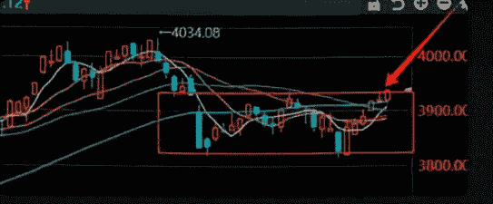
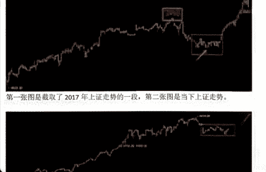
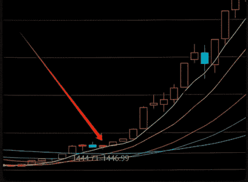
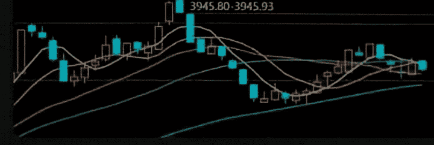

# 群公告

[File] 股市行情推演.docx

23号大盘: 上午震荡反弹, 下午有所回调。

24号大盘: 上午反弹震荡, 下午回调震荡。

如果上午没出现反弹, 则反弹出现在下午。

了解更多

# 格隆汇·电报

新闻更快的财经资讯

2025·12·23 22:18 星期二

# 特朗普：关税政策是当前亮眼经济数据的重要推手

格隆汇12月23日|美国总统特朗普：关税政策是当前亮眼经济数据的重要推手，关税促成了刚刚公布的美国经济数据，而且情况只会越越好！此外，没有通胀，国家安全也十分稳固。

# 观海收盘如站上3936 点就是突破了

观海

朱明广发银行券

观海

大盘大概率跟我提前预判的走势一样

观海

预测，并指出：“和彭华判断中期的调整现在在16号已经结束”。本期预测关注关键节点对比：

观海

24号是券商的一个重要时间点，证券股有可能启动

观海

有量化在，不会走的那么顺畅的

付费进群+V: cuk255

人工追踪50+大V付费文...
每日分享各类深度文章..

观海

本月收盘

观海

WF

# 期待

crastyl

下午还会回调吗，观海

观海

本月下影线 16号已经做好

focus

这都2点了 怕是不会了

观海

横盘也是调整的一种方式

观海

下午1分钟走势，明显调整的嘛

观海

本月影线 16 号已经做好

focus

这都2点了 怕是不会了

观海

横盘也是调整的一种方式

观海

下午1分钟走势，明显调整zzz

观海

观海

量能比上一交易日减少 400 多亿

# 深度视野优质集圈，链接优质群，助你成功

全部包含以下内容：限时费188/年 加微信cuk255

- 1 吃瓜群众倍信时圈加时群对话（原价 365 元/年）
- 2 子明私享亨（会）内部文章（原价 568 元/年）
- 3 政事堂（原子明）付费加送顺子明群聊
- 4 米联诸间【作者米穗】（原价 599 元/年）
- 5 欧洲金雀会员专属文章（原价 328 元/年）
- 6 传五厂内部圈（原价 400 元/年）
- 7 卢克文青读书会专属文章（原价 699 元/年）
- 8 鉴财经知识星球（原价 3310 元/年）
- 9 猫哥的视界知识星球（原价 299 元/年）
- 10 财新周刊【独家新闻（原价 1498 元/年）
- 11 杨世光在金钱（原价 2200 元/年）
- 12 森森财经知识星球（原价 1600 元/年）
- 13 源译译译付费文章（持续更新）

# 深度视野文集
群微微信cuk255

- 14 司马林解读毛选全套音频和全书珍藏无版减（原价 2.3 万）
- 15 虚虚三部曲[民国梦、帝国争战、不被理解的MAO]（原价 599 元）
- 16 卢克文知识星球文章（原价 268 元/年）
- 17 额外再送：卢克聚元新浪微博付费专栏、三杭村边老王、三花九洞文集

不定内容：（更多资源暂不下去了……）

- ①守夜人司令知识星球、接鸽魔王知识星球、生有术知识星球、
- ②创始笔记、达沃译论星球、成付财富圈、雪花甲老头等
- ③ A视野、大树乡谈、江宁后、泮咩说、上海海学等付费文集
- ④ 西风付费文章、老端、赢在小时之外、局外人的视界、升值、老体制内等等其它一些V付费文章（每月不超过600元的付费文集）
