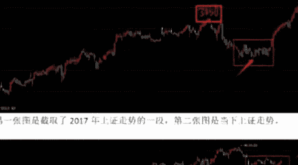
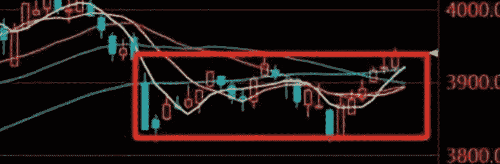

公众号预测今天回调5日线，今天五日线在3009点，大盘最低3912点，差3个点没有探到，走势比较强势。

预测里重点提示 16 号调整结束了，低位卖出就要谨慎，这几天低位卖出的都不合格。

预测里，并提出：初步判断中短期将在16号左右结束调整。本期预测将继续对比：

第一阶段锁了2017年上证趋势的一段，第二阶段是当下上涨走势。

直接看图更直观。

# 昨天公众号文章

## 观海

观海的公众号在更新？上面图中的3616点和3815点构成了，支撑线位置就是3916点。今天底部及触底后已经回到底了，今天在公众号等回到了3916点一个回踩，现在要等反弹回到底了。认为反弹概率为大，回测3815点，这个概率能够！很多人不看好市场了，认为已经结束了，下一个级别的底部就是这里！而且，持有股票的，还有耐心和信心，等到春季或许就无此烦。

## focus

### 观大估预计券的空间有多少多少呢

## 观海

### 40%-60%，前预期预测里有

## 观海

### 证券不是主线，只是低估

## focus

### 嗯 还是得科技啊，再加上一个商业航天

## focus

### 商业航天现在还没有ETF，

## focus

### 只不过带动军工涨了不错

## 观海

### 没科技哪能上天？

## 观海

### 都是科技

## focus

哈哈 没毛病

### 朱明明广发银行 卫星ETF

## 观海

### 卫星也是科技啊

## focus

### 也不一定吧 可以主要是AI链

## focus

### 商业航天是另外的版块儿

## 观海

### AI更是科技，科技范围太广了

## 今天回调幅度决定了大盘走势，

- 种：震荡反弹的趋势，低点在周二，高点26号。
- 种：冲高回落的趋势，高点在周二三。
月的“月预测”里，提前半个月给出26号是个高点时间，所以倾向于第一波。

## 观海

### 群公告

[File] 股市行情推演.docx

- 23号大盘: 上午震荡反弹，下午有所回调。
- 24号大盘: 上午反弹震荡，下午回调震荡。如果上午出现反弹，则反弹出现在下午。
- 25号大盘: 上行遇阻，日内必有一波回调出现。预计上午反弹遇阻，下午调整震荡。

# 深度视野优质集圈，链接优质社群，助你成功

全部包含以下内容：限时年费188/年 加微信cuk255

- 1 粉丝含时圈加时群对话（原价 365 元/年）
- 2 子明私享亨（会）内部文章
- 3 政事堂（原子明）付费内容加送顺子明群聊
- 4 米联储闽【作者米楷】原价 599 元/年）
- 5 欧洲金雀会员专属文章（原价 328 元/年）
- 6 钛五厂内部圈（原价 400 元/年）
- 7 卢克文青读书会专属文章（原价 699 元/年）
- 8 鉴茶财经知识星球（原价 3310 元/年）
- 9 猫哥的视界知识星球文章（原价 299 元/年）
- 10 财新周【独家新闻】原价 1498 元/年）
- 11 杨世光在金钱（原价 2200 元/年）
- 12 森森财经知识星球（原价 1600 元/年）
- 13 源译译许付费集（持续更新）
- 14 司马林解读毛选全套音频和全书珍藏版无割减（原价 2.3 万）
- 15 虚虚三部曲[民国梦、帝国兴亡、不被理解的 MAO]（原价 599 元）
- 16 卢克文知识星球文章（原价 268 元/年）
- 17 额外再送：卢赣元新浪微博付费专栏、三村边老王、三八九文集

不定内容：（更多资源不下下去……）

- ① 守夜人司令知识星球、接魂魔王知识星球、生术知识星球、
- ② 创始笔记、达越译论星球、成为财富圈、雪花花甲老头等
- ③ A视野、大树乡谈、江初知道、泮咩说、上海海学等付费文集
- ④ 西风付费文章、老端、赢在八小时之外、局人的视界、升值、老体制内等一些大 V 付费文章（每月低于 600 元的付费文章）

## 深度视野文集
进群微信cuk255

深度视野（付费文集）

限时年费188/年 低成本链接全网 优质内容

## 观海

总趋势目前处于区间震荡，震荡幅度稍微大一点就足以改变日内高低低点，这是不好判断的原因

## 观海

## 观海

阻力位 3956
