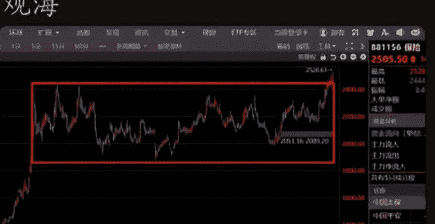
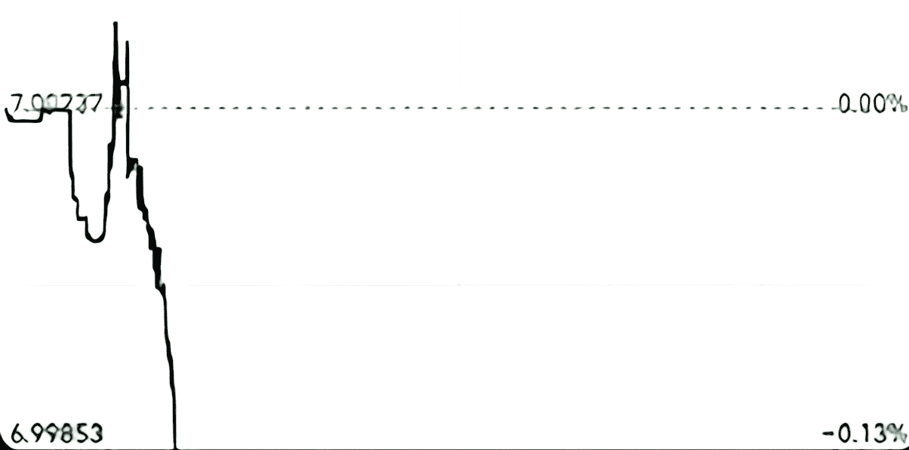
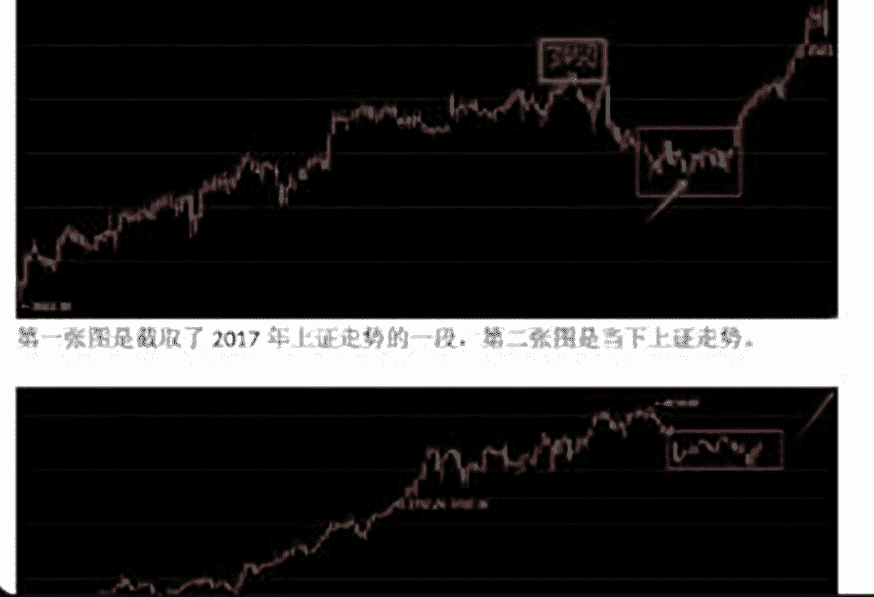
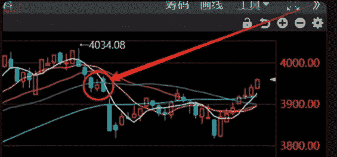

观海
券商行情在一季度，低估一定阶段后，主力不请自来的

观海
最低点，在 12月4日，后面不会再创新低了

focus
我主要是买的东北证券

focus
早上不知道怎么突突上去了😅

观海
保险已经突破大箱体了

大盘已经连拉7阳了，如果出现回调，也属正常

# 美元/人民币(离)
USDCNH
6.99883 高 7.00951 开 7.00730 买 6.99521
-0.00854 -0.12% 低 6.99853 振 0.16% 卖 7.00244

分时 日K 周K 月K 五日 更多

最新: 6.99883 -0.00854 -0.12187% 0.13%

进群加微信cuk255

# 短期趋势要服从大趋势
# 观海

预测里，并指出：“初步判断中期趋势在16号后结束”，本期预测将继续对比：

第一张图是了2017年上证走势的一段，第二图是当下上下走势。

# 如果突破3967点，就会创造新高

观海

小鱼大叔
# 证券尾股随便一拍，大盘就新高

小鱼大叔
没有技术，全是操盘意志

包包
这种真只能买指数

观海
春季行情是自上而下的“共识”，都知道有行情，要么没有，要么提前，不会等到春季才发动的

观海
发钱是最好的促消费方式，万恶的资本主义那套我们是不不会用的……

包包
观海：发钱是最好的促消费方式，万恶的资本主义那套我们是不不会用的……

乐活
咱不学习万恶的资本主义可以通过提升股市，让散户在我们的社会主义A股中都赚到钱，提升消费购买力。

乐活
主要好像要做这个也也没半点实力

focus
我看好多分析是明年给企业端减负

> "focus"撤回了一条消息

观海
踏空资金想等调仓，大盘偏偏连7阳不给机会……

这些年通过P2P，理财暴雷等，收回了大量资金了但大部分小散，不见得一一开始就会投入宽基指数……进来到就突然被套

马Yuc: 接下去就是通过股市再把一批高财富的人群套套住。资产缩水

先是鼓励P2P，再宣布为非法集资……

# 深度视野优质文圈，链接优质群群，助你成功

全部包含以下内容：限时年费188/年 加微信cuk255

- 1 吃瓜群众倍信时文圈加时群聊天（原价 365 元/年）
- 2 子明私享兮（含）内部文章（原价 568 元/年）
- 3 政事堂（原子明）费内容内加送顺子明群聊
- 4 米联储闲【作者米糕】原价 599 元/年）
- 5 欧洲金雀会员专属文章（原价 328 元/年）
- 6 传五厂内部文圈（原价 400 元/年）
- 7 卢克文读书会专属文章（原价 699 元/年）
- 8 鉴茶财经星球（原价 3310 元/年）
- 9 猫哥的视界星球（原价 299 元/年）
- 10 财新周刊【独家新闻（原价 1498 元/年）
- 11 杨世光在金钱（原价 2200 元/年）
- 12 森森财经星球（原价 1600 元/年）
- 13 源译译付费文集（持续更新）

# 深度视野文集
群微cuk255

- 14 司马林解读毛选全套音频和全套书籍珍藏版无删减（原价 2.3 万
- 15 虚虚三部曲【民国梦、帝国争合、不被理解的 MAO】（原价 599 元）
- 16 卢克文星球文章（原价 268 元/年）
- 17 额外再送：卢阡新源涨爆付费专栏；三村边老王、三花九洞文集
定期内容：（更多资源将不下去了……）
- 18 守夜人司令知识星球、拯救魔王知识星球、生有术知识星球、
- 19 创始笔记、达沃迷论星球、成付财富圈、雪花甲老头等
- 20 A视野、大树乡谈、江初知道、咩咩说、上海海学等付费文集
- 21 西风付费文章、老端、赢在八小时之外、局外的视野、升值、老体制内等其它一些大V付费文章每月不低于600元的付费文集

188/年 低成本链接全网大V优质内容 闲付
