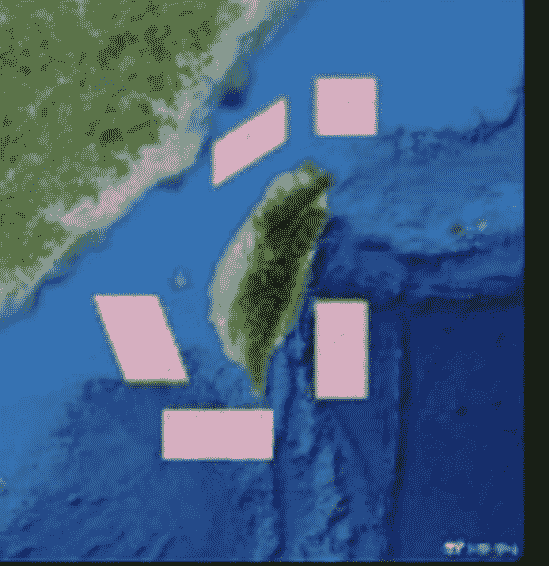

观海

东部战区将于2025年12月30日8时至18时，在以下海域和空域，进行重要军事演习，并组织实弹射击。

观海

# 观海

持有黄金白银明年要小心了，炒得太高了

# 观海

# 罗杰斯预言明年爆发“史上最惨烈”金融危机，全球面临重击

格隆汇12月24日|临年底，投资者焦点转向明年的市场行情，美国大学人称“商品大王”的罗杰斯（Jim Rogers）预测，2026年将爆发“史上最惨烈”的全球金融危机，冲击范围不仅包括英国，日本也难以幸免，甚至可能导致全球经济体系崩溃。

2025年几乎都看人民币贬值，结果大跌跌眼镜，人民币反而升值了

Alex

26年预测大概什么时候出来啊

观海

立春

人民币升值抑制出口，现在国内消费不畅，明年人民币升值必然会被政府打压。

王琦

政府就是在打压，早几个月就开始在国际上收回大量人民币了

王琦

一月大概降息

观海

从历史走势来看，在多数时间内，人民币汇率与A股市场之间呈现正相关的关系，即在人民币汇率持续升值的背景下，以人民币计价的股票市场指数也会呈现出稳健上行的运行趋势。

## 深度视野优质集群（链接优质社群，助你成功）

全部包含以下内容：限时优惠188/年 加微信cuk255

- 1 吃群众粉丝倍时文档加时群聊对话（原价 365 元/年）
- 2 子明享亨（含）内部文章
- 3 政事室（子明佛）付费内容加送额外子明群聊
- 4 米联锦美【作者米横】（原价 599 元/年）
- 5 欧洲金雀会员专属文章（原价 328 元/年）
- 6 砖瓦斥内部文档（原价 400 元/年）
- 7 卢克文青读书会专属文章（原价 699 元/年）
- 8 鉴茶财经知识星球（原价 3310 元/年）
- 9 猫哥的视视界知识星球文章（原价 299 元/年）
- 10 财新周【独家新闻】（原价 1498 元/年）
- 11 杨世光在金钱（原价 2200 元/年）
- 12 森淼财经知识星球（原价 1600 元/年）
- 13 激源异译付费文章（持续更新）
- 14 司马林解读求选全套音频和全套书籍收藏版无割减（原价 2.3 万）
- 15 虚构三部曲[民国梦、帝国战争、不被理解的MAO]（原价 599 元）
- 16 卢克文知识星球文章（原价 268 元/年）
- 17 额外再送：卢祺元新浪微博付费专栏、三村丰老王、三花九洞文集

不定内容：......（更多资源不写下去了......）

- ① 守夜人知识星球、接换魔王后星球、达达谈论星球、成术财富圈、雪花桃花甲头等
- ② 视野、大树乡谈、江初哲、泮咩说、上海海家学等付费文集
- ③ 西凤付费文章、老端、高在小时之时、局外人的视界、升值、老A体制内等其它一些V付费文集（每月低于600元的付费文集）

限时优惠188/年 低成本链接全网V优质内容

# 深度视野内文集

# 进群微信cuk255

深度视野（付费文集）

