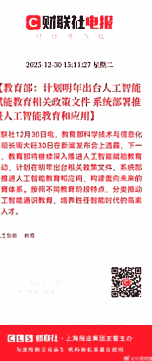

# 观海

## 教育部重磅发布：AI赋能教育
政策明年落地，
AI赋能教育，政策红利来了！

# 观海

【教育部：计划明年出台人工智能赋能教育相关政策体系 推荐进入人工智能教育和应用】

对记者12月30日，教育部、科学技术与信部联手于30日在新华社发布若干指导意见，明确教育将深度落实人工智能赋能教育行动，计划明年出台相关政策体系，系统推进人工智能教育和应用，构建面向未来的教育体系。将按不同教育阶段试点、分类推进人工智能教育，培养适应智能时代的人才。

人工翻译：若

# 观海

2025-12-30 17:24:43 星期二

## 【四部门：推动智能机器人在焊接、喷涂、总装等环节规模化应用打造汽车行业具备智能示范线】

财联社12月30日电，工业等四部门印发《汽车行业数字化转型实施方案》，关键环节人工智能应用。支持企业在研发设计、生产制造、经营管理等环节深度集成人工智能技术，打造汽车行业模型和丰富智能应用，探索在软件与智能化研发、智能工艺规划与虚拟调试等领域重塑模型。组织行业“人工智能”行动，选取一批智能创新应用标杆企业，推动智能机器人在焊接、喷涂等环节规模化应用，打造汽车行业具备智能示范产线。

汽车大数据 人工智能 机器人 智能制造

# 观海

预计明天机器人将会继续。

> “根据消息人士透露，三星和SK海力士已获美国批准，在2026年向中国出口芯片制造设备。”

路透社30日报道称，在今年早些时候撤销一些科技公司在美国芯片制造设备出口方面的许可豁免后，美国暂时松绑了对韩国企业的限制。

# 群公告

[File] 股市行情推演.docx133.docx

30号大盘: 上午先跌后弹，下午冲高回落。

31日大盘: 有先跌反弹的趋势。预判上午回调震荡，午盘后震荡反弹。

了解更多

# 观海

今天收日线、周线、月线、季线、年线。

# 观海

观海
昨天主力弄个假阳线恶心人，那不管怎么说，今天可能11连阳

## 深度视野优质集群（链接优质社群，助你成功）

全部包含以下内容：限时年费188/年 加微信cuk255

- ① 吃瓜群众倍时圈加时时群对话（原价 365 元/年）
- ② 子明私享汇（含）内部文章
- ③ 政事室（郭明）付费内容按需逐练购明群
- ④ 米联储美股【作者米横】（原价 599 元/年）
- ⑤ 欧洲金雀会员专属文章（原价 328 元/年）
- ⑥ 砖万瓦内部图文（原价 400 元/年）
- ⑦ 卢克文青读书会专属文章（原价 699 元/年）
- ⑧ 鉴茶财经知识星球（原价 3310 元/年）
- ⑨ 猫哥的视界知识星球文章（原价 299 元/年）
- 10 财新周【独家新闻】（原价 1498 元/年）
- 11 杨世在金钱圈（原价 2200 元/年）
- 12 森淼财经知识星球（原价 1600 元/年）
- 13 激源异译付费文章（持续更新）
- 14 司马林解读末选全套音频和全套书籍无损减（原价 2.3 万）
- 15 虚构三部曲[民国梦、帝国争霸、不被理解的MAO]（原价 599 元）
- 16 卢克知识星球文章（原价 268 元/年）
- 17 额外再送：卢户元新浪微专专、三村丰老王、三花九树文集

不定期内容——更多资源不再下了

- ① 守夜人司令知识星球、接入魔王后星球、成术财富圈、雪花桃花老头等
- ② 创世佳锐、达叔浅论星球、成术财富圈
- ③ A视野、大树乡谈、江宁序、泮咩说、上海海学等付费文集
- ④ 西凤付费文章、老端、高在八小时之外、局外的视界、升值、老A等等大V付费文章（每月不低于600 元的付费文章）

限时年费188/年 低成本链接全网V优质内容

# 深度视野文集
进群微信cuk255

深度视野（付费文集）

