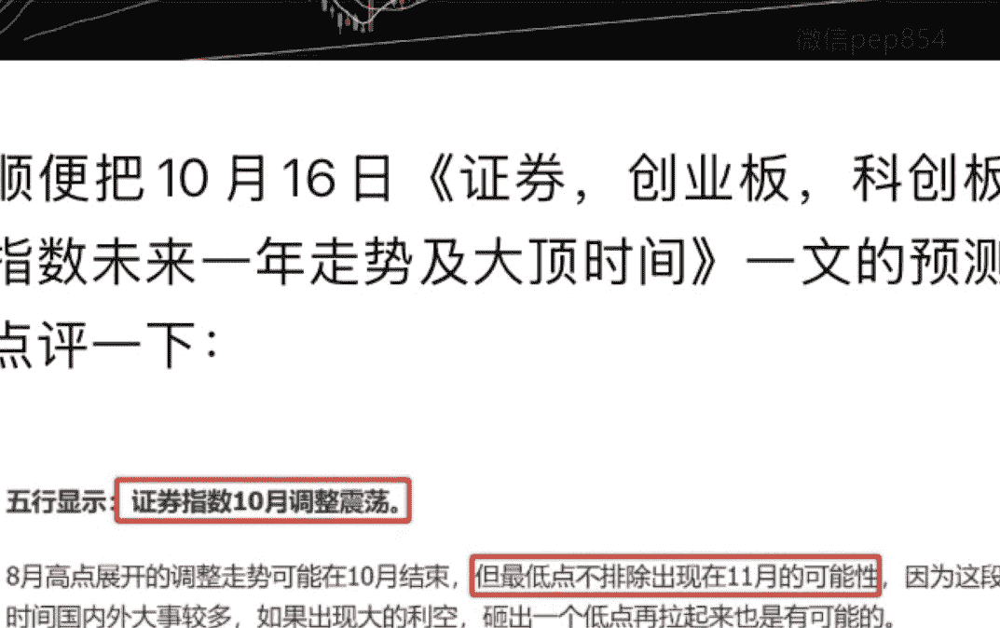
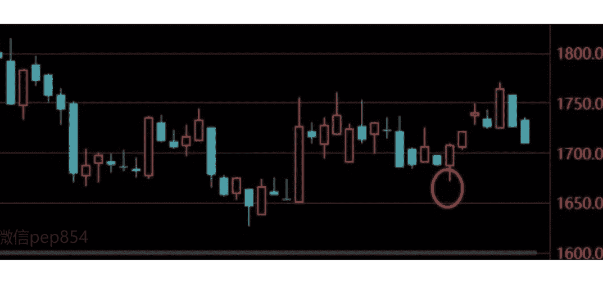
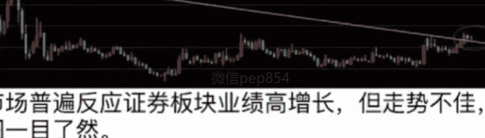

# 11股市行情推演

原文 五行对股市的影响 见五行策略
2025年11月3日 07:18 山东 ☆星星财经

先总结一下10月预测，摘录10月8号发的公众号文章《10月股市行情推演》部分预测内容，过的朋友可以对照原文，一字未改：

> “预测10月会有个剧烈波动，低点可能在月中旬”。

实际走势：10月最低点在13号。

再节选《10月股市行情推演》里预测10月低点的一段：

> “10月低点预测：大盘都会跌到60日均线处，......，10月底大概在3800点左右。”

这一段根据两轮牛市历史走势特点判断10月最低点，已经预测10月中旬低点。

不管是预测的时间还是位点，预测已经接近实际走势了。
在《10月股市行情推演》里给出的创业板的走势图：

分析过程略，一个月过去，对比一下当下走势（下图），创业板顶部预测成立，后市将会有很大调势出现。

顺便把10月16日《证券，创业板，科创指数未来一年走势及大顶时间》一文的预测整理一下：

五行策略 证券指数预测结果。
8月高点的支撑位可能在10月出现，最低点不再现在11月的可能性，这说明预测范围内大致是如此，出来的结果这样，说明一个低点再拉升上来也是可能的。

预测截图，一字未改，预测证券指数 10月“调整震荡”完全准确，11月进入建仓潜伏。

不过，证券板块我已经提前买入潜伏，买入位置在下图，公众号文章里提到过：

下面是“11月股市行情推演”内容，内容包含11月基本分析，年底大盘走势分析；低点位置；预期高点；11月大涨节奏；低点和高时间点；图分析证券指数中期走势和11月暴跌。

还是老办法联系你，我有微信的直接联系我质，发你的预测。

大盘始终未回60日，经过梳理大市值形态后发现，近4200个股已经完成了60日的回撤操作，后运行的“指数”特征是依靠部分收盘权重股持续拉抬，带动大盘指数维持强势。

11月的整体预测：上指数11月中60日均线大概在3880左右，5月大线大概在3860左右，下跌空间参考这个数值。在10月，在大胆的利好情况下跌到60线，预计11月如果没有大的利空出现的情况下，预计跌到这个数值。

11月基本面分析，目前看到的有两条信息影响股市：

1、行业：及时矫正和阻断市场“羊群效应”
如果是针对股市，就不要极端泡沫的牛市。要健健康大家都看到了，极端抱团的结果是白酒跌了5年还没涨跌。所以，持高标科技的朋友要小心了。

2、中美签署贸易协定，等于削弱了国内替代的逻辑，现在双方关系缓和，再加合行的“阻断市场羊群效应”这句话，11月注意抱团高科技题材的投资风险。

如果按照传统的预测分析分析市场基本面，11月管理层通过市场整顿，政策调整，提前化解风险的举措，避免风险累积。进阶加强微信cuk255

从以上信息推断：市场在11月可能先扬后抑或震荡加剧，关注11月先扬政策面和市场情绪的变化。

预判11月先扬后扬，高点可能出现在月中旬，然后开启调整走势，触底反弹。

分析过程：

市场普遍增长，但走势不佳，预测“证券，创业板，科创指数未来一年走势及大顶时间”，已经验证。

# 深度视野文集

全部包含以下内容（加群微信cuk255）：

- 守夜人知识星球（原价365 元）
- 卢薛元涨薇专栏（原价599 元/年）
- 欧洲金会员（原价328 元/年）
- 钨瓦内部（原价400 元/年）
- 陆文读书会专属文章（原价699 元/年）
- 鉴茶知识星球（原价3310 元/年）
- 猫哥的视界星球（原价299 元/年）
- 财经周：独家新闻（原价1498 元/年）
- 杨世光在钱桶（原价2200 元/年）
- 森森财经星球（原价1600 元/年）
- 激源异译付费文章（持续更新）
- 司马林解课毛选全套音频和书籍无损（原价2.3万）
- 虚彦三部曲[民国梦、帝国争亡、不被理解的MAO]（原价599 元）
- 克文知识星球（原价268 元/年）

额外赠送：
- 卢薛元、米东丰、老王、三花九杭州文集
- 守夜人知识星球、接换魔王后星球、自有知识星球
- 创始笔记、达叔浅论知识星球、成后财富、雪雪甲老头等
- A视野、大树乡谈、江宁后、咩咩说、财上海家学
- 西风、老端、赢在八小时之外、局外的视界、升值、老体制内等等其它大V付费文集
