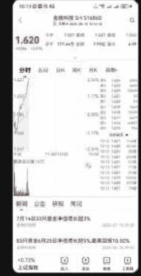

# 观海

从新闻看，俄乌要休战了，类似芬兰跟苏联战争一样，当年芬兰一下子就消灭40万苏军，但小国持久战不住，最后都是割让土地结束战争

# 观海

特朗普在俄罗斯问题上取得重大进展，给本次会晤打10分钟
- 美特使称普京已同意乌克兰“类北约第五条款”安全保障
- 泽连斯基将于下周在华盛顿与普京会晤，欧洲领导人也将华盛顿
- 特朗普：未来周将确定钢铁和芯片关税，半导体关税可能高达300%
- 美联储利：认为今年加息两次仍然很好的选择，预测：俄加斯：最新通数据令人不安
- 日本将批准首个以日元计价的稳定货币JPYC
- 国家有关部门：研究制定海洋产业发展政策措施，积极鼓励央企业和社会资本参与发展海洋经济
- 央行：落实细节适度宽松的货币政策

# 星辰

有些低位的科技股是不是不一定调整，反而是会涨呢

# 观海

按照节奏操作，既然是牛市，就不用管什么顶部，只要遇到大跌，就是进场机会

# 观海

科创 50继续补涨，明显落后他指数

本周调整比上周 4 的调整幅度大，自己决定要不要做差价，反正跌下去还会创新高

我肯定要减仓，今天就打算减，等中午看看

# 观海

现在数据支持银行资金大搬家，只是银证转账，大部分都很理性，没有一股脑冲进来，估计是在等回调低点

# 星辰

# 星辰

太猛了

# 水滴石穿

刚刚才是才涨 5%，暴涨，现在3%，又太猛了。😂

# 非银存款大增1.39万亿，但股市没进这这么多，不就是在保证金里面等待咩

阿里：那指数还跌了吗？老师@观海

观海：#非银存款大增1.39万亿，但股市没进这这么多，不就是在保证金里面等待咩

星辰：观大意思是等调整吧

星辰：他们

观海：你得反向思维，为何这个时候公布你这个消息给散户看@阿里

星辰：他们

观海：你得反向思维，为何这个时候公布你这个消息给散户看@阿阿里

阿里：😅明白了@观海

观海：“4000点牛市才开始”，这帮人坏者呢。。
