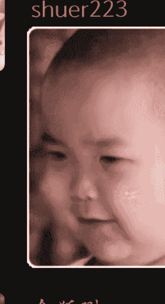

记住，下次预测高点的时候减仓位，9个月股价预计下跌30%不少少数

观海：下次预测高点的时候减仓位，9个月股价预计下跌30%不少少数

😊好的，老师！@观海

观海：下次预测高点的时候减仓位，9个月股价预计下跌30%不少少数

未明明广发银行

🐻

笨笨熊❄*

高点大，记住，下次预测高点的时候减仓位，9个月股价预计下跌30%不少少数

笨笨熊❄*

@观海

要留资金年底前加仓，到时满仓满溢，只有低位仓位，你才能拿得，收益才高

笨笨熊❄*

@观海 今天亏太大了

观海：要留资金年底前加仓，到时满仓满溢，只有低位仓位，你才能拿得…

笨笨熊❄*

我想个高点少脸出去 🤡

笨笨熊❄*

那天减一半吧

今天指数并没有跌多少，只是个预演

@笨笨熊❄️ 操作细节，只能自己决定

9月大开大合

露洒加油

为了 3900-4000吗

# 笨笨熊

有好2个-7

# 笨笨熊

低点时候重仓的每日互动有点伤

# 观海

如果大开大合，仓位重就会心里失衡，就容易买在高位，卖在低位

# 观海

看图中的3858点那个位置，出现大幅波动很正常的

# shuer223

今天可以加仓哪个ETF?

# 令孤狮zane

这波行情个股太惨了。上涨轮不到，挨打一次不落

shuer223

观海

今日央行回笼货币 1500 亿

不是单边下跌，也不会有单边上涨，来回做差价为好，18号还有美联储降息这个大利好呢

# 等天气好点再跑路啊

👑 哪里了

美国法院已经判定特朗普普命中中国，墨西哥，加拿大的芬太关税违法

方一明天多难看呵。提前释放压力。

所以，20%的芬太尼关税已经不存在了

@今袭狮zane ETF 有没有减仓

@今袭狮zane 明天跌了也不难看吧？

你们这些回回路。听着就行了。还当我和交流吗

历史上，遇到大事件时，股市表现都不佳的

我没动

是啊。08年奥运会大跌

在想要不要买点通信ETF

我觉得明天跌过了

@shuer223 不买不买不买

不买了。昨天大线已经公众号公布代码了🤡

别买

高在

# 大文集 VIP 群（原价 300，限时年费 249）包括以下全部内容历史清单：

加微信 daizongdai2021 大文集 VIP 群简介 加微信 pepp854

- 1 吃瓜群众杂谈实时文档加微信群聊天（原价 365 元/年）
- 2 子明私享汇 内部文档（原价 566 元/年）
- 3 政事堂（醒子明）付费内容另加购子顾明耕购
- 4 米储见闻【作者米筐（原价 599 元/年）
- 5 欧洲舞会会员专属文章（原价 328 元/年）
- 6 蚌幻厂内部文档（原价 400 元/年）
- 7 卢克文青读书专属文章（原价 699 元/年）
- 8 鉴茶财经知识星球（原价 3310 元/年）
- 9 猫哥的视角知识星球文章（原价 299 元/年）
- 10 大新周刊【独家新闻】（原价 1498 元/年）
- 11 杨世光在金钱榜（原价 2200 元/年）
- 12 蔡森财经知识星球（原价 1600 元/年）
- 13 澜泽译谈付费文章（持续更新）
- 14 司马解读猛选全音频和全套书籍无割（原价 2.3 万）
- 15 虚芦三部曲（民国风、帝国齿轮、不被理解的 MAO）（原价 599 元）
- 16 卢克文知识星球文章（原价 266 元/年）

17 额外内容：卢顾新薇付费专栏、三近丰老北、三花九树集
不定期内容：————（更多资源下不要了......）
