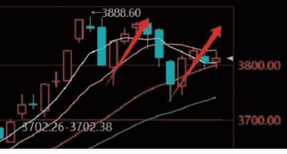

# 观海

美国国会代表团9月下访华，主要商谈军事，科技，关税……

# 观海

由军事委员会主席罗杰斯带队

# 司睿1319

军方？

# 群公告

[File] 股市行情推演.docx118.docx 9号大盘：上午冲高回落或遇阻回调，下午先跌后弹。日内可能有一波回调出现，观望为宜。

10日大盘：反弹还有阻力，预判上午震荡反弹后，下午先跌后弹。

[Image] 结合画的走势图画的箭头看更直观。

11号：昨天已经提示反弹还有阻力，今天预判大盘呈先跌后弹再回落调整的震荡走势。

了解更多

特朗普政盟演讲时遭枪击身亡，终年31岁

江苏新闻

11号：昨天已经提示反弹还有阻力，今天预判大盘呈先跌后弹再回落调整的震荡走势。

问了 deepseek，中国的上市公司里，和甲骨文业务形态最相似的是用友软件、达梦数据、星环科技@走出思维沼泽

外媒报道，美国可能会出政策，限制美国制药公司从中国药企业那里购买实验药物的权利，另外还将阻止制药商依赖中国患者的临床试验数据，FDA已普遍要求制药商将晚期临床试验数据主要针对对美国患者。

今天估计会对创新药产生影响。

# 观海

明天是“时间点”，转向，上涨

# 观海

下周大盘走势：上下震荡走势。

下周有两个重要的时间点，8 和 12

预判反弹到 8 号，然后震荡回调到 12 号再次开展反弹。

总之，短期大盘就是上下震荡走势。

# 明天是“时间点”，转向，上涨

下周大盘走势：上下震荡走势。
下周有两个重要的时间点，8和12
预判反弹到8号，然后震荡回调到12号再次开展反弹。
总之，短期大盘就是上下震荡走势。

现在还不能确定最低点在今天
还是明天早盘

大佬文集圈VIP群专属分享，付费进群微信pep854 微信daizongdai2021

# 观海

通信我们领先，不受美国影响

# 000

昨天通信落袋为安了

# 观海

| 代码 | 名称 | 涨跌 |
| --- | --- | --- |
| 5050 | 5G通信ETF | +3.00 |
| 9994 | 5GETF | +3.08 |
| 5880 | 通信ETF | +3.59 |

# 大方向向昨天就给画好了，短期回调完全可以忽略，安心持股就好

观海

观海
8:11

......

10日大盘：反弹还有阻力，预判上午震荡反弹回调，下午先跌后弹。

结合画的走势图画的箭头更直观。

令孤兽zane

# 要灵活啊

观海

# 牛市里通常有聪明资金提前抢跑的

大佬文集团VIP专属分组，付费进群加微信pep854 微信daizongdai2021

牛市里通常有聪明资金提前抢跑的

高价股还涨，低价股还跌的缘由：说明高价股不高，低价股不低

早盘绝对绝对冰点啊。就 800 只股票在涨

然后人工智能你是扛跌

逆势

本轮牛市主线是科技，从7月就开始不断重复说，主要仓位不要偏离

和上周五。

# 现海

5050 5GETF +6.87%
9994 5GETF +6.68%
5880 通信ETF +7.54%

# 现海

5880 人工智能ETF +3.43%
58930 科技ETF +3.64%
51780 通信ETF +5.32%
12930 人工智能ETF +6.17%
15980 人工智能ETF +5.28%
15070 人工智能ETF +6.47%

# shuer23

收到

# 春开的日子

下午冲高吗？太累了

以下消息

# 春开的日子

1:47

# 现海

于4号的涨出新高，都会大跌，提前一下

# 现海

1:47

# 现海

下周一减仓

# 乐活

就是12号突破3888就要回去？

# Alex

看近期没有388高

# 笨案

创出新高，都会跌！

# sophie77

@现海 是这两天要减仓？

# 现海

和突破没@乐活

# sophie77

这个意思吗

# 现海

本周持不动

# sophie77

拇

# 笨案

静等提示

# 郭林志

反正都是顶部区域，没有多少了吧

# 现海

下周还有利

# 郭林志

这是意思

我已经见到两仓了，是否可以补点？

# 笨案

我上周出了

大趋势现在就是震荡，结果就是主升浪，涨的所有人都瞪呆

# 笨案

牛市里空仓，不用管太阳调，要保持二

# 大哥文集 VIP 群（原价300，限时年费249）包括全部内容历史清单：加微信 daizong2021 大哥文集 VIP 群 加微信pep854

- 吃瓜群众交流实时间加微信（原价365元/）
- 2 子私享汇内部文档（原价566元/年）
- 3 政事堂堂（醒子）付费内容再读该子明晴
- 4 米储间【作者筐（原价599元/年）
- 5 欧洲畅会专属文章（原价328元/年）
- 6 咕吼内部文档（原价400元/年）
- 7 卢克文青读书会专属文章（原价699元/年）
- 8 鉴茶财经顶级知识星球（原价3310元/年）
- 9 猫哥的视角星球文章（原价299元/年）
- 10 才新刊【独家新闻】原价1498元/年）
- 11 杨世光在钱星球（原价2200元/年）
- 12 蔡森财经知识星球（原价1600元/年）
- 13 澜泽异访谈付费文章（持续更新）（原价2.3万）
- 14 司马湖解读逸全套音频视频和全套书籍版无割
- 15 虚虐三部曲（民国风、帝国齿轮、不被理解的MAO）（原价599元）
- 16 卢克文青知识星球文章（原价268元/年）
17 额外外享：卢颜新新浪微付费专栏、苏杭边老龙、三花九集

不定期内容：————（更多资源没有下去了）

- 1 守夜人司令知识星球、拯救狂魔王知识星球、达天滚论知识星球、付财富圈、雪花老甲头等
- 2 创始人笔记、在八小时之外、局外人的视界、升值
- 3 A视野、大树野乡谈、江宁知府、砰咩同学、财上海学家等付费文集
- 4 西风付付费文章、老端、赢在八小时之外、局外人的视界、升值、A体制内等等等一些大V付费文章（每月不超过600 元的付费文章）

大哥文集 VIP 群，原价300 元，现需 249 元/年，包含以上所有内容。

微信：daizong2021

大哥文集 VIP 群（微信微...

1:47
