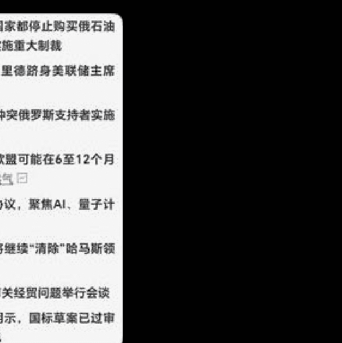

# 公众号观海

转一个数据给大家：
07年大牛市，92%的个股翻倍，51%的个股翻五倍，12%的个股翻十倍，个股平均回报率532%，中位数回报率 408%；

15年大牛市，98%的个股翻倍，27%的个股翻五倍，4%的个股翻十倍，个股平均回报率336%，中位数回报率 27%；

而本轮牛市，只有 25%的个股翻倍，1%的个股翻五倍，0.1%的个股翻十倍，个股平均回报率79%，中位数回报率 59%。

特朗普：当约国家都停止购买石油时，我准备对俄实施重大制裁。

贝莱德高康格莱·里德格游身美联储主席热门人选。

G7将对乌乌冲突爆发俄罗斯支持者实施制裁和递进关税。

英美拟签署关键技术协议，聚焦AI、量子计算等关键技术。

坦桑尼亚硝糖将继续“清除”哈马斯德领导。

中国在西班牙就有关贸易问题举行会谈。

餐厅预测蔬菜需要说明，国际草案已过审筹将公开征求意见。

4、商务部9月13日发布公告，决定对原产于美国的进口相关规模芯片发起反销调查，并对美国华成集成电路领域相关措施发起反倾调查。

5、央行数据显示，2025年前八个月社会金融融资规模总量累计为26.56万亿元，比上年同期多4.66万亿元。月末M2余额331.98万亿元，同比增长8.8%。前8个月人民币贷款增加13.46万亿元；人民币存款增加20.5万亿元。

# 公众号观海

2025.09.15 09:23

15号大盘: 上午震荡反弹，午盘后震荡有所回调。本周高点可能在周三，注意风险。

# 如果大盘见顶，基本都会回调，本轮行情

基本就是科技股的行情

| 代码代码 | 名称 | 涨跌幅 |
| :--- | :--- | :--- |
| 588200 | 科创芯片 | +3.12% |
| 159995 | 芯片ETF | +3.16% |
| 512760 | 芯片ETF | +3.01% |

# 固态电池是行业推动形成的长线趋势

# 电池ETF

高开低走了 😅

公众号观海：创投芯片电池ETF

芯片是国产替代+消息刺激，是拿来跟美方谈判用的，消息刺激一下，而固态电池是行业推动形成的长线趋势。

# 模拟芯片上市盈利能力排名：

1. 芯动联科 10.11% 85.03% 54.93% 未明确披露 高性MEMS惯性传感器（陀螺仪），技术壁垒高，毛利率业领先。

2. 圣邦股份 7.63% 49.60% 10.32% 信号链和电源管理产品全覆盖，国内模拟芯片龙头。

3. 盛景微 25.05% (3年均值) 40.50% 16.16% 未进入前民爆行业电子控制模块细分龙头，基于自研芯片向石油、军品拓展。

4. 南芯科技 8.77% 42.30% 14.68% 进入前电源管理芯片（充电管理、DC-DC等），覆盖消费电子、汽车电子。

5. 力芯微 13.66% (3年均值) 44.20% 19.96% 进入前电源管理IC（LDO, DCDC），优势在消费电子，并向工业汽车泵延伸。

6. 锐波科技 6.53% 49.65% 21.80% 未进入智能电表芯片（计量芯片、载波芯片），智能网络领域核心供应商。

7. 汇顶科技 7.27% 41.79% 13.80% 6.043 指纹识别芯片龙头，安卓营全球指纹识别方案第一供应商。

8. 艾为电子 6.78% 30.43% 8.69% 2.553数模混合信号、模拟、射频集成电路，产品线丰富。

9. 早胜微 4.02% 39.49% 8.9% 2.53射频前端（关、低噪声放大器）。

10. 芯源微 4.52% 16.75% 11.31% 11.14电源管理芯片，国内实现。

圣邦股份 002615 13.85% 19.01% 芯片利好，新能源大升。

# 深度视野优质内容

全部包含以下：

- 1. 粉丝会员（子明文章）
- 2. 子明私享
- 3. 政事室（子明）
- 4. 米联储【米穗】
- 5. 欧洲金雀专属文章
- 6. 砖瓦内部圈
- 7. 卢克文青学会文章
- 8. 鉴茶财经星球
- 9. 猫哥的视界星球
- 10. 财新周【独新闻】
- 11. 杨世光在钱塔
- 12. 森森财经星球
- 13. 莱源译全套音频和书籍无损
- 14. 司马林解读谋选
- 15. 虚虚三部曲[民国梦、帝国争亡、不被理解的DAO]
- 16. 卢克文知识星球
- 17. 额外再送：卢锐元新微博获付费专栏、斯特丰边老王、三花九术文集

不定内容：......（更多资源不写下去了......

① 守夜人知识星球、接换魔王知识星球、成术谈知识星球、成就财富圈、雪花甲老头等
② 创世始纪、达叔译论知识星球
③ 视野、大树乡谈、江宁后、泮咩悦说、上海海学等付费文集
④ 西风付费文章、老端、高在八小时之外、局人的视界、升值、老A体制内等等其它一些大 V 付费文集

# 深度视野文集 进群微信cuk255
深度视野（付费文集）

# 限时年费188/年 低成本链接全网V优质内容
