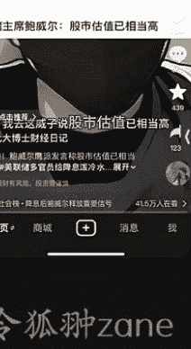

观海
波兰总理图斯克表态，将于25日凌晨重新开放与白俄罗斯的边界口岸，也就是说，中欧班列将可能会重新运行，这场折腾了10多天的“闹剧”终于以波兰协妥结束。

花王【诸情寻】
东西做不过去，他们也难受啊

观海：波兰总理图斯克表态，将于25日凌晨重新开放与白俄罗斯的边界口岸，也…

观海
据欧洲媒体透露，这次最先声反对波兰关闭口岸的国家是德国和荷兰，因为停运，它们的汽车配件无法按时安装，整个生产计划都被打乱，如果波兰不能及时打开口岸，它们的车企可能面临数十亿美元的损失。

观海
每年单单从中国入境波兰的过境费就高达5亿欧元。

# 群公告

[File] 股市行情推演.docx120.docx
doc120.docx

23号大盘：上午冲高回落，下午先跌反弹。

....
24号大盘：上午反弹震荡，午后调整震荡。

周末在预测中虽有提到‘节前力无心胜志’，但若力过头了，就不会出现护盘的。
就择昨天那天再预测，“上午冲高回落”，明显显迹跌过头了，所以主力下手出来护盘抬升。

所以，预测‘下午先跌后反弹’通常不会错的。

了解更多

主力无心忠诚，节前没蹲榔头，我今天继续不看盘，走走走走，你们继续玩。。。。

哈哈！观大不管我们了

大方向向告诉我们了，操作细节只能我们自己把握🙈@星眼里

还不知周日关回app躺平算了吧

观大不管，心慌慌

还是会下跟跌喵

@观海 观大，请问下周四周五还是会按照照片里面的预测来走Main

观海：[File] 股市行情推演.docx120.docx120.docx23号大盘：上午…

@观海 观大，请问一下周周五还会按照文档里面的预测推来来呀

观海 [File]股市行情预测.docx120.docx1.docx23号大盘: 上午...

09:28

听雨轩
低开

阿里：@听雨轩 不信？

嬷娃嬷.念母
哈哈

令苏召唤zane
9月24日凌晨开盘低开，市值已经相当高了

令苏召唤zane
昨天晚上没说一句好话

阿里
信了？?@听雨轩

听雨轩
乌鸦嘴

听雨轩
🙏

阿里
低开闷茶+洗洗昨天抄底的。这是经验之谈

听雨轩
老套路了，是吧

阿里
对

观海
上周都预测3899顶部了，本周预测里还是跌到周五反弹的，没必要那么急抄底

今天3000多只股票涨。赚一点不难

令狐辩zane
卖早了。低开高走

花王【精情寻】
还想着3770来点

令狐辩zane
这不是反弹了，科创板还涨了1.34%

观海
划重点

观海
量股政策：冲回回落。
无心恋下周每日日记下方特殊说明如下：22号探底回升；23号上涨；24号总体低下；25号下午；26号探底回升；盘后可能再次调回。
止后：适合每日早预测作为参考。

花王【精情寻】
24号是？

听雨轩
🍊

观海
24号大盘：上午反弹，午后调整。
周末未在跌中及时抄底，“择前后力无心恋”；
但由于昨日跌了，主力就会出来护盘的。就择天后处理；中午回回升；但明后跌过了
所以主力下午出来护盘的，所以下午跌后通常不会跌的。

观海
24号大盘：下午反弹量，午后调整震荡。周末在预测时提到‘节前主力无心意涨’，但如果经历过了，主力会出来护盘，就像天榜那样，预测‘下午冲回落’，但明胆过头，所以主力出来护盘抬，所以预测‘下午战后’通常不会错的。

花落【惊情寻】
看来今日10点左右要将昨日日的先抛了

令孤涯zane
反正我赚了一点跑路了😅😅

观海
很早就预测下半年科创板有行情，主板看不好的

令孤涯zane
我估计接下来的外围风险也大

观海
代表主板的不就是权重股嘛，代表科创50的不的就是芯片半导体体嘛

令孤涯zane
国庆长假不太好持股过节

代表主板的不就是权重股嘛，代表科创50的不就是芯片半导体嘛
国庆长假不太好持股过节

代表主板的不就是权重股嘛，代表科创50的不就是芯片半导体嘛
国庆长假不太好持股过节

代表主板的不就是权重股嘛，代表科创50的不就是芯片半导体嘛
国庆长假不太好持股过节

代表主板的不就是权重股嘛，代表科创50的不就是芯片半导体嘛
国庆长假不太好持股过节

代表主板的不就是权重股嘛，代表科创50的不就是芯片半导体嘛
国庆长假不太好持股过节

代表主板的不就是权重股嘛，代表科创50的不就是芯片半导体嘛
国庆长假不太好持股过节

代表主板的不就是权重股嘛，代表科创50的不就是芯片半导体嘛
国庆长假不太好持股过节

代表主板的不就是权重股嘛，代表科创50的不就是芯片半导体嘛
国庆长假不太好持股过节

代表主板的不就是权重股嘛，代表科创50的不就是芯片半导体嘛
国庆长假不太好持股过节

代表主板的不就是权重股嘛，代表科创50的不就是芯片半导体嘛
国庆长假不太好持股过节

代表主板的不就是权重股嘛，代表科创50的不就是芯片半导体嘛
国庆长假不太好持股过节

代表主板的不就是权重股嘛，代表科创50的不就是芯片半导体嘛
国庆长假不太好持股过节

代表主板的不就是权重股嘛，代表科创50的不就是芯片半导体嘛
国庆长假不太好持股过节

代表主板的不就是权重股嘛，代表科创50的不就是芯片半导体嘛
国庆长假不太好持股过节

代表主板的不就是权重股嘛，代表科创50的不就是芯片半导体嘛
国庆长假不太好持股过节

代表主板的不就是权重股嘛，代表科创50的不就是芯片半导体嘛
国庆长假不太好持股过节

代表主板的不就是权重股嘛，代表科创50的不就是芯片半导体嘛
国庆长假不太好持股过节

代表主板的不就是权重股嘛，代表科创50的不就是芯片半导体嘛
国庆长假不太好持股过节

（注：此处存在重复内容，此处已按逻辑处理）
代表主板的不就是权重股嘛，代表科创50的不就是芯片半导体嘛
国庆长假不太好持股过节

代表主板的不就是权重股嘛，代表科创50的不就是芯片半导体嘛
国庆长假不太好持股过节

（注：此处存在重复内容，此处已按逻辑处理）
