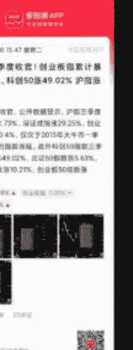
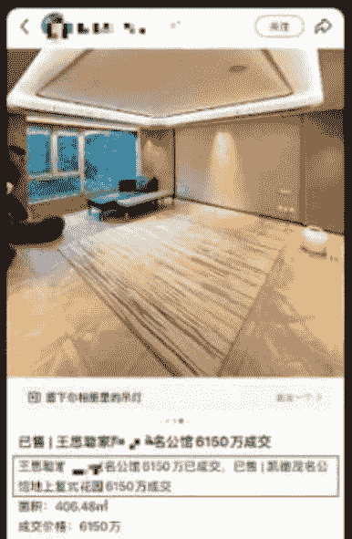
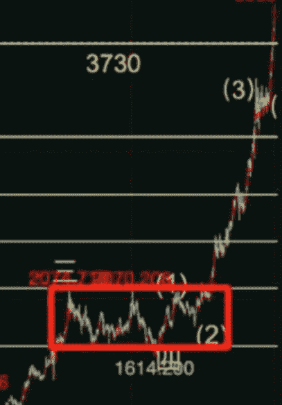

十三少：央行继续释放流动性啊，整个和10月才8000亿到期，9号就来了11000亿。

观海：10月有重大事件，维稳需要。

“十三少”撤回了一条消息。

十三少：哦哦，原来有此深意啊。

令狐辩zane：10月2号进入特朗普财年。

令狐辩zane：据说美股会股债双杀啊。

观海：主要有一个重要会议，关系重大。

花王【精情寻】：国庆期间美、港股股市涨，等A股开市再杀？

令狐辩zane：10月2号进入特朗普财年。

花王【精情寻】：每逢大会必接挨打。

观海：主要有一个重要会议，关系重大。观海：国家都控盘了，不用担心。

## 10月有重大事件，维稳需要

“十三少”撤回了一条消息。

哦哦，原来如此深意啊。

10月2号进入特朗普财年。

说美股会股票债双杀啊。

主要有个重要会议，关系重大。

国庆期间美股港股涨，等A股开市再杀？

10月2号进入特朗普财年。

每逢大会必打。

主要有一个重要会议，关系重大。

## 别和实施好“十五五”资本市场

提到打造一流投行，双创改革，国家队的券商？

观海：提到打造一流投行，相关概念去年炒过了。

海通国泰合并后，再找几个两两组合，估预计这样。或者银行加证券组合，这个更有点创新。

三季度创业板累计大涨50.4%，这个涨幅历史第二高，仅次于2015年的一季度！三季度科创50大涨49.02%，这是科创板历史上最大的涨幅。

## 买指数挣钱更容易

9月30日 晚上20:40。

日月生：创业板逻辑：易中天、胜宏。

观海：从双创的角度，现在牛市强度已经超过2015、2021那两次了，仅次于07年那波。

花王【猜情亨】：估计第四季度，还是涨他们。

Alex：观海，双创回调幅度大概多少，10%打得得住吗？

观海：从双创的角度，现在牛市强度已经超过2015、2021那两次了，仅次于07...

上证本月小涨0.64%。深成指本月大涨6.45%，创业板指本月累计涨超12%，科创50指本月涨超11%！都是月线5连阳了。

## 观海

牛市不言顶，这还远开跌呢，回调时再测。

新股民为啥盈利大？----胆大。

老股民：老畏畏缩缩怕跌，老股民特性。零点。

老王家看样子真的的资金紧张，儿子都把家卖了。

观海：特朗普竟然宣布！从2025年10月1日起，美国对橱柜、浴室柜征收50%关税，对软垫家具征收30%关税。他还给了一个非常“高大上”的理由：国家安全。

阿里：🤡

观海：特朗普10月第一天就出招。

阿里：他会不会干预内瑞拉？@观海

阿里：明抢。

观海：他想拿诺贝尔和平奖，预计不会主动出兵。

阿里：嗷。

观海：2025年三季度全球主要要素价格趋势。对橱柜、浴室柜征收50%关税，对软垫家具征收30%关税。他给了一个非常“高大上”的理由：国家安全。

阿里：特朗普10月第一天就出招。阿里：他会不会干预内瑞拉？@观海。阿里：明抢。观海：他想拿诺贝尔和平奖，预计不会主动出兵。阿里：嗷。

2025年第三季度主要指数涨跌幅

| 指数 | 涨幅 |
| :--- | :--- |
| 标普500 | 2.1 |
| 纳斯达克 | 4.5 |
| 道琼斯 | 2.5 |
| 罗素200 | -1.2 |
| 富时100 | 8.8 |
| 恒生指数 | -3.4 |
| 德国DAX | 5.6 |
| 英国富时指数 | 4.2 |
| 日经225 | 1.8 |
| 印度尼指数 | 1.5 |
| 斯富克斯50 | 9.5 |
| 上证300 | -5.5 |
| 中深成指 | 8.2 |
| 离人民币指数 | 3.2 |
| 欧元对美元 | 1.5 |
| 标普富时100 | 8.8 |

观海：节后节后预测上涨，目前看还是对的，妮娃娃...希望他们能坚持几天，最好是慢涨。观海：8月是上半年最佳加仓点；10月是下半年最佳加仓点。佳伟：节后减仓等低点加仓机会。应该就在节后第一周。观海：牛市。花王【精情矛】：比亚迪，中芯，陆积电，阿里巴巴，AI。狮zane：中芯国际港股涨了9个多点。花王【精情矛】：大涨。

观海：中国最好长线标的是腾讯，没人能竞争他。阿里：港股企业，腾讯是第一位的。观海：中国最好长线标的是腾讯，没人能竞争他。令涯涯zane：你太牛了。拿这么久。mojin：我15买的中芯。mojin：我非常有耐心，海光还在。阿里：不过认为腾讯过不了1000点。观海：A股里面最好的科技股是工业富联，也没人能竞争他。

“阿里”撤回了一条消息。mojin：海光成本是负了，数量比原来少了，但我现在住的房子贷款还完了，无债一身轻。那些都是极度风险厌恶者，不会给你拍的。说是买了银行的基金，银行的基金进场了。观海：确实从银行出来了，大部分没进场，只是观望。为什么ETF涨的好？银行出来的资金都是买了ETF，不直接买股的。为什么今年ETF涨的好？银行出来的资金都是买了ETF，不直接买股的。而ETF占比最大的都是重仓股。一个对市场陌生的投资者，选股是难点，ETF就是他们准备的，专业人士选股。昨晚，三倍做多中国ETF，跌了3.5%。熟悉的配方，同样的味道，高盛资本在假期期间高调宣布市场将有大幅调整。目的很明确，就是诱导A股节后开盘大跌。明天的黄金、铜、小金属等资源大宗商品上涨应该是无疑的。而科技板块比较纠结，CPO、HBM等芯片分支内部、前期涨幅较小的个股还有上涨的空间。节前减仓铜、铝，现在想想有点后悔。后市要加大仓位布局有色吗？放假期间黄金和半导体都涨了不错。

## 观海

这是伦美走势，现在上证走势大约类似于红色方框位置，多点耐心，等待主升浪。

## 北瑜

帅呆了。

## 观海

还没突破呢，突破前需要大家拱手让出筹码。

阿里：观海：还没突破呢，突破前需要大家拱手让出筹码。

## 观海

心态放平和一些，现在套牢的筹码说不定过。
