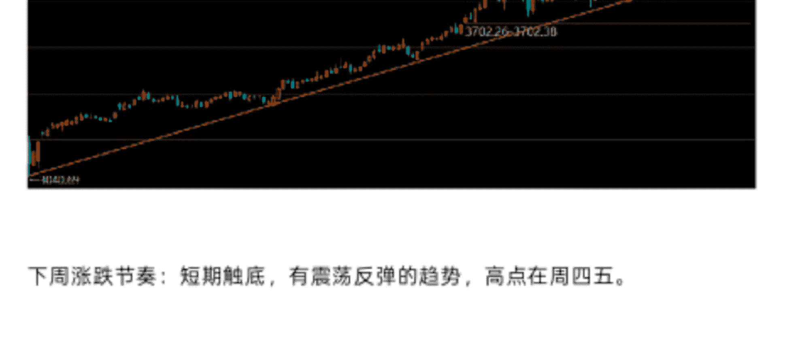
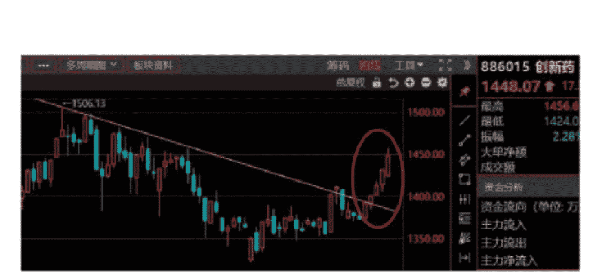
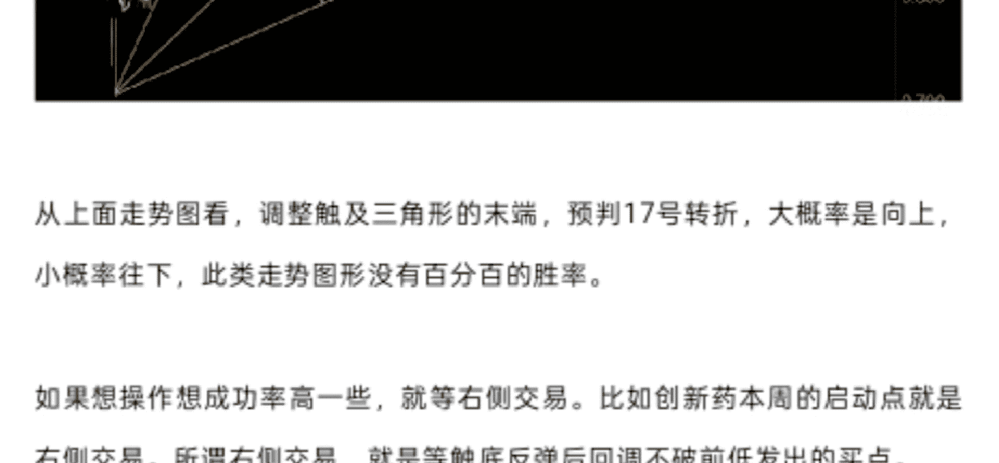

# 股市行情（11月17日-11月21日）

大路分析：

本质五大点，从走势图（下表）看不出大盘上行中期可见的趋势，整体震荡，正需调整：进加微信cuk255

下底部跌势：短期触底，有蓄反弹的趋势，高点在南五。

下方有两个时间点：17；21

如果结合量能判断：17号低点，21号高点。

板块分析：

上期分析了证券和创新指数，总结回溯一下：

- 1, 股票指数

深度视野VIP群 人工进加微信cuk255 微信chp5568

看着红腰处，已经触底部，下周证券指数回弹升，11月预利收小。

- 2, 创新指数：进群加微信cuk255

上期圈范围分析，本周拉近5个指标，中期尚在12月。

本周重点分析指标机器人ETF：

深度视野VIP群 人工追踪50+大V 付费进群加微信cuk255 微信chp5568

从表面趋势看，调整及三角形的未见到，预见未转，大概17号将向上，小概率下走，此走势形态有百分的概率。

如果构想成功此一波，就是右侧交易。对比基金的起点就是右侧交易，所谓右侧交易，就是等支撑线回调后不会被触发发出的卖点。

17号主力一左侧交易，若在此处踩，后期可能会给出一个右侧交易点。
进群加微信cuk255

网上找了一个相似的走势作为参考：

深度视野VIP群 人工通道50+大V 付费进群加微信cuk255 微信chp5568

## 深度视野优质集团（链接优质社群，助你成功）

全部包含以下内容：限时年费188/年 加微信cuk255

- ① 吃瓜群众包时圈加时群群对话 (原价 365 元/年)
- ② 子明享享（内部）文章
- ③ 政事室（顾子明）付费内容内加送顾子明群聊
- ④ 米联锦闲【作者米穗】（原价 599 元/年）
- ⑤ 欧洲黄金会员专属文章（原价 328 元/年）
- ⑥ 砖瓦内部文档（原价 400 元/年）
- ⑦ 禹青读书会专属文章（原价 699 元/年）
- ⑧ 鉴茶财经知识星球（原价 3310 元/年）
- ⑨ 猫哥的视界知识星球文章（原价 299 元/年）
- ⑩ 财经周【独家新闻】（原价 1498 元/年）
- ⑪ 杨世光在钱桶（原价 2200 元/年）
- ⑫ 森森财经星球（原价 1600 元/年）
- ⑬ 激译译付费文集（持续更新）
- ⑭ 司马林解读毛选全套音频和全套书籍藏版无割减（原价 2.3 万）
- ⑮ 虚彦三部曲[民国梦、帝国争夺、不被理解的MAO]（原价 599 元）
- ⑖ 知识星球文章（原价 268 元/年）
- ⑰ 额外再送：卢薛元新浪微博付费专栏、三村丰老王、三花九术文集

不定内容：......（更多资源不写下去了）......
- ① 守夜人知识星球、接换魔王星球、成败知识星球
- ② 创始笔记、达叔浅谈星球、成就财富、雪球花甲老头等
- ③ A 视野、大树乡谈、江初俊、咩咩说、上海海洋学等付费文集
- ④ 西凤付费文章、老端、赢在八小时之外、局人的视界、升值、老体制内等等其它一些大V付费文集

限时年费188/年

## 底层链接全网V优质内容

深度视野文集
深度视野（付费文集）

