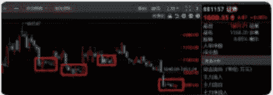

## 观海
周五正常回调，是上周末提前预判到的，都看补缺口，就会先让这部分人下车。

观海
操作上，先以反弹补缺口来操作。

下周大盘：有下跌反弹的趋势，局部在周二周一震荡反弹周二所有回调调整，周三继续反弹周五回调。

先看下午会不会反弹，上午提前跌了，通常下午会出现反弹。

已经挂单在3830这个位置了。

在补缺口时，先反弹，再有二次探底。3040点那波补缺很强，是因为国家队投入几千亿硬拉，本次补缺要复杂得多。

AI 应用开始炒AI眼镜了。

## 观海
国家队压着证券不让涨，说明是有意不让指数涨，也说明指数完全在他们操控之下，完全不用担心跌下去。

## focus
我也感觉证券被压着。

## focus
可能还没释放的时候，可能类似中金的情况吧。

## 王琦
中金复牌才是证券启动之时。

## 王琦
预计 12.24 美国当晚不开盘。

## 花王【诸情寻】
之前不得先挖一个大坑，再让证券涨。

## 观海
开盘量化先割了一筐韭菜，短线并不好操作，他们可以T+0，当天锁定利润，散户只能眼看着924那波量化爆仓的不少，结果主力直接拔网线……这些巨虫不除，天理难容。

缩量这么多，不敢眼。比如今天，即使你再在3856点抄到了最低点，眼看着到了3881点，却不能卖，量化却可以。下午再碰下来，散户即使抄到最低点，也是坐了个过山车。

## 观海
证券横盘4-5天就会拉阳几天。

## 观海

如果是T+0，主力当天拉高，散户卖掉，主力就无法割韭菜了。交易制度不公平，印度是散户t+0，机构T+3。

## 观海
今天预测是偏空趋势，上午出现反弹就不能跟，否则下午就有被割韭菜的。

## 观海
......
28号大盘：上午先退后跟，下午回调后触反弹警惕，总体日内安全趋势。

Edit
10:25

focus
等下午再来说吧。

## 观海
昨天预测日内有一个反弹，实际力度还不小，只是尾盘跌下来了。

## 观海
......
27号大盘：上午先退后跟，下午反弹震荡，总体上日内有一个反弹出现。

## 观海
大方向还是“补缺口”，不用担心进入熊市。

## 深度视野优质社群（链接优质社群，助你成功）

全部包含以下内容：限时优惠188/年 加微信cuk255

- ① 吃瓜群众包帝文加实时群对话（原价 365/年）
- ② 类似中金的情况吧（原价 568/年）
- ③ 子明优享（原价 599/年）
- ④ 欧洲金会员（原价 328/年）
- ⑤ 砖瓦内部（原价 400/年）
- ⑥ 卢克文专属（原价 699/年）
- ⑦ 鉴茶财经（原价 3310/年）
- ⑧ 猫哥的视界（原价 299/年）
- ⑨ 财经周独家新闻（原价 1498/年）
- ⑩ 杨世光在钱（原价 2200/年）
- ⑪ 森淼财经（原价 1600/年）
- ⑫ 激源译读持续更新
- ⑭ 司马林解读末选全套音频和全套书籍无损（原价 2.3 万）
- ⑮ 虚政三部曲[民国梦、帝国亡、不被理解的 MAO](原价 599/年）
- ⑯ 卢克文知识星球（原价 268/年）
- ⑰ 额外再送：卢祺元新微付费专栏、三村丰老王、三花九术文集

不定内容：……更多资源不写下了……
- 守夜人星球、接换魔王星球、成败财富星球
- 创始星球、达叔译论、成败财富圈、雪雪花老头等
- A视野、大树乡谈、江初优、咩咩说、上海海学等付费文集
- 西风付费、老端、高在八小时之外、局人的视界、升值、老A体制内等等一些大V付费文集（每月低于600 元的付费文集）

## 深度视野文集 进群微信cuk255

深度视野（付费文集）

# 限时优惠188/年 低成本链接全网U优质内容