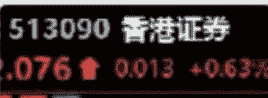
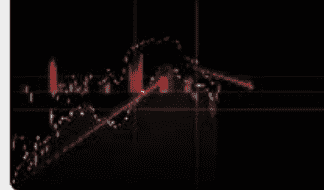

观海
梁文峰的量化基金今年入账400 亿。突然对梁文峰有了不同的看法！

观海

观海
吸血鬼

观海
近期我买这个来套利了两三次，下周中金复牌还有一次套利机会。

观海

吴桂华
今天卖了是非，观大

观海
还拿着着呢。

观海
散户通病：每一个波动都想吃透吃尽，每只牛股都能捕捉，天天买进卖出...

星辰
🌰只看，不乱动

花王【寻情】
所以我现在就是拿着不动了

# 观海
上午走势基本吻合，不过很难提前预判到低开这么多

观海

# 观海
15:26: 特大了 下二卖出

# 星辰大海比亚迪
这种行情 炒股的都是妈妈有病

# 星辰大海比亚迪
拿着不动 都能天赢

11:18
观海
近期我买这个回来套利了两三次，下周中金复牌还有一次套利机会。

观海
513090 香港证券 .076 +0.013 +0.63%

没必要天天进进出，钱是一天亏不完的。25日？

观海：近期我买这个来回套利了两三次，下周中金复牌还有一次套利机会。

20-25
一手优质资源：cuk255
观大，证券ETF调仓到香港证券ETF可行不

观海
很多人都不明白一个道理：涨10%跌5%就回回原点……

观海
@别时容易 我两个都有

"花王【猜情寻】"撤回了一条消息

花王【猜情寻】
即使不能站着不动。还是要卖

观海：很多人都不明白一个道理：涨10%跌5%就回回原点……

吴桂华
感谢观大分享，多学习中。

观海：很多人都不明白一个道理：涨10%跌5%就回回原点……

观海
确定性最重要。

观海
银行只赚那点“息差”，业绩都很优良，因为他们只赚不亏。

假如看好一个标的，上涨确定性高，但上涨幅度有限，就上杠杆加倍买入，收益一点不小，比如前期买银行股。。

假如看好一个标的有大涨可能，但确定性不高，这个时候买不但不能上杠杆，还不能满仓。

学习了🙏
请教个问题，是不是每次买来的前提就是银行股涨，平安上60块？……

观海：假如看好一个标的，上涨确定性高，但上涨幅度有限，就上杠杆加倍...

现在证券就处于未来3个月上涨的“确定性高”……

# 吴桂华
请教个问题，是不是每次牛来的前提就是银行股涨，平安上60块？……

观海：假如看好一个标的，上涨确定性高，但上涨幅度有限，就上杠杆倍...

# 观海
现在证券就处于未来3个月上涨的“确定性高”……

# 观海
牛来之前涨银行的原因是有前置先觉的资金看到牛市了，但又怕熊市还没结束，为保万一无失，就买高股息股，万一套牢牢可以吃股息等待。

11:50 一优质资源：cuk255

# 观海
对风险厌恶的资金如果觉得后市有风险，也会去银行股里躲避。

## 深度视野优质社群（链接优质社群，助你成功）

全部包含以下内容：限时年费188/年 加微信cuk255

- ① 吃瓜群众倍时圈文加时群对话（原价 365 元/年）
- ② 子明私享汇（含）内部文章
- ③ 政事室（顾子明）付费内加送顺明群
- ④ 米联储闲文【作者米栖】（原价 599 元/年）
- ⑤ 欧洲金雀会员专属文章（原价 328 元/年）
- ⑥ 砖瓦仁内部圈（原价 400 元/年）
- ⑦ 卢克读书会专属文章（原价 699 元/年）
- ⑧ 鉴茶知识星球（原价 3310 元/年）
- ⑨ 猫哥的视界星球（原价 299 元/年）
- ⑩ 财财经周【独家新闻】（原价 1498 元/年）
- ⑪ 杨世光在金塔（原价 2200 元/年）
- ⑫ 森淼财经星球（原价 1600 元/年）
- ⑬ 激泽异读付费文章（持续更新）
- ⑭ 司马林解读全套音频和全套书籍无割（原价 2.3 万）
- ⑮ 虚三三部[民国梦、帝国争亡、不被理解的 MAO]（原价 599 元）
- ⑯ 卢克星球文章（原价 268 元/年）
- 额外再送：卢祺新源博付费专栏、三村丰老王、三花九树文集

不定内容：——（更多资源不下去了……

- 守夜人司令星球、接换魔王星球、成达泛论星球、成就财富圈、雪球花甲老头等
- A视野、大树乡谈、江宁后记、泮咩说、上海家学等付费文集
- 西凤付费文章、老端、赢在八小时之外、局外的视野、升值优、老 A 体制内等其它一些大V付费文章（每月不低于600元的付费文集）

低成本链接全网V优质内容

深度视野（付费文集）

