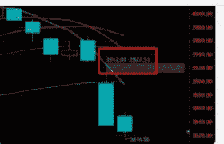

最近流感挺厉害，相关个股估计会炒作些日子，补完缺口记得减仓。

## 观海114(189)

令狐狸zane：短时间不要想飞得太高，就是补缺口。港股好猛，补完缺口后再等二次抄底，踩准节奏拍很重要。一手优质资源进群微信cuk255

## 观海
昨天最低点提示大家买入，涨了追高就没意思了。

## 观海
甜草莓送你一根，柠檬西瓜、蓝海鳕鱼，酷独口有辣东方的美味我们。平内销量要不要去观。非常辣口，计划下次会有...爆爆，酷酷才便宜 cheapest。一手优质资源进群微信cuk255

如果想短线捞一把，就今天买，周四五卖，到缺口有80点左右的差价。千万别涨上来去追。补完缺口，预计还会有一波回调，然后才会去创新高。

Alex一手优质资源进群微信c255：观，反弹选什么方向好吧。

## 观海
补缺口是上证历史传统，传承一直很好。一手优质资源进群微信cuk255

本周补完缺口就不错了，哪能一直涨，量化还要不断割韭菜呢。预计下午就会有波回调。一手优质资源进群微信cuk255

## 深度视野优质集圈（链接优质社群，助你成功）
全部包含以下内容：限时优惠188/年 加微信cuk255

- ① 吃瓜群众包圈微信时群群对话（原价 365 元/年）
- ② 子明私享汇（含）内部文章
- ③ 政事室（周子明）付费内容再送周子明群聊
- ④ 米联储闲间【作者米楷】（原价 599 元/年）
- ⑤ 欧洲金雀会员专属文章（原价 328 元/年）
- ⑥ 砖万瓦内部文档（原价 400 元/年）
- ⑦ 卢克青云读书会专属文章（原价 699 元/年）
- ⑧ 鉴茶财经知识星球（原价 3310 元/年）
- ⑨ 猪哥的视界知识星球文章（原价 299 元/年）
- ⑩ 财新周刊【独新闻】（原价 1498 元/年）
- ⑪ 杨世光在金钱壕（原价 2200 元/年）
- ⑫ 森森财经星球（持续更新）
- ⑬ 司马林解读全套音频和全套书籍珍藏版无割减（原价 2.3 万）
- ⑭ 虚构三部[民国梦、帝国争亡、不被理解的MAO]（原价 599 元）
- ⑮ 额外再送：卢薛新浪微博付费专栏、三村丰老王、三花九术文集

不定期内容：（更多资源下文去了……——

- ① 守夜人司令星球、接魂魔王星球、成败财富、生术知识星球
- ② 创始笔记、达叔谈论星球、成败捞财富、雪花甲老头等
- ③ A 视野、大树伶、江宁后、泮咩说、上海海家等付费文集
- ④ 西风付费文章、老师、老羡、高在八小时、局外的视界、升值计、老A体制内等其他一项V付费文集（每月不低于600元的付费文集）

## 深度视野文集
进群微信cuk255

