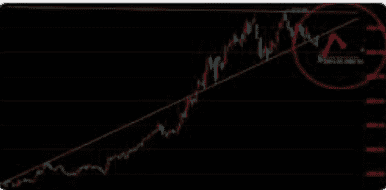
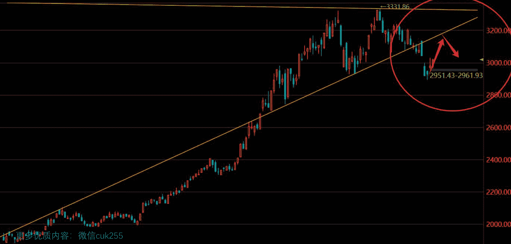
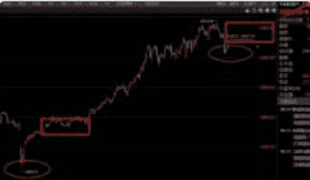
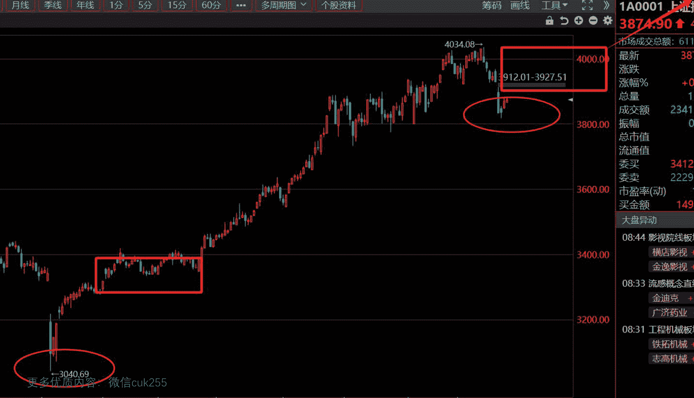
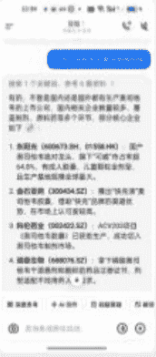

观海

创业板反弹后，还会会下

观海

@观海看看股票ETF仓位不小，更多优化内容：微信cuk255

更多优化内容：微信cuk255

上证类似复制3040点走势，反弹后，会有一段“躺平”走势，然后拉升

证券重复过多少次了，年底前没有行情@笨笔风运运更多优质内容：微信cuk255 *

笨笔牛运🐞

这个月小阳的观点改不改呀

乐活

春节前还是这2025年12月呀?

观海：证券重复过多少次了，年底前没行情@笨笔牛运🐞

观海

主要表达的是11月不排除新低，亥月拉个小阳，@笨笔牛运🐞

笨笔牛运🐞

更多内部调整请加微信：微信cuk255 ✨

预测里写的很清楚了，不明白的可以去看看预测，既想吃大肉，又不想潜伏，最好等“猪物”来了再动手

观大，向上补缺后，回落确认低点，低点会比3817低吗？那个时候是最佳买点吗？

观海：上证类似复制3040点走势，反弹后，会有一段“横平”走势，然后拉升

想象一下，猎手潜伏在森林里，等待猎物出现的过程中，挨饿受冻的滋味确实不好受

通常打猎，都是看到猎物直接放箭，这这也是大多数人炒股的方式，看到股票上涨就追进去

确实

走一步看一步，这要看当时处于什么环境中，影响股市走势的方面很多，可能更多优质各种因素引发股市大跌

现在确定性的就是补缺口，吃这段利润无风险

10:22

这个药治疗流感很好，但生产厂家分散，并不容易炒作

## 上市公司有生产奥司他韦的吗

搜索1个关键词，参考6篇资料 >

有的，不管是国内还是国外都有生产奥司他韦的上市公司，国内相关企业数量较多，覆盖制剂、原料药等多个环节，部分核心企业如下：

- 1. 东阳（600673.SH、01558.HK）：国产奥司他韦绝对龙头，旗下“可威”市占率超64.8%，成人胶囊、儿童颗粒全剂型，且生产基地规模全球最大。
- 2. 金石药业（300434.SZ）：推出“快克清”奥司他韦胶囊，借助“快克”品牌的渠道优势，在市场认可度较高。
- 3. 科伦药业（002422.SZ）：ACV203项目（奥司他韦胶囊）已批生产，成功切入奥司他韦制剂市场。
- 4. 诺泰生物（688076.SZ）：拿下磷酸奥司他韦干混剂和颗粒的药品注册证书，剂型适配不同用药人

观海

我是前天刷抖音看到很多博主因流感停播，说是近期流感很严重，大家可以关注一下周围，更多优质内容：微信cuk255

观海

（此处图片可能重复，已按逻辑处理或保留原文逻辑合并内容）
