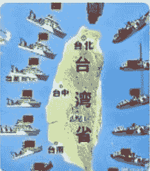
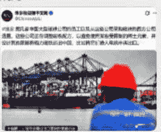
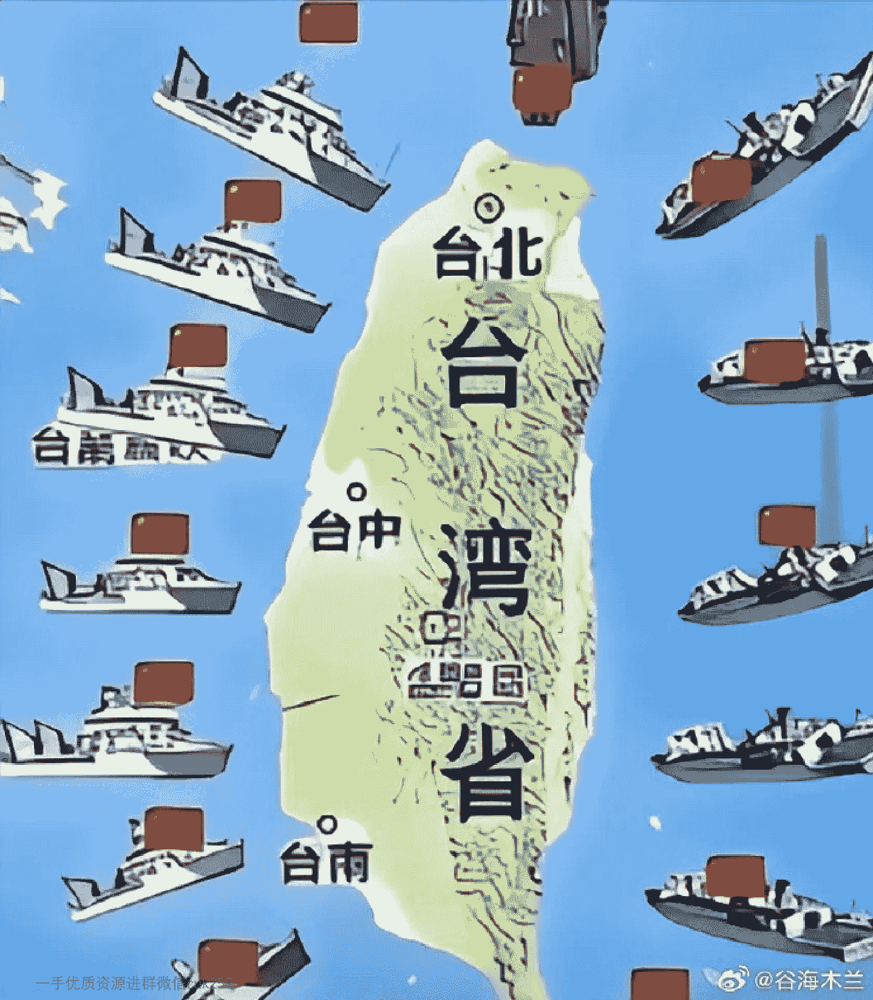
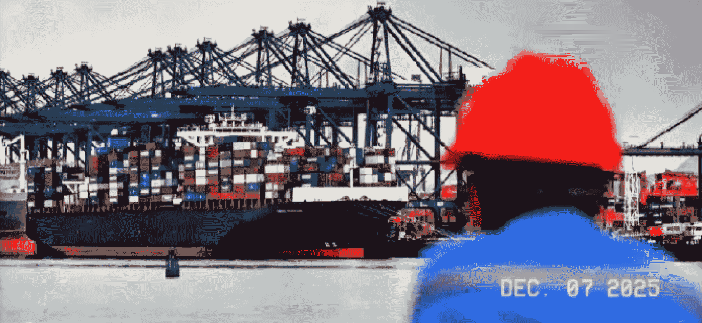
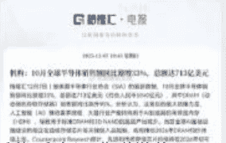

让对岸的还以为是练习

自得：攻台必是偷袭或突袭，时间一定特别，既成事实，让世界猝不及防。

可能打起来，从古至今懂点历史的人都明白，只要掌握了权利，只要动兵，就有失去权利的可能，打只是下策。

孙子总结兵法的时候，欧洲人美洲人还在吸血呢。

最好的办法就是多造军舰，把台湾围起来，针插不进去，自然就投降了。

## 观海
你看香港一个火星就烧了几座大楼，炸弹可以不长眼，你打人家，人家也会报复，倒霉的还是老百姓。

## 观海
俄罗斯纵深大，人烟稀少，依靠能源，我们依靠出口，开战不是好的策略。

## 龙腾东南
是呀，最好不用打仗。

## 龙腾东南
但犹太人、鲁克撒人不会甘心失去地位的。

## 观海
用不说别的，只要开战，股市就会回跌停，跌到1000点都有可能。

一手优质资源进群微信cuk255

## 观海
台湾也是中国人，中国人不打中国人，现在科技发达，学以色列列，定点清除台独分子即可。

## 自得
台湾有个教授建议，一定偷袭斩首，48小时完事，世界一切如旧。如围台，美日西必制裁，岛内死抗，弄成丧生饭。

## 西西西飞
在和美国和平啊，10年后，不要说弯弯弯，小日本一样每年朝贡。

13:15

## 贝加尔湖
这种都是垃圾观点，建立在打不赢美日联军的幻想上。没听过圈点打援吗？

> 自得：台湾有个教授建议，一定偷袭斩首，48小时完事，世界一切如旧。如围台，美日西必制裁，岛内死...

## 龙腾东南
军事上我们跟俄罗斯是强国，把美日打趴不是问题。但台湾是自家菜园子，打仗了是自家吃亏。一手优质资源群微信cuk255

## 观海

## 观海

一手优质资源进群微信cuk255

## 台湾省
- 台北
- 台中
- 台南
- 台东

## 华尔街日报中文网
### 独家
据几家中国大型磁铁公司的员工以及从这些公司采购磁铁的西方公司透露，这些公司正在调整磁铁配方，以免使用某些受限制的稀土元素，并设计其他策略将强力磁铁运出中国，比方将它们嵌入电机中再出口。

中国稀土公司寻求绕过出口管制的变办法

## 观海
半导体利好

## 观海

一手优质资源进群微信cuk255

## 格隆汇·电报
比新闻更快的财经资讯
2025-12-07 10:43 星期日

## 机构：10月全球半导体销售额同比激增33%，总额达713亿美元
格隆汇12月7日 | 据美国半导体行业协会（SIA）的最新数据，10月全球半导体销售额同比激增33%，总额达713亿美元（约713亿美元）。

这种都是垃圾观点，建立在打不赢美日联军的幻想上。没听过圈点打援吗？

Counterpoint认为，由于AI需求激增，先进封装产能临临短缺，导致DRAM价格持续上涨。一手优质资源进群微信cuk255

## 深度视野文集
全部包含以下：限时年费188/年 加微信cuk25

- 守夜人（原价365/年）
- 摇拨魔王（内部文章）
- 米联诸（原价599/年）
- 欧洲金雀（原价328/年）
- 砖瓦内部（原价400/年）
- 卢克文青读书会（原价699/年）
- 鉴茶财经（原价3310/年）
- 猫哥的视界（原价299/年）
- 财新周刊独家新闻（原价1498/年）
- 杨世光在钱爆（原价2200/年）
- 森淼财经（原价1600/年）
- 激源异译持续持续更新
- 司马林解课毛选全套音频和全套书籍无删减
- 虚彦三部曲[民国梦、帝国争亡、不被理解的MAO]
- 卢克知识星球（原价268/年）
- 额外再送：卢薛元微信滚播获专栏、三村丰老王、三花九术文集

- 守夜人
- 摇拨魔王
- 创始人笔记
- 达叔谈论
- 大树乡
- 江初序
- 咩咩说
- 上海海家
- 西风
- 老端
- 赢在八小时之外
- 局外的视界
- 升值
- 老体制内等等其它一些大V付费文章（每月低于600 元的付费文集）

深度视野（付费文集）

