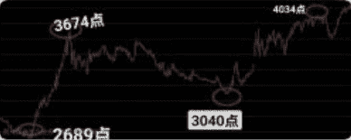
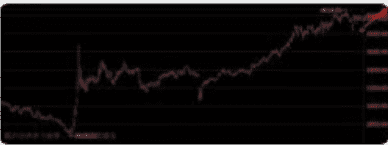
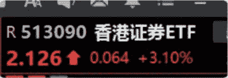
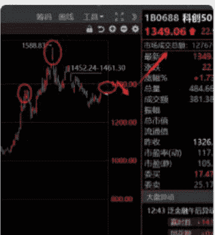
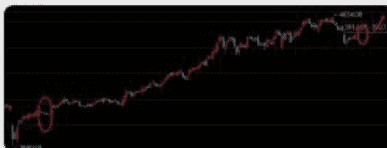
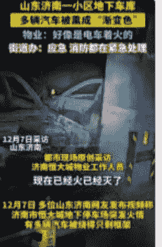

观海

这图是11月23发在周群的

观海

观海

要跑肯定早一步啊

看样子就是不会回调到3600对吗？
3816最低了

还想3600? 想什么呢

那就好

今天这量能奔2万亿去了

很早早我就在群里发过，4季度下跌低点在5月线

增到了3600，想想什么时候到3400

观海:还想3600? 想什么呢

大金融价格不高，难跌

中金停牌后，我又配置了这个，他持有中金最多

观海

村长讲话，明显就是不让跌

观海

如果果跌到3600，村长还不疯了啊

包包

我现在拿招商银行来当反指标看指数，早上招行低点

观海：村长讲话，明显就是不让跌

创先森

👍有道理 今天趋势和情绪都好 普涨

包包

要是下午回调，我估计会涨上去。这个看了1，2周😂

北琦

给村长点赞👍

进群加微信：cuk255 一手优质资源每天更新..人工跟踪50+大V文...

# 观海

# 花王【猜情寻】

我还按预测，要等到1月..

观海:

## 春暖花开的日子

@花王【猜情寻】

进群加微信：cuk255

一手优质资源 每天更新...
人工追踪50+大V热门文...

# 顶天立地

今天是节气 大张深圳成分指数 创业板指数都是向上的跳空缺口 周初是本周高点？后面会回今日缺口吗？还是通空走势？

观海

补掉了也是按图走

观海

这个图是1月28号画的，观海主力完全是按图操作的完美踏空

focus 谨慎微包包+1

观海躲过下跌的人，通常躲过上涨，没有完美的操作

观海无人每次买在最低点，卖在最高点的，多就行

包包新手适合什么模式，观海：无人每次买在最低点，卖在最高点的，差不多多就行

观海过度追求，容易踏空行情

focus 进群加微信：cuk255 一手优质资源 每天更新..人工追踪50+大V付费文..闲定投吧

# 观海

新手适合小资金，感觉能盈利了加大投入，不然一开始投入过多，很容易套牢

包包感觉这个是最省事的安全的吧，如果定投，自己就不会聚了。还是想学点存活的技能，毕竟这种行情，估计后面难有。focus 定投指数吧

包包恩恩，确实吃过亏

观海：新手适合小资金，感觉能盈利了加大投入，不然一开始投入过多，很容易套牢

## 观海就像游泳，先在浅水区扑棱一段时间

## 观海百姓就像老兵，听到枪响先趴下了，新兵看到老兵这副模样，还以为老兵是胆小鬼

13:55

## 观海牛市适合新股，直起腰板往前冲...

# 进群加微信：cuk255 优质资源 每天更新..人工进阶50+大V付费文...

## 包包不适合，被砸的时候慌得很

观海箭头只是代表方向，不是天天拉阳线@顶天立地

令狐兽zane盘面一兴奋，量化就要按

包包这里的量化是指闯汪队，还是指机构量化?

观海上午进来那么多韭菜，肯定要割的，都成了规律

令狐兽zane我估计韭菜是下午进的

观海现在大户都搞了量化，既然不能取消，就加入队伍

令狐兽zane下午的估计去追张商业航天了

观海回落的全都是些上拉的

进群微信:cuk255 一手优质源 每天更新..人工进源50+大V付费文...手不见..

嘉宁观海老师，尾盘适合接回吗？（早上丁丁）

观海今天跌回靠主要主要是白酒、贵金属和煤炭板块。

嘉宁明天科技科技会调整吗

focus这情绪才这么点量

focus道阻且长

观海不是预测9号回调低点，尾盘接不不怕？@嘉宁

贝加湖科技种类很多，神仙也回答

嘉宁：明天科技会调整吗

# 进群加微信：cuk255 优质资源 每天更新...人工进阶50+大V付费文

嘉宁犹豫得很，才叫

观海：不是预测9号回调低点，尾盘接不不怕？@嘉宁

观海下午这个回调延续到明天了高回落有调整，下午跌反弹，如果上午冲后未能回调。大盘：上午冲回落有调整，下午跌反弹，如果上午冲后出现回调走势，则就会回调。证券走小阳走势，全球流动性宽松下，有机上。有色金属博弈：铜、铝、镍。谢谢

进群加微信：cuk255 一手优质资源 每天更新，人工追踪50+大V付费...减重看了新能源车架，是铝合金的

## 观海国家战略，发展新能源，大趋势如此

## 观海缺油，没办法

# focus新能源产量饱和了，主要是铜在里面用，铝应用于新能源汽车

# 享暖花开的日子

进群加微信:cuk255 一手优质资源 每天更新，人工追踪50+大V付费...

## 观海全国每天都有自然的，每分钟都有

# 深度视野优质集团（链接优质社群，助你成功）

全部包含以下内容：限时年费188/年 加微信cuk255

- 吃瓜群众粉丝圈加群对话（原价365 元/年）
- 子明私享汇（含）内部文章
- 政室（子明佛）付费内送额外子明群
- 米联储顶级【作者米糕】（原价599 元/年）
- 欧洲金雀会员专属文章（原价328 元/年）
- 砖瓦斥内部圈（原价400 元/年）
- 卢克青读书会专属文章（原价699 元/年）
- 鉴茶财经知识星球（原价3310 元/年）
- 猫哥的视界知识星球文章（原价299 元/年）
- 财经周【独家新闻】（原价1498 元/年）
- 杨世光在金钱塔（原价2200 元/年）
- 森淼财经知识星球（原价1600 元/年）
- 激源异译付费文章（持续更新）
- 司马林解读谋选全套音频和全套书籍版权无损（原价2.3 万）
- 虚构三部曲[国梦、帝国战争、不被理解的 MAO](原价599 元）
- 克克知识星球文章（原价268 元/年）
- 额外再送：卢澜新微博付费专栏、三村丰老王、三花九洞文集

不定期内容：......（更多资源不下去了）

- 守夜人司令知识星球、接换魔王星球、达叔滚论星球、雪球花甲老头等
- A视野、江初师傅、泮咩说、上海海学等付费文集其它一些大V付费文集（每月不超过600元的付费文集）
