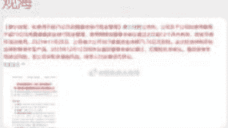
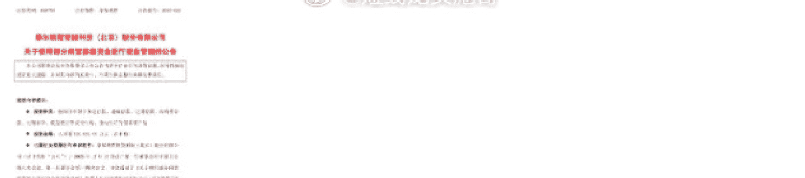
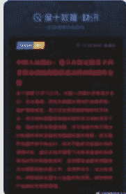
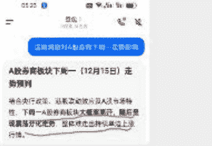

观海

本周证券预测走势图放大看，在支撑线上止跌反弹，从时间上看，下个月就要变盘了。

观海

贝加尔湖一月。

观海不排除提前发动的可能。

# 贝加尔湖
日本加息就是个鬼故事啊。

# 观海
向下不符合春季行情走势。

# 观海
12月4号基本可以确认就是最低点了。

# 观海
12月25号中金复牌是个机缘，到时再看吧。

# 观海
日本加息提前消化了，顶多低开。

@ WF
@观海 观大，这次牛市，中金最后有机会一手抓颇赚进群微信cuk255

# 观海
幅度不可测，主力自己心里也没底，都是边走边看。

一手优质资源进群微信cuk255

观海
敞客户没有信息优势，进去就是接盘的。昨天 21:58。

观海
现在北交所打新的7000亿资金，如果改成市值配售，这部分资金无处去，肯定有部分资金流入沪深股市，不要期望股市有大的跌幅，大量资金虎视眈呢。

观海
# 所市值新开始网上调研
12日 15:48 作者：刘艺文 郭洁 郭薇 回复181

观海
资金又宽松了。

# 5日将开展6000亿元资金
一手优质资源进群微信cuk255

# 北交所市值打新开始网上测试？
2025年12月12日 15:48 作者:刘艺文 来源:证券时报 181人评论

一手优质资源进群微信cuk255

# 央行：12月15日将开展6000亿元买断式逆回购
2025年12月12日 17:02 来源 东方财经新闻 86人评论 优质资源进群微信cuk255

观海
# 满屏利好
观海

杨涛（万涛）
@观海
观海
> 不缺钱的来圈钱，圈钱，买财。75亿资金，2个点利息，一年利息1.5亿，比公募利润都多，比A股5000多家公司大部分利润都多。

观海

一于优质资源进微信微信cuk255

# 摩尔赛程：拟使用超75亿元闲置资金进行现金管理
摩尔赛程公告称，公司及子公司拟使用最高不超过75亿元闲置募集资金进行现金管理，使用期限自董事会审议通过之日起12个月内有效，资金可循环使用。2025年11月28日，公司首次公开发行募集净额75.76亿元到账。此次投资将购买协定存款等本型产品。2025年12月26日相关案获董事会审议通过，无需股东会审议。投资有波动风险，但公司采取多种风险措施。保荐人对对此事项无异议。

收起全文

李华优质资源群微信cuk255

# 央行 灵活高效运用准降息等多种货币政策工具
格隆12月12日 | 中国人民银行党委召开会议，会议强调，继续实施适度宽松的货币政策，加快推进金融供给侧结构性改革。把促进经济稳定增长、物价合理回升作为货币政策的重要考量，灵活高效运用准降息等多种货币政策工具，把握好政策实施的力度、节奏和时机，保持流动性充足，促进社会综合融资成本低位运行，加强对实体经济的金融支持。畅通货币政策传导机制，优化结构性货币政策工具运用，加强与财政政策的协同，激励和引导金融机构加力支持扩大国内、科技创新、中小微企业等重点领域。保持人民币汇率在合理均衡水平上的基本稳定。

# 观海
量化对比散户优势还是太大了，从今年的收益就能看出，很多量化机构都是40%以上收益，幻方旗下的基金就没有低于50%的。但散户呢？今年平均收益不知道有没有10%。

# 观海
每秒不超过300笔，太高频了，美股这种成熟的市场每秒15笔，证监会会是帮凶。

一手优质资源进微信cuk255

# 观海

# 观海
| 中国证券 | 11.110 | 18.55% | 1.960 |
| 中信证券 | 29.080 | 8.57% | 2.200 |
| 广发证券 | 18.330 | 7.37% | 1.250 |
| 光大证券 | 9.230 | 6.64% | 0.580 |
| 国泰证券 | 17.020 | 5.11% | 0.900 |
| 中州证券 | 2.230 | 6.69% | 0.120 |

# 观海
有资金提前知道消息了，而且，明显港股券源要比A股券源通多了。一手优质资源进微信群cuk255 更多优质资源进微信群cuk255

# 金十数据·快讯
比新闻更快速的新闻
12-12 20:29 07 星期五

# 中国人民银行：建立在特定情境下金融机构提供流动性的机制
金十数据12月12日讯，中国人民银行党委召开会议，会议强调，防范重点领域的风险，维护金融稳定。助力在宏观层面把握好经济增长、结构调整之间的动态平衡，推动高质量发展，夯实市场稳健经营根基。坚持维持市场平稳运行，综合平衡，建立在特定情境下金融机构提供流动性的机制。坚定推进融资支持，积极妥善处置风险。做好宏观审慎管理。

# 观海
美股昨晚也是奇葩，三大指数都跌，斯拉斯和汽车。

# 观海
这则消息对A股下周走势影响。#券商板块下周一 (12月15日)走势预判
结合央行政策、港股联动效应及A股市场特性，下周一券商大概率高开，随后呈现震荡分化，整体难走出单边上涨行情。此次机制针对金融机构主要包含证券公司、基金、信托、保险管理等，此外还涵盖租赁、资产管理、消费、汽车、集团等类型。利好这些区块。

一手优质资源进群cuk255

# 观海
财联社
2025-12-13 13:48 星期六

# 【宇树科技发布人形机器人App Store】
财联社12月13日，宇树科技宣布人形机器人“App Store”，用户将其训练好的舞蹈动作一键上传分享，也可以下载模型部署到机器人上。

# 观海
预计下周人形机器人又要成为热点题材。TMT行业聚焦机械机器人。

# 观海
12月13日，下周五重要的时间，上证指数会下跌吗？首先，下周五之前，2024年3月是第一次，2024年7月是第二次，2025年1月是第三次，2025年10月是第四次。如果下周五再次加息，就是第五次。对应加息，美股的表现分别为上涨0.8%、4.7%、2.5%。来源：优质资源来自微信cuk255

# 观海
最近有一种观点，日本加息前利空，加息后利空。牛市行情中，忽略短期波动，眼睛看得更远。

# 观海
感觉现在是禁锢了，上次周二大跌，反而是周末涨。覆盖航天、半导体、芯片等大板块。北交所市值打新开始网上测试，澎湃新闻属实。优质资源进群cuk255

# 快人一步！下周事件前瞻 (12月15)
| 日期 | 事件 | 影响范围 |
|---|---|---|
| 12月15日 周一 | 2025年软件大会 | 汽车电子；德赛赛域、拓普电子、家恩电气、均衡电子 |
| | 2025年智能产业大会 | 人工智能；武赛、小米信息、中际创、潮信、工业富联 |
| 12月17日 周三 | 小米生态伙伴大会 | 消费电子；联创蓝、航天智造、骏益蓝、立讯精密、华菱技术 |
| | 古态电池技术大会 | 固态电池；国资材料、安泰道诸技术、云亘、万润股份 |
| | 海南自由贸易港启动 | 海南领先区；海南发展、神农产业、联龙控股、海马汽车、京德股份 |
| 12月18日 周四 | 2025通信产业大会 | 通信设备；联博科技、东方信息、德科力、长飞蓝牙、剑创科技 |
| 12月19日 周五 | 摩尔旋线USA大会召开 | 康德隆；捷越科技、东华敏、润润科技、光聚 |

# 深度视野优质文集（链接社群，助你成功）全部包含以下内容：限时年费188/年 加微信cuk255
- 吃瓜群众天天圈粉丝群对话 (原价365 元/年)
- 子明私享汇（含）内部文章
- 政事室（顾子明）付费内加送顾子明群
- 米联储闲文【作者米穗】(原价599 元/年)
- 欧洲金雀会员专属文章 (原价328 元/年)
- 砖瓦仁内部圈 (原价400 元/年)
- 卢克青文读书会专属文章 (原价699 元/年)
- 价值财经知识星球 (原价3310 元/年)
- 猫哥的视界知识星球文章 (原价299 元/年)
- 财经周刊【独家新闻】(原价1498 元/年)
- 杨世光在金钱煽 (原价2200 元/年)
- 蒜森财经知识星球 (原价1600 元/年)
- 极源译读文星球（持续更新）
- 司马林解课选全套音频和全套书籍收藏版无割 (原价2.3 万)
- 虚走三部[民国梦、帝国战争、不被理解的MAO](原价599 元/年)
- 卢克知识星球文章 (原价268 元/年)
- 额外再送：卢麒元新浪微铂专栏、三村丰老王、三花九洞文集
