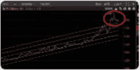
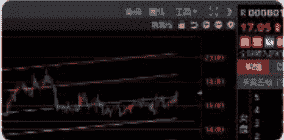
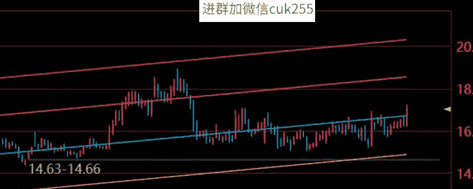

# 观海

市场对本周期的政策预期为宽松，这对市场具有利好影响。未来
[图片]
观海
（...）...（...）...（...）
这个消息看上去是利好，实则短期利空。注意的是三个月内完成不是十个交易日内，所以后面出现下跌都说得过去全部丢量给量化背锅，清除完才是利好。

这个消息看上去是利好，实则短期利空。注意的是三个月内完成不是十个交易日内，所以后面出现下跌都说得过去全部丢量给量化背锅，清除完才是利好。

## 收到专属交易设备要在交易所清退的通知？券商回应：真实

来源：同花顺724快讯 2025-12-12 08:36:48
关键词：券商 量化投资 进信息cuk255

据财报，12月11日晚上，市场传出一则消息：交易所要求券商在三个月内清退所有客户专属交易设备。该内容清退引发业内广泛关注。本次“清退设备”的内容源于对券商的“三条交易链接调整通知”，该通知核心内容包括：一、交易报盘时间延时；二、要求三个月内清退所有客户专属设备，包括单一客户服务设备；三、评估清退后对券商业务的影响。对此，财阀向某券商机构业务负责人进行求证，对方表示：“真实的。”此次调整直指高频量化交易。当前，部分高频量化机构通过服务器直接部署于交易所机房，以致压缩指令传输时，速度优势实现套利。上述券商人士对财阀表示，新增实施，私募行业交易频率下降，许多高频量化策略产品会受到影响，产品一旦不能稳收益，不排除引发投资者回撤的风险。

观海

大盘：受墨西哥加征50%关税等影响，12号开盘继续下跌，预估跌触底，下午反弹震荡。

观海
划重点

进群加微信cuk255

## 12号大盘：受墨西哥加征50%关税等多重利空影响，12号开盘继续下跌，预计上午调整触底，下午反弹震荡。

观海
农行顶部

观海

春暖花开的日子

观海
这股横了了好久了

观海

进群加微信cuk255

江淮奇楚
可惜只买了1000股 📉

进群加微信cuk255

观海
只要是好股，潜伏总有上涨的那一天

我原来手里有这票，中金停牌前夕都换了中金。我对大涨过的票有种天生厌恶感，喜欢潜伏一些没长的优质票。

受墨西哥加征50%关税等重重利空影响，预估：上午调整触底，下午反弹震荡。

进群加微信cuk255

## 深度视野优质集团（链接优质社群，助你成功）

全部包含以下内容：限时年费188/年 加微信cuk255

- ① 吃瓜群众包帝圈加微信时群对话（原价 365 元/年）
- ② 子领域明享汇（含）内部文章
- ③ 政事室（顾子明）付费内容加送顾子明群聊
- ④ 米联储闲文【作者米穗】（原价 599 元/年）
- ⑤ 欧洲金铂会员专属文章（原价 328 元/年）
- ⑥ 砖瓦仁内部圈（原价 400 元/年）
- ⑦ 东方克文青读书会专属文章（原价 699 元/年）
- ⑧ 鉴茶财经知识星球（原价 3310 元/年）
- ⑨ 猫哥的视界知识星球文章（原价 299 元/年）
- 10 财新周刊【独家新闻】（原价 1498 元/年）
- 11 杨世光在金钱榜（原价 2200 元/年）
- 12 森淼财经知识星球（原价 1600 元/年）
- 13 潇泽译异付费文章（持续更新）
- 14 司马林解读课全套音频和全书籍隐藏版无删减（原价 2.3 万）
- 15 虚构三部曲[民国梦、帝国兴亡、不被理解的 MAO]（原价 599 元出）
- 16 户克克知识星球文章（原价 268 元/年）
- 17 额外再送：卢祺元新浪韭搏付费专栏、三村丰老王、三花九洞文集

不定内容：......（更多资源写去了）......

- ① 守夜人知识星球、接换魔王知识星球、达叔谈论星球、成术财富、雪花花甲老头等
- ② 创始人笔记、达叔谈论星球、成术财富、雪花花甲老头等
- ③ A视野、大树乡谈、江初江、泮说、上海海学等付费文集
- ④ 西凤付费文章、老端、赢在八小时之外、局外的视界、升值、老A体制内等其它一些V文章（每月低于600元的付费文集）

# 限时年费188/年 底部链接全网V优质内容

## 深度视野文集

深度视野（付费文集）

