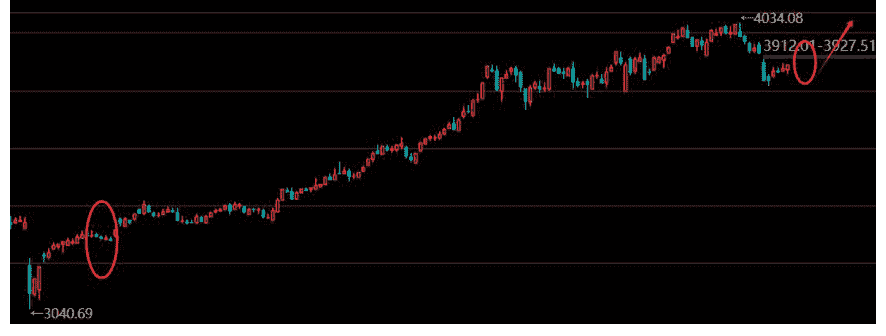

# 股市行情推演（12月1日-12月5日）

上期“行情推演”里提到：大盘从3040的上涨趋势结构遭到破坏，调整确立，留下了3912-3927缺口。A股向来有回补缺口的传统，短期大盘有回补缺口的需求，预判本周大盘以反弹为主。并指出，底部就在周二。

本周实际走势趋稳，大盘低点出现在周一，并开展反弹。本周大指数除了上证，都已经回补了下跌缺口。

看下图，上证历史走势补缺口存在一定的共性：

今年股市在3040点补缺口时，先上升一波，再回调一波（红圈处），然后上涨完全回补缺口。初步判断本次补缺口行情也是类似走势，上周已经反弹一波，接下来走势有两种可能，一种是先震回调几日后再上行补缺口；另一种是下周接补缺口再回调。

由于大趋势已经确立为调整趋势，在操作上，这两种走势无论是哪一种，都是回调，所以短期观望为主。

# 深度视野VIP群 人工追踪50+大V 付费进群加微信cuk255 微信ch5568

下周大盘涨跌节奏：冲高震荡回落调整趋势。

短期回调日 K呈阴阳交错形式，不排除四周四反抽再再出高点的可能，但周五再下。

请关注每日分时预测。

12月1号大盘：冲高回落。

上午反弹见顶，下午调整震荡。

深度视野VIP群 人工追踪50+大V 付费进群加微信cuk255 微信ch5568

# 深度视野优质集团（链接优质社群，助你成功）

全部包含以下内容：限时年费188/年 加微信cuk255

- ① 吃群众粉丝倍时圈加时群对话（原价 365 元/年）
- ② 子明私享汇（会）内部文章
- ③ 政事室（顾子明）付费内容再送顾子明群聊
- ④ 米联储闲【作者米穗】（原价 599 元/年）
- ⑤ 欧洲金雀会员专属文章（原价 328 元/年）
- ⑥ 砖万瓦内部文档（原价 400 元/年）
- ⑦ 卢克青文读书会专属文章（原价 699 元/年）
- ⑧ 鉴茶财经知识星球星球（原价 3310 元/年）
- ⑨ 猫哥的视界知识星球文章（原价 299 元/年）
- 10 财经周【独家新闻】（原价 1498 元/年）
- 11 杨世光在金钱煽（原价 2200 元/年）
- 12 森淼财经知识星球（原价 1600 元/年）
- 13 潇潇异译付费文章（持续更新）
- 14 司马林解读课全套音频和全套书籍隐藏版无割减（原价 2.3 万）
- 15 虚构三部曲[民国梦、帝国争亡、不被理解的MAO]（原价 599 元出）
- 16 卢克知识星球文章（原价 268 元/年）
- 17 额外再送：卢旷元新涨薇薇付费专栏、三村丰边老王、三花九树文集

不定内容：（更多资源写不下了）......

- ① 守夜人司令星球、接魂魔王知识星球、成术后富圈、雪花甲老头等
- ② 创始人笔记、达叔谈论知识星球、成术后富圈、雪花甲老头等
- ③ A视野、大树乡、江江后、咩说、上海海家学等付费文集
- ④ 西风付费文章、老端、赢在小时之外、局外人的视界、升值、老A体制内等其它一些V付费文章（每月不低于600元的付费文集）

限时年费188/年

# 深度视野文集
进群微信cuk255

深度视野（付费文集）

# 底层链连接全网V优质内容
