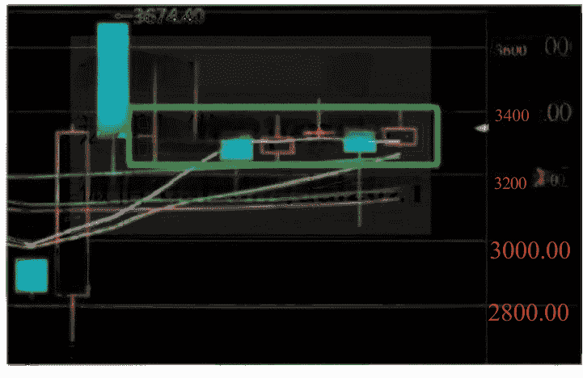
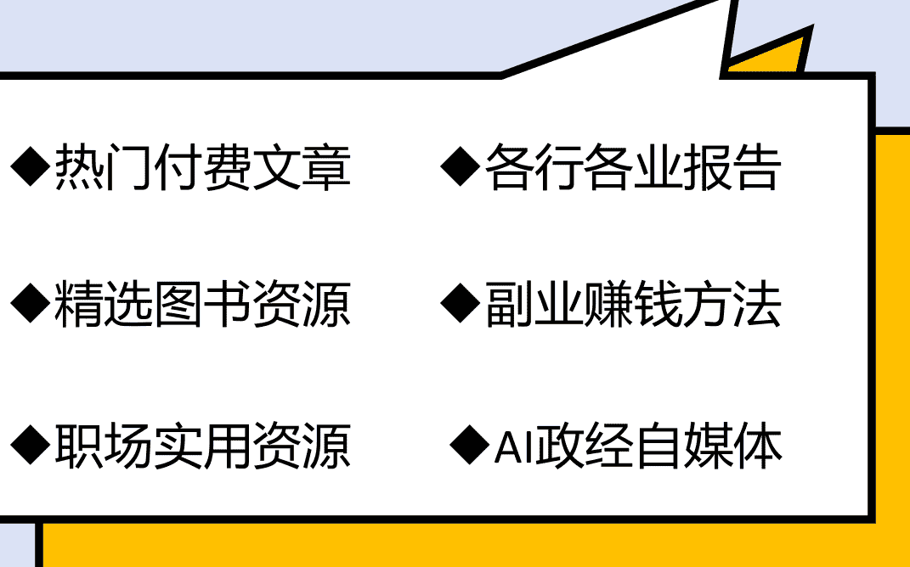

# 观海谈五行对股市的影响：6月股市行情推演-250606

5月预测回望：5月“涨跌节奏”给出“冲高回落趋势”。

实际走势：5月K线收了根上影线的阳线，完全符合“冲高回落趋势”。

5月预测里给出的时间点：9；14；21；次时间点19，26。

实际走势：9号低点上涨，14号高点，19号低点，21号是次高点。预测里疏忽略了21号这个时间点的作用，但并不影响本月“冲高回落趋势”。

在5月预测还特别提到：按照历法，5月也是容易出现大事件的月份。

5月大事是中美瑞士关于关税的谈判，直接影响了股市的冲高。

## 6月大盘走势如何呢?先看大趋势分析：

这是上证月K线，从图中可以看出从去年9行情后，大盘处于区间震荡状态，有规律的出现一阴两阳的格局，并且阴线都呈现出影线，阳线都是影线的情况，超级主力做盘迹象明显，6月可能打破这种状态。

从更大的趋势看，月线震荡完成后，会出现月线级别的大行情，会涨到2027年视。不过，现在走的是波段上涨行情，比如，这波起于3040点行情就是波段上涨行情，预判这段上涨行情还没见顶。

6月涨跌节奏：先跌后涨趋势。

6月重要时间点：6, 12, 27；次要时间点9, 16, 23。

注：给出的时间点并不是一定发生什么，只是重要拐点容易出现在时间点上，多留意即可。

### 6月总体走势预判：

预判低点出现在上半月的回调中，下半月反弹见顶震荡，或者冲高回落趋势。

本月重点关注高点时间的预判，低点并不重要，顶部多回补3316点的缺口，且市场成本区域在3300点一线，向下空间不大。

预计本月高点时间出现在23日，27日可能较较大。由于6月是笔者“年预测”里的重要顶部时间，不排除这个高点就是上半年的高点。

在“年预测”里，提示关注川总生日（6月14日）附近日子，因为这个时间附近容易出现消息多发，并影响股市的走势。

顶部特征：人声鼎沸时。

本月如果出现大涨，人声鼎沸，请及时关注“周预测”，及时逃顶。

# 免费 价值 及时 专注

# 扫码加入 知识星球TOP 免费资源群

- 每日免费获取有价值资源
- 可提供各类资源搜索服务

| 热门付费文章 | 各行各业报告 |
| :--- | :--- |
| 精选图书资源 | 副业赚钱方法 |
| 职场实用资源 | AI经营自媒体体 |

公众号: 知识星球TOP 微信号: jntsg8 微信号: jntsg2

分享资料仅供个人学习，请及时删除，切勿商用传播
