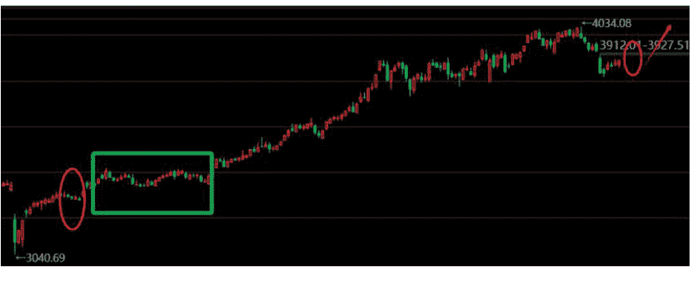

# 股市行情推演（12月15日-12月19日)

前两期预测用这个图解释走势，本期继续用这个图：

在前期预测里计：判断本次缺口行情类似于今年指数在3040点补缺口走势。

实际走势：大盘走出了类似3040点补缺口走势，本期预测在原图上增加了一个绿色方框，预判近期股指继续类似走势，会走一段震荡走势，没有大跌，也没有大涨。

大走势研判：（一手资源源群+v:cuk255）

预判本轮调整3816点是最低点，不会再有新低走势。缘由：A股历史上，前两轮大牛市股指突破过5月线，最后都会收上来的。本周五月线在3894点，本周指数最低3850点，收盘3889点，略低于5月线，正常情况的话，底部指数收收在5月之后。

由于预判股指数会走一段图中绿色方框内横盘震荡的走势，在短期涨跌预测上，判断上涨或下跌幅度就大了一了，所以本周给出两种走势预判。

深度视野VIP群 人工追踪50+大V 付费群微信cuk255 微信chp5568

下周涨跌节奏：

第一种：先跌后弹的趋势。
预判周一回调震荡，周二震荡反弹到周四，周五所有回调。

第二种：先涨后调的趋势。（进群+v:cuk255）
预判周一二反弹后开展回调走势。

总体下周就是震荡走势，如果调整，就会有所有反弹；如果先反弹，后面会有回调。具体哪种走势，通过周一走势基本就能判断大概了。

15 号大盘：上午反弹震荡，下午高回落震荡。

深度视野VIP群 人工追踪50+大V 付费进群加微信cuk255 微信chp5568

## 深度视野优质集团（链接优质社群，助你成功）

全部包含以下内容：限时年费188/年 加微信cuk255

- ① 吃瓜群众包时圈加微信时群对话（原价 365 元/年）
- ② 子明私享汇（内部）文章
- ③ 政事室（子明优）付内容额外再送顺子明群聊
- ④ 米联诸闲文【作者米楷】（原价 599 元/年）
- ⑤ 欧洲金铂会员专属文章（原价 328 元/年）
- ⑥ 砖五斥内部圈（原价 400 元/年）
- ⑦ 卢克青读书会专属文章（原价 699 元/年）
- ⑧ 鉴茶财经知识星球（原价 3310 元/年）
- ⑨ 猫哥的视界知识星球文章（原价 299 元/年）
- ⑩ 财新周【独新闻】（原价 1498 元/年）
- ⑪ 杨世光在金钱圈（原价 2200 元/年）
- ⑫ 森森财经知识星球（原价 1600 元/年）
- ⑬ 激译异付费文集（持续更新）
- ⑭ 司马林解读毛选全套音频和全书籍藏版无割减（原价 2.3 万）
- ⑮ 虚走三部[民族梦、帝国兴亡、不被理解的 MAO]（原价 599 元）
- ⑯ 克文知识星球文章（原价 268 元/年）
- ⑰ 额外再送：卢祺新微捞获付费专栏、三村丰老菜、三花九树文集

不定期内容：......（更多资源将不下了）

- ① 守夜人司令知识星球、接换魔王知识星球、生有术知识星球、
- ② 创创始老张、达沃谈论知识星球、成术财富圈、雪花花甲老头等
- ③ A 视野、大树乡谈、江宁优付、咩说、上海海家学等付费文集
- ④ 西风付费文章、老端、赢在八小时之外、局外人的视角、升值、老体制内等其它一些大付费文集（每月低于 600 元的付费文集）

## 深度视野文集
进群微信cuk255

深度视野（付费文集）

# 限时年费188/年 低成本链接全网大优质内容
