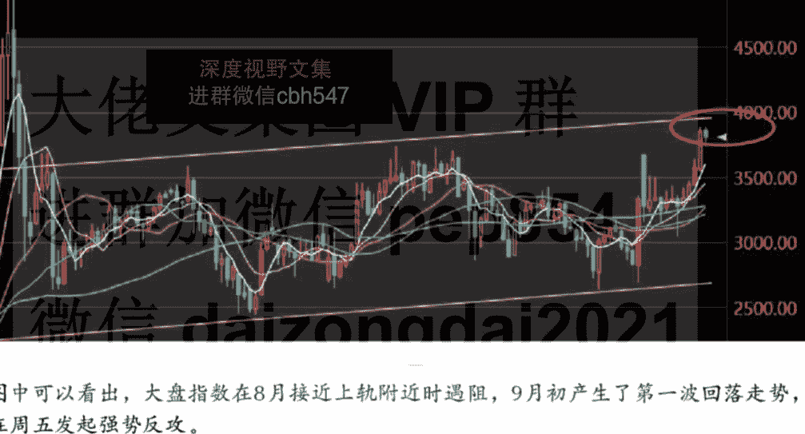

# 行情推演（9月8日-9月12日）

这个周末很热闹，股民戏说甚于过村胜利，股民无不拍手，压在股民心中的底终于得到释放。在拍手将近之时，需要些事到位，对股市产生多大的影响。

不论两万长涨落的，股民只看到一件事，依然如此，行情涨，股市期待在3000点附近回调，股民只长不降，既然这种趋势大家看得清清楚楚，老师的说明，这种股市生态环境很有可能发生变化。股指突破4000点却是众所期待的，涨也是理所应当的。

现在股市已经这么远了，股指一路斩新高，几乎没有看到到的阻力，大军已经到了10年来的压力区，在这个位置出现震荡当准确呢。

从图中可以看出，大盘指数在8月接近高点时迟缓，9月初产生了第一波回落走势，并在周五发后强势反攻。

拿着周五发出的提示：预判大盘在21年的高点3731点，昨天最低到了3732点，昨天还是时间点，预判大盘已经见底了。

预判3732点见底的原因：一遭遇突破压力区后，回落，原来的压力区就会变成重要支撑，所以要提前预判回调附近4000点大盘已经见底了。

虽然大盘已经“见底”，但大盘指数在空中穿行，未达到3910附近上轨，指数创新高后低的变化需要，上下波动已经稳定，短期将在3732-3910这个区间震荡波动。要看明白了，主力不怎么会折腾，我们会及时应对时机。

大盘在此处上下震荡有技术上的原因，又有主力高低换手的需求，我们需要通过上下震荡的方式，把个股涨高了的品种转换成涨幅不大的品种。当主力高低换手切换完成后，股指就会去突破上轨，开启主升行情。

下周走盘：上下震荡走势。

下周有两个重要的时间点，8号和12号。

预判反弹到8号，如果回落回调到12号再次开展反弹。短期大盘就是上下震荡走势了。

8号大盘：预判上上高回调，下午跌后后扬。
