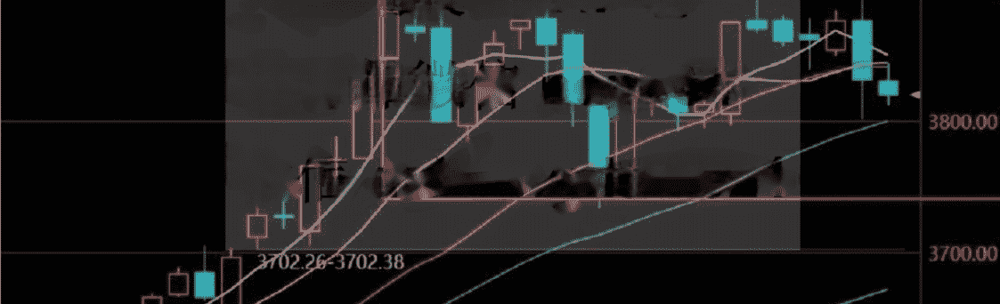
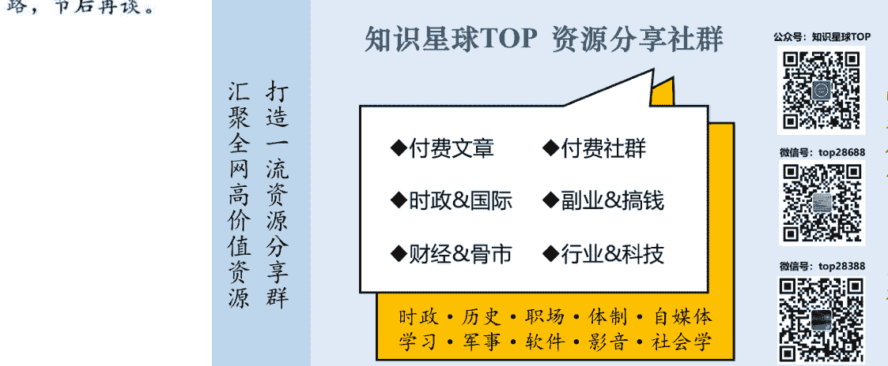

# 股市行情预测（9月22日-9月26日）

上期预测本周股市震跌势，冲高见回落的趋势。

实际走势：本周大盘最高触到3899.9点，然后大幅回落，周五收盘3820点。

接下来该谈谈本次调整的性质：

在19日早盘预测到：将距离3900点位置并不是中大顶部，理由是：如果是中大顶部，将会通过护市的形式调整为主动力，而现在主力主动打压大金融板块，尤其是银行已经连续跌两个月，超级主力明显是回升很难死路。

在17日早盘预测到：3900点是过去十年的重力关，短时间内很难突破的。

本期还是这个观点，加上节前效应，应大盘本月是很难突破3900点的。

预测主力思路，看图：

按照预测2014年轮牛市的走势趋势，大盘会在此个中枢（红色方面），然后选择向上还是向下突破方向。

还有7个交易日进入国庆长，节前主力无心死战，周日每日走势预测如下：22号预计回升；23号上拉；24号是时间点，可能被选择向下：25号下探；26号预计回升，尾盘可以再次回调。

# 知识星球TOP理资分享社群

- 付费文章
- 付费社群
- 政治&国际 · 传媒&热线
- 财经&职场 · 行业&科技

下周大盘时间点：24

下周大盘震跌节奏：冲高回落趋势。

注：大盘走势可以结合每日早盘预测作为参考。
