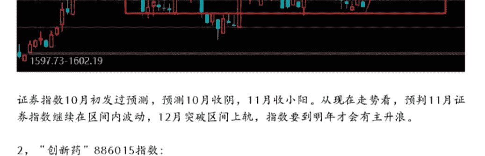

# 股市行情预测（11月10日-11月14日）

上期“行情推测”本周大盘走势：为震荡回调再反弹的趋势。回调低点可能在周三四。

实际本周大盘走势：是周三低点，并开展反弹的，预测基本正确。

大盘中期走势：

现在看来大盘有见见的远途，看今年大盘K线走势的多头亮：

- 上升趋势：一底部形成，很难扭转趋势的，短线可能会回调，中线继续看好。
- 短期走势：跟群加仓cuk255

美股大盘下跌，三大指数全部收周跌，创四月以来最大周跌。欧洲股市和亚洲股市，也下跌。

外国股市下跌的影响，对A股产生不小的影响。从周五A股受外股大跌的影响来看，下午十字线将又走低，为主开始并悉A股继续受到外国股市下跌的影响。

下周大盘震荡：有回调的趋势，低点在周四五。

预测周一反弹震荡，周二回调震荡周五反底，中间伴有小阴线。

10号大盘：上周领先后跌，下年反弹震荡回调。

板块点评：

1， 沪指指数881157再次点评：

沪指指数10月初的预测，预测10月收阴，11月微小。从现在走弱，预测11月证筹指数线在区间内变动，12周突破上沿，预计到明年有望上升。

2，“创新药”8860155指数：

从形态看，从去年到今年高涨回缩幅，11月中旬进入进入调整，什么时候将再次向上呢？

用趋势线方法判断“创新药”：10月调整底，11月震荡筑底反弹，12月反弹注解，2026年1月有望回调震底。

底部结束医药股可关注大中中医药走势。

# 深度视野优质集团（链接优质社群，助你成功）

全部包含以下内容：限时年费188/年 加微信cuk255

- ① 吃群众倍帝文档微信时群群对话 (原价365 元/年)
- ② 子明私享会（内部）优质文章
- ③ 政事室（子明优）付费内容再加送子明群群
- ④ 米联锦寂【作者米穗】(原价599 元/年)
- ⑤ 欧洲金雀会员专属文章 (原价328 元/年)
- ⑥ 砖瓦仁内部文档 (原价400 元/年)
- ⑦ 卢克青文读书会专属文章 (原价699 元/年)
- ⑧ 鉴茶财经知识星球 (原价3310 元/年)
- ⑨ 猫哥的视界知识星球文章 (原价299 元/年)
- 10 财经周刊【独家新闻】(原价1498 元/年)
- 11 杨世光在金钱树 (原价2200 元/年)
- 12 蒜淼财经知识星球 (原价1600 元/年)
- 13 激游异译付费文章（持续更新)
- 14 司马林解课选全套音频和全套书籍收藏版无割减 (原价 2.3 万)
- 15 虚构三部曲[民国梦、帝国争霸、不被理解的 MAO](原价 599 元)
- 16 虎克文知识星球文章 (原价 268 元/年)
- 17 额外再送：卢涯元新涨浪博客付费专栏、三村丰老王、三花九树文集

不定内容：......（更多资源写去了......

- ① 守夜人司令星球、接换魔王后星球、成术后财富、雪花枫甲等
- ② 创始笔记、达叔泛谈论星球、成术后财富、雪花枫甲等
- ③ A 视野、大树乡谈、江初序、咩咩说、上海家学等付费文集
- ④ 西凤付费文章、老端、赢在八小时之外、局人的视界、升值、老A体制内等一些 V 付费文章（每月不超过 600 元的付费文集)

# 限时年费188/年 底部链接全网达V优质内容

# 深度视野文集
进群微信cuk255

深度视野（付费文集）

