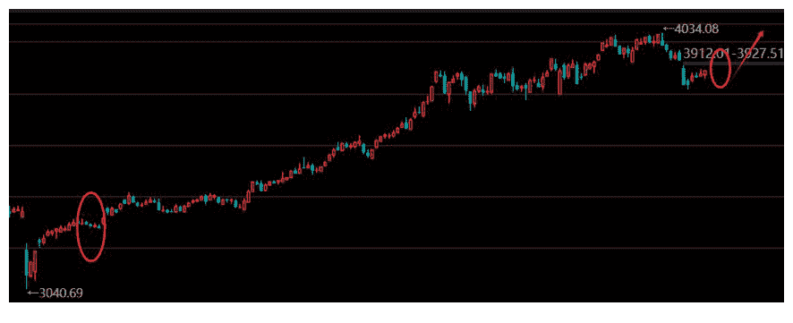
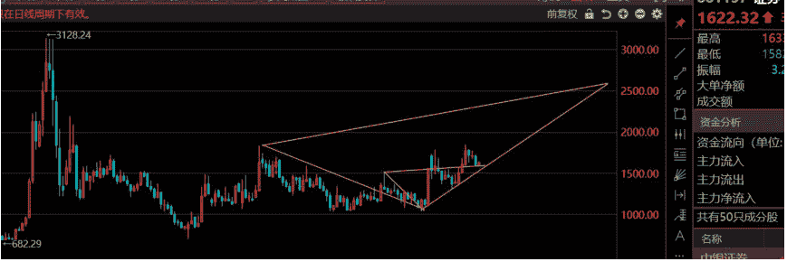

# 股市行情推演（12月8日-12月12日）

上证指数还没补缺口，上期预测则给出下面这张图，用来说明上证历史走势补缺口存在一定的确定性：

上期预测里肯：今年沪指在 3040 点补缺口时，先上升一路，再回调一路（红圈处），然后上涨完全补缺口。初步判断本次补缺口行情也是类似的走势。

实际走势：本周大盘右上红圈确实走出了类似左下红圈的调整走势，如果大盘继续类似的走势，那么近期就会回补缺口。进群加微信cuk255

下周大盘跌节奏：先跌后弹，预计周二低点，然后开展反弹走势。

由于周末利好消息太多，势必影响短期走势，如果周二未出现调整，周初的这股做空动能可能释放，就要小心下周大盘是冲高回落的节奏。

8 号大盘：上午冲高回落调整，下午先跌反弹。如果上午冲高后未回调走势，则下周就会回调。

深度视野VIP群 人工追踪50+A 付费进群微信cuk255 微信chp5568

# 证券指数月线预测：

证券指数 K 走了一个大的三角形形状，这个大三角形的末端在 2500 多点，周五指数在 1622 点。未来指数会多次触及这个三角形的上轨，然后才能形成突破。所以，明年证券指数在上轨上，大概会有回落。

在这个三角形中，还有较小的三角形，指数在第一次突破小三角形的上轨后又跌了回去，可见是假突破；在回落触及上轨后再次突破小三角形的上轨，并在今年的 8 月冲高后再次掉头回。在“预测证券指数明年走势”文中，预测调到 11 月，从图中可以看出，证券指数正好好回到小三角形的上轨上，可能发生突破小三角形的回撤。

为哈喽底部前证券是否有行情？进群微信chatkuz255

这是因为：要到 2026 年 1 月，这个三角形的末端才会跟大三角形的下轨交合，也就是证券指数会落到底 2026 年 1 月再次转向向上。从上看，这个时间恰好处于春季的初始阶段，每年春天大盘或小盘，都有上涨行情，这就是证券指数向上移动的概率。

从这个图中可以看出，证券指数在明年没有极大行情，向上波动幅度在 40%-60%左右，明年行情的主线概率可能是科技股。

深度视野VIP群 微信加50+A 付费群微信chatkuz255 微信chap5568

# 深度视野优质集团（链接优质社群，助你成功）

全部包含以下内容：限时年费188/年 加微信cuk255

- ① 吃瓜群众包信圈加微信时群对话（原价 365 元/年)
- ② 子明私享汇（含）内部文章
- ③ 政事室（顾明友）付费内容再送顾子明群
- ④ 米联锦兜【作者米穗》（原价 599 元/年）
- ⑤ 欧洲金会员专属文章（原价 328 元/年）
- ⑥ 砖瓦仁内部文档（原价 400 元/年）
- ⑦ 卢克文青读书会专属文章（原价 699 元/年）
- ⑧ 鉴茶财经知识星球（原价 3310 元/年）
- ⑨ 猫哥的视界知识星球文章（原价 299 元/年）
- ⑩ 财新周刊【独家新闻》（原价 1498 元/年）
- ⑪ 扬世光在金钱爆（原价 2200 元/年）
- ⑫ 森淼财经知识星球（原价 1600 元/年）
- ⑬ 潇泽异译付费文章（持续更新）
- ⑭ 司马林解课选全套音频和全套书籍版权无损减（原价 2.3 万）
- ⑮ 虚构三部曲[民国梦、帝国扩张、不被理解的MAO]（原价 599 元）
- ⑯ 卢克知识星球文章（原价 268 元/年）
- ⑱ 额外再送：卢户源新浪韭搏付费专栏、三村丰老王、三花九洞文集

不定内容：......（更多资源不下去了）......

- ① 守护者司令星球、接换魔王知识星球、成术打造财富、雪花记忆甲老头等
- ② 创始人笔记、达叔谈论知识星球、成术发财富、雪花记忆甲老头
- ③ A视野、大树乡谈、江初江、泮咩说、上海海家学等付费文集
- ④ 西风付费文章、老端、赢在小时之外、局外的视界、升值、老体制内等其它一些V付费文章（每月低于600 元的付费文集）

限时年费188/年

# 底层链接全网V优质内容

深度视野文集
进群微信cuk255
深度视野（付费文集）
