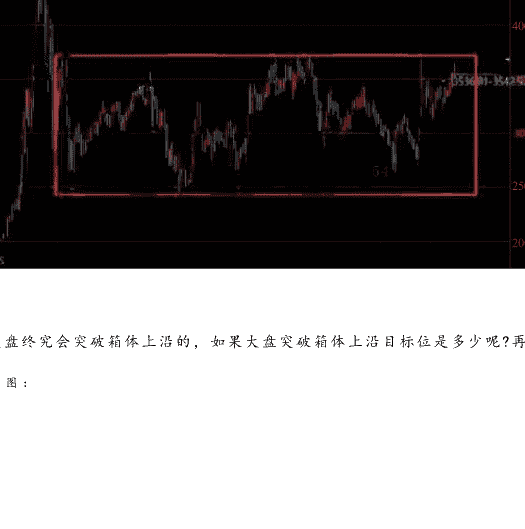
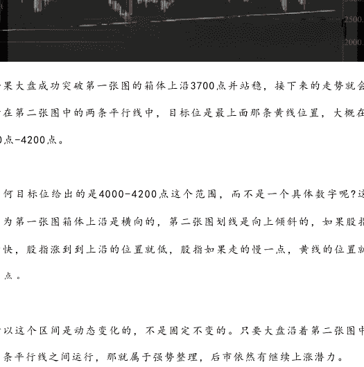
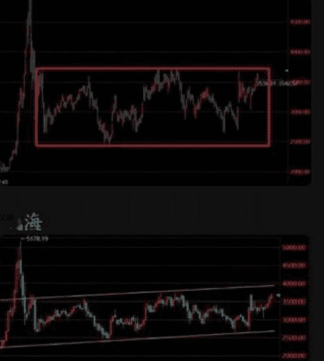
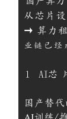
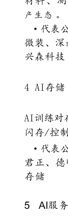
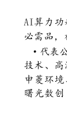

# 股市行情援俄（8月18日-8月22日）

上期巡查显示：周一回落周三，周四跌两五反弹。

Actual结果：基本正确。

130今日开盘（下图）显示美元汇率上目标。延续周上在3700点附近。14日平盘显示汇率恰好位于3703点，Actual美元汇率高了3700点后是否可能的？说明美元汇率确定这个箱体上不容易的。

美元走强就会确定第一箱体的活的。如果美元走强突破箱体目标则是多少？大可能再弹一周：

如果美元走强确定第一箱体上3700点后站稳，接下来的美元就会在第二箱体的两个平行线之间运行，目标则是上部底部支撑位，大可能在4000-4200点之间。

为何目标恰在4000-4200点这个区间，而不是一个箱体呢？是因为第一箱体上支撑了的，第二箱体将是向上运行的。加之，回调跌到到位位置后，黄线的位置会更高一点。

目前看来，美元在3700点附近的波动率较慢，稍显积极的，此建议多观望，等回调后再再判断。

不如比股市的说法要弱。3700点开始出现美元的强势，只要考虑美元强势，就还需要长线了。

> 知识星球TOP资源分享群

俄军政策战略首脑宣布：将彻底乌克兰，长胜利将结束；美国基从此点观点中，攻乌克兰首长则表示：乌克兰想要谈判，而乌克兰强势可以吗？值得关注：

美东联事可能要确定第一箱体上3700点，站稳后俄亥首人再一跌回上到4000点以上；如果美元再突破第二箱体国线后，预计将会彻底回底。

事实上，2016年到现在有10个月了，美元上3700点后无动反应，可看3700点有多个支撑位可以如此，所以多方会有这个区间进行反复的。

以上以及要重点的，下周美元将会体会：高冲后美元的回踩。

预计将周一回落周二，然后回落到3700点，日元高冲后回踩。

周一下跌：上高冲后，下周调整结束。

以上是下周美元走势预测，还有一个小概率：例如周四调整，将会遇到周五。这个不排除，通过观察周一是大涨还是震下跌了即可。

微信：int568 免费直播

# 观海

本周给我给出这个图，股指正好在箱体上沿遇阻；下周预测里我又给出一张图，用来讲解接下来的走势:

上轨位置大概在4000点左右

# 观海

# 观海

> 首页 > 财经数据 > 正文
银存存款新增2.14万亿元流向A
来源：齐商中国 202人评论
08月17日10:2724

# 观海

银行公布的7月金融数据显示，7月存款数据中，非银存款新增2.14万亿元，为2015年有数据记录以来同期最高水平，同比多增达1.39万亿元。

这进场资金达到了2015年牛市高峰时期的水平

# 观海

本周末影响市场的重要资讯有：
央行最新货币政策报告释放重要信息；美俄总统在阿拉斯加举行会晤；特朗普宣布暂无计划因中国购买俄罗斯石油而对中国产品加征关税，两周内对钢铁、芯片加关税，进口半导体税率最高或达300%；业内人士称2025年第一批稀土开采、冶炼分离总量控制指标已下发；交易所本周对对上纬新材、长城军工等严重异常波动股票进行重点监控。

# 本周市场的重要要关注：：央行发行货币政策释放重要信息；美...

美联储在华尔顿举行利率会议；决议后俄罗斯石油价格上涨；中国产品可能加税；两周内利率维持高位或达500%；美国人预计2025年通胀下行计划下调；

18:29

## 老师，对国内半导体是有好处

聚焦：本周市场的重要要关注：：央行发行货币政策释放重要信息；美...

18:43

# 我们是对国产芯片片有信心

不过低位了。

19:30

# 令林zane

缘捷光电源天添

20:07

## 国产产业的主线越清晰。

国产产业的主线越清晰。
从芯片设计 -> 制造 -> 服务器 ->
-> AI算力租赁 -> 配接环节、PCB
产业链已成型。

+1 AI芯片(ASIC/GPU)

AI替代的内核芯片，将能在
AI训练/推理芯片领域突破，领先
目前是未的的。

- 代表公司：龙芯、海光信息、光信
信通、芯片股份、中芯、捷科技、东方股份。
