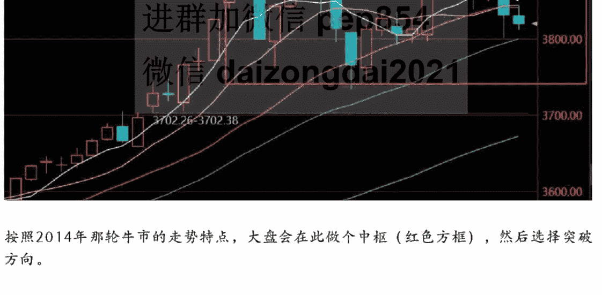

# 股市行情预测（9月22日-9月26日）

上期预测本周大盘走势震跌、冲高后回落的趋势。
实际走势：

在19日早盘预测提到：将3900点位置并不是中期大顶，理由是如果是中期大顶，会通过震跌的形式延续主力的护盘思路，而现在主力主动打压大金融板块，尤其是银行已经调整了两个月，越界主力明显是升顶思路。

在17日早盘预测提到：3900点是过去十年的重力区，短时间内很难突破。
本期还是这个点位，加上节前预期，大盘本月将是不易以突破3900点的。

预测主力思路，看图：

在上期预测分析了超级做回调最佳思路，大盘先向上的突破到达4200点，按照上期牛市中期回调幅度调整10%左右，年底则回到3700点左右付出的最佳成本。
如果实在3899点选择中期回调，调10%的话就会到了3500点。这个点直接接进蓝泽，越主力今年不容易把泡股给拉出来，如果调整到3500点，又有再次进洗的风险，则有最佳策略是单向上突破。进群加微信pep854

还有7个交易日进入国庆长假了，节前主要是无心恋战的，最终主力选择哪种策略，节后再洗。

下周大盘时间点：24
下周大盘涨跌节奏：冲高后回落趋势。

节前主力无心恋战，下周走势预测如下：22号探底回升；23号上涨；24是时间点；可能向下；25号下跌；26号探底回升，尾盘可能再次回调。

注：大盘走势可结合每日早盘预测作为参考。

大佬文集集团VIP群专属通道，付费进群微信pep854 微信daizongdai2021

# 大太集团 VIP 群（原价 300，限时年费 249）包括以下全部内容清单：

加微信 daizongdai2021 大太集团 VIP 简介 加微信 pepp854

- ① 吃瓜群众百倍时效与实时图文对话（原价 365 元/年）
- ② 子明私享汇 内部文章（原价 568 元/年）
- ③ 政事堂（顾子明）付费后另购交流群
- ④ 米联储见闻【作者米穗（原价 599 元/年）
- ⑤ 欧洲金会会员专属文章（原价 328 元/年）
- ⑥ 玲广广内部文章（原价 400 元/年）
- ⑦ 卢克文读书专属文章（原价 699 元/年）
- ⑧ 茶茶财经领域知识星球（原价 3310 元/年）
- ⑨ 猫哥的视界知识星球文章（原价 299 元/年）
- ⑩ 财经周刊【独家新闻】（原价 1498 元/年）
- ⑪ 杨世光在金钱榜（原价 2200 元/年）
- ⑫ 蔡森财经知识星球（原价 1600 元/年）
- ⑬ 澜泽许异谈付费文章（持续更新）
- ⑭ 司马湖解逸选全套音频和全套书籍珍藏版无割（原价 2.3 万）
- ⑮ 虚陆三部曲（民国史、帝国齿轮、不被理解的MAO）（原价 599 元）
- ⑯ 卢克文知识星球（原价 268 元/年）
- ⑰ 额外内容：户眼新浪微博付费专栏、村西里老王、三九花树集；

不定期内容：（更多资源就不写下了）

- ① 守夜人司令知识星球、摇拨魔王知识星球、达达诸论星球、成竹财富圈、雪花劫老乞头等
- ② 创始人笔记、大树野仿谈、江宁知广、洋咩论、财上海学家等付费集锦
- ③ 西凤付费文章、老磊、赢在八小时之外、局外的视界、升值记、A体制内等其它一些大V VIP付费文章（每月不超过 600 元的付费文章）

大太集团 VIP 群，原价 300 元，现需 249 元/年，包含以上所有内容。

微信：daizongdai2021
大太集团 VIP 简介（微信微...）

长按识别二维码

大太集团文章二维码（微信扫）
加微信pep854

长按识别二维码
